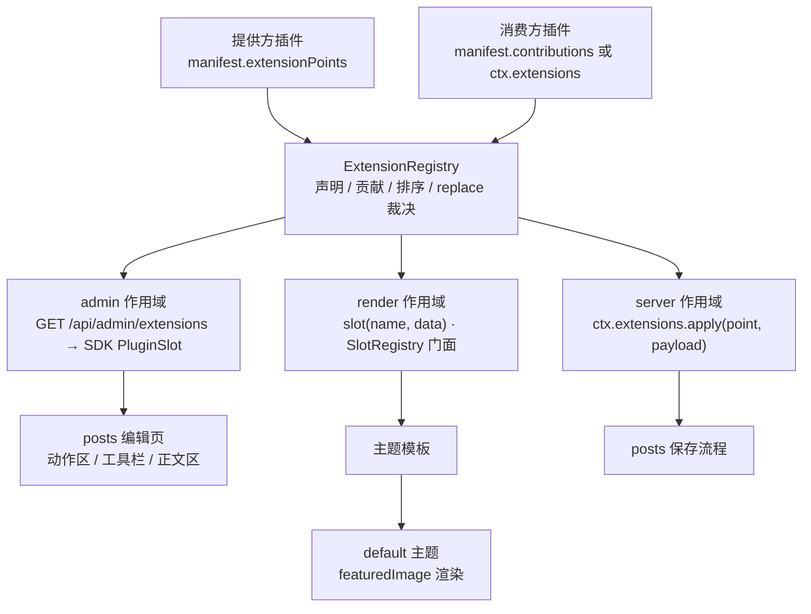
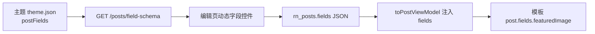

## Product Overview

为 RiceNote 的插件平台补上缺失的「扩展点」能力：插件不仅能提供自己的页面，还能**声明命名扩展点（hook）供其他插件接入**，别的插件以「声明式贡献」扩展它的界面与逻辑，并可用 `replace` 语义接管默认内容。以此打通用户最初的需求：文章列表点「新建文章」不再弹窗，而是打开独立编辑页，正文换成现成的 Markdown 编辑器。

同时给文章插件新增「主题声明自定义文章字段」能力：主题声明它需要哪些文章字段（如特色图片），作者在后台填写（输入链接），前台模板按需渲染。

## Core Features

### 一、命名扩展点（三作用域统一模型）

- **声明（提供方）**：插件声明自己暴露的扩展点，如文章插件声明「列表页动作区」「编辑器工具栏」「编辑器正文区」；扩展点名带命名空间（`rice.posts.list.actions`），并标注是否允许替换与可传入字段说明。
- **贡献（消费方）**：其他插件声明「往哪个扩展点贡献什么」，零代码、随插件启停自动生效；需要动态判定时可用运行时接口。贡献可声明为「追加」或「替换」。
- **替换语义**：存在替换贡献时，提供方的默认内容不再渲染，由替换者接管（例如把默认「新建文章」按钮换成「跳转新页面」）；同一扩展点上出现多个冲突的替换贡献时，在部署前校验阶段直接报错。
- **三种作用域**：后台界面插槽；站点页面渲染插槽（沿用现有标准插槽并统一到同一模型）；服务端钩子（按顺序串行传递数据，可修改或替换）。
- **失败隔离与可回退**：单个后台贡献崩溃只让该处降级为空；页面渲染插槽沿用「异常降级为空片段」；服务端钩子默认「响亮失败」，避免悄悄写入未经验证的数据。插件停用后其声明与贡献立即消失，注册表零残留。
- **权限与启用态**：贡献只在提供方与消费方插件均启用、且当前用户拥有所需权限时出现；停用任一插件即恢复默认行为，无需改代码。

### 二、文章独立编辑页

- 列表页「新建文章」与行内「编辑」改为跳转独立页面：`/posts/editor`（新建）与 `/posts/editor?id=12`（编辑）是同一页面的两种入口。
- 页面左侧为元信息（标题、别名、状态、摘要、词条），右侧为占满可用高度的正文区；正文区顶部是工具栏锚点、下方是正文锚点。
- 未保存离开时给出确认提示，不使用浏览器原生确认框。

### 三、Markdown 编辑器（由第三方插件注入）

- 使用现成的 **Toast UI Editor**（vendor 预构建文件，不引入插件侧构建步骤），以「替换」贡献接管正文区：Markdown 模式 + 双栏实时预览、工具栏、常用快捷键、自动草稿、字数与行号状态栏。
- 额外提供「前台预览」入口：调用文章插件的服务端渲染接口，在对话框中展示与前台完全一致的渲染结果（因 Toast 自身预览使用其自带渲染管线，与前台存在差异，故显式提供权威预览并在文档说明）。

### 四、主题自定义文章字段

- 主题清单声明 `postFields`（复用设置表单的全部字段类型：文本、长文本、链接、图片、颜色、开关、数字、下拉、字符串列表）。
- 作者在编辑页填写这些字段，例如「特色图片」输入一个链接；模板可读取该字段渲染。
- 只接受当前启用主题声明的键，未声明键写入被拒绝；读取时按声明过滤，脏数据不进入模板。切换主题后字段集合随之变化，历史数据保留但不展示。
- 内置 default 主题真做一遍：声明「特色图片」并在文章页与列表页渲染，作为验收证据。

### 视觉与交互效果

- 独立编辑页：沿用后台既有语言——顶部标题与右侧「取消/保存」动作区，主体两栏（窄屏堆叠），细边框分层、无阴影、无毛玻璃。
- 编辑器：左侧等宽字体编辑区、右侧预览区，中间 1px 分隔线；工具栏为图标按钮一行，分组间 1px 竖线；底栏小字显示「字数 N · 行 L:C」与「草稿已自动保存」（等宽数字、次要文本色）；窄屏时预览折叠为「编辑/预览」标签页。
- 字段区：按主题声明的字段自动生成控件，图片类字段显示缩略图预览；未装编辑器插件时正文回落为普通多行文本域，外观与既有输入框完全一致。

## Tech Stack Selection

- 沿用现有栈，**不新增宿主运行时依赖**：Node.js ≥ 20.11、TypeScript 5.7、Fastify 5、MySQL 8 + Drizzle、Vue 3.5 + Vite 5（后台 SPA）、零构建 ESM 插件后台界面（ADR-014）。
- 编辑器：**Toast UI Editor**（`@toast-ui/editor`，MIT），其**预构建 UMD 文件与 CSS 直接 vendor 进第三方插件目录**（只存在于该插件目录内，宿主不新增依赖、插件侧无需构建步骤）。
- 校验/测试沿用：ajv（`packages/shared` 既有）、`node:test` + `tsx`、`playwright-cli` 浏览器实测。

## Implementation Approach

### 关键决策一：一个注册表承载三种作用域，旧 API 退化为别名

新增 `ExtensionRegistry`（`packages/core/src/extensions/registry.ts`）作为唯一事实来源，一条记录形如 `{ point, scope: 'admin'|'render'|'server', providerId, consumerId, mode: 'append'|'replace', order, payload }`。

- `packages/core/src/render/slots.ts` 的 `SlotRegistry` **签名与错误隔离行为完全不变**（`register / componentsFor / render / list / ownedBy / clear`），内部委托给注册表：`register(name, component, { priority })` ≡ `contribute(name, component, { scope:'render', mode:'append', order: priority })`。这样 `{{ slot('post.comments') }}`、标准插槽常量、`plugins/third-party/reading-time`、主题渲染路径、`assertNoLeaks()` 全部无需改动即继续工作。
- payload 形状**按作用域区分**（注册表本身不解释 payload）：`render` 为既有 `{ name, render(context) }`；`admin` 为「浏览器可 import 的 ESM 模块 URL」；`server` 为「Node 可 import 的模块」。这一点必须写进文档，否则贡献者会写错形状。
- `replace` 裁决：存在 `replace` 贡献时，默认内容与所有 `append` 贡献都不渲染，生效者 = `order` 最大者；`order` 相同按 `consumerId` 字典序取第一并记警告，而 `pnpm validate` 直接把这种冲突判为错误（运行期不猜）。

### 关键决策二：清单声明为主（可校验、随启停自动生效），运行时接口为辅

`plugin.schema.json` 新增两个顶层字段（顶层与 `admin` 均为 `additionalProperties: false`，必须同步扩展）：

```
"extensionPoints": [
  { "name": "rice.posts.list.actions", "scope": "admin", "replaceable": true,
    "description": "文章列表页顶部动作区",
    "props": [{ "name": "onCreate", "description": "打开新建流程" }] }
],
"contributions": [
  { "point": "rice.posts.editor.body", "scope": "admin", "mode": "replace",
    "entry": "./admin/editor.js", "style": "./admin/editor.css",
    "order": 100, "permission": "post.write" }
]
```

- 命名规范 `<pluginId>.<area>[.<position>]`（与 `AdminMenuItem.id` 同族正则）；Core **预置标准 render 扩展点**（直接沿用 `packages/plugin-sdk/src/slots.ts` 的 `STANDARD_SLOTS`）。
- 新增能力点 `extensions:declare` 与 `extensions:contribute`（fail-closed：未声明即 `RN_FORBIDDEN`，与 `context-factory.ts` 既有 `forbidden()` 门面同构）；`slots:register` **保留**为 render 作用域贡献的别名能力，reading-time 无需修改。
- `entry` 白名单便于审计：admin 限 `./admin/*.js`，render/server 限 `./dist/*.js`；`style` 仅 admin 可用。
- 命令式补充：`ctx.extensions.declare(...)` / `ctx.extensions.contribute(...)`，两者都必须经既有 `track()` 收集 `Dispose` 句柄，纳入 `assertNoLeaks()`（已停用插件在扩展点声明与贡献上同样零残留）。
- render / server 的声明式贡献由 Core 在插件 `start()` 后按 `entry` 动态 `import()`（`pathToFileURL(path.resolve(plugin.dir, entry))`），契约：`{ name, render(ctx) }`（render）、`{ apply(payload, ctx) }`（server）。

### 关键决策三：后台插槽由服务端下发，SDK 组件渲染（不放开宿主源码）

- 新增 `GET /api/admin/extensions`（`apps/server/src/http/admin/extensions-routes.ts`，`guard(kernel, {})`，与既有 `/menu` 同口径），服务端做三重过滤：仅启用且启动成功的插件、`scope === 'admin'`、按 `describUser()` 得到的权限过滤 `permission`——**绝不依赖前端隐藏**。贡献携带 `entryUrl` / `styleUrl`，复用 `admin-pages.ts` 的 `pluginAdminEntryUrl()` 换算。
- `packages/admin-sdk` 新增：`defineAdminContribution({ name, props, setup, template })`、`useAdminExtensions()`（一次拉取 + 缓存，登录/启停后失效）、`<PluginSlot name :context>默认内容</PluginSlot>`：
- 无生效贡献 → 渲染默认插槽内容（保证「没装插件就是原样」）；
- 有 `append` 无 `replace` → 默认内容 + 贡献（按 order 降序）；
- 有 `replace` → 只渲染生效贡献，默认内容不渲染；
- 每个贡献独立异步组件 + 错误边界隔离，`import()` 失败只留控制台告警并追加 `?retry=N`（复用 `PluginHostView` 既有做法）；`styleUrl` 注入与卸载移除沿用 `PluginHostView` 策略。
- 关键便利事实（已核对）：零构建插件入口 `/admin-sdk/v1/ricenote-admin.js` 由 `browser-entry.ts` **re-export `vue` 与 `vue-router`**，因此插件页可用 `onMounted / onBeforeUnmount / watch / nextTick / ref / computed` 与 `useRoute()`（读取 `?id=`），无需扩展 SDK 的 Vue 出口。
- `admin.pages` 新增可选 `hidden?: boolean`：只影响 `apps/admin/src/stores/menu.ts` 的 `visibleItems`（`pluginPages` 仍包含它，从而深链可解析，与既有 `available: false` 兜底逻辑同构）。

### 关键决策四：服务端钩子默认「响亮失败」

`ctx.extensions.apply(point, payload, { onError })` 按 `order` 升序串行（filter 语义），默认 `onError: 'abort'`：贡献抛错即上抛 `RiceNoteError`，让调用方（如「保存文章前」）失败，而不是静默写入未经验证的内容；需要容错时显式传 `'skip'`（记日志后沿用上一版 payload）。这与 render 的「降级为空片段」是刻意相反的策略，理由写进 ADR 与文档。

### 关键决策五：自定义文章字段 = 主题声明 + 白名单校验 + JSON 列

- 主题契约：`theme.json` 新增 `postFields?: Record<string, SettingFieldSchema>`（扁平「键 → 字段定义」），字段类型与 `label/description` **完全复用 `settings.schema.json` 的 `settingsSchema` 字段定义与 `localizedText`**（该 schema 已被主题与插件清单共用，ajv 侧已 `addSchema`，无需新机制）；`theme.schema.json` 同步扩展并加校验（键名格式、数量上限、类型合法、label 必填、默认值类型匹配、`select` 必须带 `options`）。
- 存储：posts 新增迁移（`0004_post_fields.sql`）：`ALTER TABLE rn_posts ADD COLUMN fields JSON NULL AFTER template;`（沿用 `0003_post_template.sql` 的加列写法与注释风格）。
- 读写与校验：posts 服务层按**当前启用主题声明的字段集**做白名单校验（复用 `packages/core/src/plugins/settings-schema.ts` 与 theme-sdk 既有的字段值校验思路），未声明键拒绝写入；读取时按声明过滤后注入 ViewModel。
- 模板暴露：在 `plugins/official/posts/src/runtime.ts` 的 `toPostViewModel` / `toPostViewModels` 注入 `fields`，模板写 `{{ post.fields.featuredImage }}`；`cover_media_id`（媒体库封面）保持原样不动，与新的 URL 型自定义字段并存。
- 后台：新增 `GET /posts/field-schema`（`post.write`）返回当前主题声明的字段 DTO（本地化 label/type/options/default），编辑页据此动态渲染控件；`POST/PUT /posts` 的 body 增加 `fields`。
- 路由顺序注意：posts 既有 `GET /posts/:postId` 会吞掉 `/posts/fields`，因此**新端点必须用不与 `:postId` 冲突的路径，或注册在 `:postId` 之前**（计划采用 `GET /posts/field-schema`，无歧义）。
- 响应沿用 posts 既有约定：`reply.json({ data })`（见 `plugins/official/posts/src/admin.ts`）。
- 示范：`themes/default/theme.json` 声明 `featuredImage`（`image` 类型），并在 `templates/post.njk`、`templates/archive.njk`（或首页卡片）渲染（为空时不渲染），附少量样式；`themes/minimal` 不动，用来验证「换主题字段集合变化不影响渲染」。

### 关键决策六：编辑器 vendor Toast UI，并显式调和预览差异

- 第三方插件 `plugins/third-party/markdown-editor/`（参照 `reading-time` 的包结构：`manifest.json` + `package.json` + `tsconfig.json` + `src/index.ts` + `admin/`，另加 `README.md`）。vendor 文件放 `admin/vendor/`：`toastui-editor-all.min.js` 与 `toastui-editor.min.css`（固定版本号、保留 license banner、README 注明来源/版本/许可证）。
- 贡献：
- `replace → rice.posts.editor.body`：`initialEditType: 'markdown'` + `previewStyle: 'vertical'` 双栏，`toolbarItems` 按需裁剪，`useCommandShortcut: true`，`hideModeSwitch` 保留（允许切所见即所得）；在 `onMounted` 创建实例、`onBeforeUnmount` 调 `destroy()`；监听变更写入父级 model 并做 debounce 自动草稿（localStorage）+ 字数/行号状态栏。
- `append → rice.posts.editor.toolbar`：「前台预览」（调 `POST /posts/preview`，在既有 `Dialog` 里 `v-html` 展示**服务端已消毒**的结果，与前台 1:1）与「插入图片」。
- `replace → rice.posts.list.actions`：「新建文章」+ 快捷键提示，跳转 `/posts/editor`。
- 文档明确：编辑器内即时预览使用 Toast 自带渲染管线，与前台存在细微差异；权威预览走「前台预览」。

### 关键决策七：闭环交付（posts 1.5.0 → 1.6.0）

- 声明扩展点 `rice.posts.list.actions`（replaceable，默认 = 「新建文章」按钮）、`rice.posts.editor.toolbar`（append）、`rice.posts.editor.body`（replaceable，默认 = 普通 Textarea）。
- `admin.pages` 新增 `hidden: true` 的 `posts.editor`（`/posts/editor`，权限 `post.write`，entry `./admin/editor.js`）。
- 列表页动作区包 `<PluginSlot>`；新建/行内编辑改为 `navigate('/posts/editor')` / `navigate('/posts/editor?id=N')`；移除对话框编辑路径（正文不再弹窗）。
- 新增 `admin/editor.js`：独立编辑页（读 `?id=`，复用既有表单字段、词条多选与保存逻辑，新增动态字段区；工具栏与正文区各包一个 `<PluginSlot>`）。
- 新增 `POST /posts/preview`（`post.write`）→ `{ html }`，内部即 `renderMarkdown()` + `runtime.html.sanitize()`（复用既有管线，保证与前台一致）。

## Implementation Notes

- **执行前置**：当前工作区 `pnpm build` 会在 `@ricenote/admin-sdk` 报 `'vite' is not recognized`（根 `node_modules/.bin` 缺 vite），需先 `pnpm install`（此前用户两次取消过该命令，执行前先征询）。改 `packages/*` 后必须 `pnpm build` 并重启进程（ADR-012）；插件 ESM 改动只需刷新浏览器。
- **校验新增项（`apps/server/src/cli/validate.ts`）**：扩展点名格式与全局唯一（跨插件冲突判错）；贡献指向的扩展点必须存在（标准 render 扩展点视为存在）；`scope`/`mode` 合法；`entry` 存在且在白名单内；同点多个 `replace` 且 `order` 相同判错；插件必须声明对应能力；主题 `postFields` 校验。
- **计数回归点**：新增第二个第三方插件会让「插件清单 12/12」变成 13/13，需检查 `tests/**`、`docs/**`、`README.md` 中硬编码的数字。
- **性能**：注册表按 `point` 建 `Map`、注册时排序一次；`render()/apply()` 单次为 O(1) 查询 + O(k log k) 排序（k 通常 0–3）。后台只拉一次 `/api/admin/extensions`（与菜单同生命周期）；贡献模块由浏览器模块表缓存。
- **可观测**：沿用既有日志口径（`logger.child({ plugin })`）；`logger.error` 记贡献崩溃（含 `point`/`plugin`/错误摘要，不打印 payload）；`logger.warn` 记未声明的扩展点引用与权限过滤掉的贡献（便于排查「为什么没生效」）。
- **安全**：`/api/admin/extensions` 与 `/posts/field-schema` 的服务端过滤是唯一可信边界；模板注入的自定义字段按声明过滤后再暴露；前台预览 HTML 由服务端消毒后返回，前端 `v-html` 仅用于该已消毒内容。
- **blast radius**：不动主题 slot 的既有渲染路径与签名；`replace` 仅在有插件显式声明时才改变表现；`cover_media_id`、既有 posts 保存流程与词条逻辑保持兼容。

## Architecture Design





## Directory Structure

```
packages/core/src/
├── extensions/registry.ts            [NEW] ExtensionRegistry：声明/贡献/replace 裁决/排序/隔离/ownedBy/clear；admin 载荷构造（含权限过滤）
├── extensions/contributions.ts       [NEW] 声明式贡献解析与注册：admin（URL 换算）/render/server（entry 模块 import）+ 能力校验，返回 Dispose[]
├── extensions/index.ts               [NEW] 出口（由 packages/core/src/index.ts 再导出）
├── extensions/post-fields.ts         [NEW] 主题 postFields 解析/本地化 DTO 构造/白名单校验（复用 settings-schema 与 theme-sdk 校验思路）
├── render/slots.ts                   [MODIFY] SlotRegistry 退化为 render 作用域门面，签名与单组件隔离行为不变
├── plugins/context-factory.ts        [MODIFY] 注入 ctx.extensions（declare/contribute/apply/list）；能力门面扩展；slots.register 保留为别名
├── plugins/manager.ts                [MODIFY] 装配 ExtensionRegistry、解析声明式扩展点与贡献；assertNoLeaks 增加扩展点与贡献断言
├── plugins/settings-schema.ts        [MODIFY] 抽出可复用的字段值校验/默认值解析，供 postFields 复用
└── index.ts                          [MODIFY] 导出扩展点与 postFields 相关类型

packages/plugin-sdk/src/
├── extensions.ts                     [NEW] 三作用域契约类型（Scope/Point/Contribution/Mode/apply 选项）+ ctx.extensions 门面类型
├── slots.ts                          [MODIFY] STANDARD_SLOTS 标注为预置 render 扩展点；SlotRegistryFacade 标注为别名
├── context.ts / index.ts             [MODIFY] PluginContext 增加 extensions；导出新类型

packages/shared/
├── manifests/plugin.schema.json      [MODIFY] extensionPoints / contributions / admin.pages.hidden / 新能力白名单
├── manifests/theme.schema.json       [MODIFY] 新增 postFields（复用 settingsSchema 字段定义与 localizedText）
├── src/manifests.ts                  [MODIFY] PluginManifest 与 ThemeManifest 类型补充（extensionPoints/contributions/hidden/postFields）
├── src/types/dto.ts                  [MODIFY] AdminExtensionPointDto / AdminExtensionContributionDto / AdminExtensionsDto / PostFieldSchemaDto / PostFieldsDto
└── src/index.ts                      [MODIFY] 导出新类型

packages/admin-sdk/src/
├── extension/contribution.ts         [NEW] defineAdminContribution（name/props/setup/template）
├── extension/use-extensions.ts       [NEW] 贡献清单拉取与缓存、按 point 解析生效贡献（replace 裁决与后端一致）
├── extension/PluginSlot.vue          [NEW] 默认内容 + 贡献渲染 + 惰性 import + 错误隔离 + 样式注入
├── extension/index.ts / index.ts     [MODIFY] 出口

apps/server/src/http/admin/
├── extensions-routes.ts              [NEW] GET /api/admin/extensions（启用态 + admin 作用域 + 权限过滤，entryUrl/styleUrl）
└── server.ts                         [MODIFY] 注册新路由（不改 /menu 语义）

apps/admin/src/
└── stores/menu.ts                    [MODIFY] visibleItems 过滤 hidden 页面（pluginPages 保留以保证深链）

plugins/official/posts/
├── manifest.json                     [MODIFY] 1.6.0；声明 3 个扩展点；admin.pages 增加 hidden 编辑页
├── admin/main.js                     [MODIFY] 动作区包 PluginSlot；新建/编辑改为 navigate；移除对话框编辑
├── admin/editor.js                   [NEW] 独立编辑页（动态字段区 + 工具栏/正文区锚点 + 未保存离开提示）
├── admin/style.css                   [NEW] 编辑页专有样式（如需）
├── src/runtime.ts                    [MODIFY] toPostViewModel/toPostViewModels 注入 fields（按主题声明过滤）
├── src/service.ts / src/repository.ts [MODIFY] fields 读写（JSON 列）、白名单校验
├── src/admin.ts                      [MODIFY] POST /posts/preview、GET /posts/field-schema；保存端点接受 fields
├── src/theme-fields.ts               [NEW] 读取当前启用主题的 postFields 并做声明/校验（缓存 + 站点语言本地化）
├── migrations/0004_post_fields.sql   [NEW] ALTER TABLE rn_posts ADD COLUMN fields JSON NULL AFTER template
└── README.md                         [MODIFY] 扩展点与自定义字段说明

plugins/third-party/markdown-editor/
├── manifest.json                     [NEW] id acme.markdown-editor；能力 extensions:contribute；3 条 contributions
├── package.json / tsconfig.json / src/index.ts  [NEW] 参照 reading-time（空实现，仅提供构建入口）
├── admin/editor.js                   [NEW] replace 正文区：Toast UI 实例 + 自动草稿 + 状态栏
├── admin/toolbar.js                  [NEW] append 工具栏：前台预览（调服务端渲染）+ 插入图片
├── admin/list-action.js              [NEW] replace 列表动作区：新建文章跳转 + 快捷键提示
├── admin/vendor/toastui-editor-all.min.js / toastui-editor.min.css  [NEW] 预构建静态文件（固定版本，保留 license）
├── admin/editor.css                  [NEW] 编辑器样式（1px 边框、等宽、无阴影）
└── README.md                         [NEW] 第三方扩展他人插件界面的示例说明 + vendor 归属

themes/default/
├── theme.json                        [MODIFY] 声明 postFields.featuredImage（image 类型）
├── templates/post.njk                [MODIFY] 渲染特色图片（为空不渲染）
└── templates/index.njk               [MODIFY] 首页卡片可选展示特色图片

docs/
├── plugin-api/v1.md                  [MODIFY] 新增「命名扩展点」章节（三作用域/声明/贡献/渲染/replace/命名规范/能力与校验/与 slots 兼容）
├── theme-api/v1.md                   [MODIFY] §6 指向统一模型；新增「自定义文章字段」章节
├── adr/ADR-017-named-extension-points.md [NEW] 决策记录（含 server 钩子默认 abort 的理由）
├── adr/README.md / architecture/hooks-inventory.md / CHANGELOG.md [MODIFY] 索引、清单与变更记录

tests/
├── unit/extension-registry.test.ts        [NEW] 声明/贡献/replace 裁决/排序/隔离/零残留/权限过滤
├── unit/admin-contributions.test.ts       [NEW] 声明式贡献解析（URL 换算、entry 缺失、能力缺失、hidden 页面）
├── unit/plugin-manifest-extensions.test.ts [NEW] 插件/主题 schema 校验（含 postFields、replace 冲突）
├── unit/post-fields.test.ts               [NEW] 字段解析/本地化 DTO/白名单校验/默认值
└── integration/extension-points.test.ts   [NEW] 内核装配 + /api/admin/extensions + render slot 兼容（reading-time）+ server hook 顺序与 abort + 自定义字段端到端
```

## Key Code Structures

```ts
/** 扩展点作用域：后台界面 / 站点渲染 / 服务端钩子。 */
export type ExtensionScope = 'admin' | 'render' | 'server';

/** 提供方在 manifest.extensionPoints 中声明；消费方在 manifest.contributions 中贡献。 */
export interface ExtensionPointDeclaration {
  name: string;                 // <pluginId>.<area>[.<position>]
  scope: ExtensionScope;
  replaceable?: boolean;
  description?: string;
  props?: { name: string; description: string }[];
}

export interface ExtensionContributionDeclaration {
  point: string;
  scope: ExtensionScope;
  mode?: 'append' | 'replace';  // 缺省 append
  order?: number;               // 数值越大越靠前；replace 生效者取最大
  entry: string;                // admin: ./admin/*.js；render/server: ./dist/*.js
  style?: string;               // 仅 admin
  permission?: string;          // 仅 admin：服务端按当前用户过滤
  label?: string;
}
```

```ts
/** ctx.extensions：运行时声明/贡献/触发（声明式之外的动态路径）。 */
export interface ExtensionRegistryFacade {
  declare(point: ExtensionPointDeclaration): Dispose;
  contribute(
    point: string,
    payload: unknown,
    options?: { scope?: ExtensionScope; mode?: 'append' | 'replace'; order?: number }
  ): Dispose;
  /** 服务端钩子：按 order 升序串行传递 payload；默认 onError='abort'。 */
  apply<T>(point: string, payload: T, options?: { onError?: 'abort' | 'skip' }): Promise<T>;
  list(): { point: string; scope: ExtensionScope; provider: string; contributions: number }[];
}
```

```ts
/** 主题声明的自定义文章字段（复用设置表单的字段定义）。 */
export type PostFieldsSchema = Record<string, SettingFieldSchema>;
```

## 设计风格

严格沿用后台既有视觉语言：**细边框分层、无阴影、无毛玻璃、等宽代码与数字**，不引入新配色与字体。本轮新增界面只有两处：文章独立编辑页（含动态自定义字段区）与由第三方插件注入的 Markdown 编辑器正文区；其余后台页面零改动。

## 独立编辑页（/posts/editor）

- **顶部**：沿用既有 `AdminPage` 外壳——左侧标题「新建文章 / 编辑文章」+ 一行次要说明「正文支持 Markdown；可在下方填写主题声明的字段」，右侧动作区为「取消」（ghost）与「创建文章 / 保存修改」（主按钮，带 loading）。
- **主体两栏**：左列（约 1/3）为元信息卡片，依次为标题、别名、状态、摘要、词条多选、以及**主题声明的自定义字段区**；右列（约 2/3）为正文区。窄屏（<1024px）回落为单列堆叠，元信息在上。
- **正文区容器**：1px 边框、圆角与既有卡片一致；高度占满剩余视口（最小 420px），内部纵向为「工具栏锚点 → 正文锚点」两段；未安装扩展插件时正文回落为多行文本域，外观与现有输入框完全一致。
- **自定义字段区**：按主题声明自动生成——图片/链接类字段为单行输入（提示「粘贴图片链接，例如 https://…」）并在右侧显示 64px 缩略图预览；开关为 Switch；下拉为 Select；颜色为色块 + 文本；字符串列表为可增删的胶囊；数字为带步进的输入。
- **离开保护**：有未保存改动时用既有 `ConfirmDialog` 提示（不使用浏览器原生 confirm）。

## Markdown 编辑器（第三方插件替换正文锚点）

- **布局**：左右各半（`grid lg:grid-cols-2`），中间 1px 分隔线；左侧 Markdown 编辑区为等宽字体、行高 1.7、无自身边框（由外层容器承担）；右侧为实时预览，排版沿用前台观感（标题、引用、代码块浅底、列表、表格）。
- **工具栏**（一行图标按钮，ghost/sm 变体，hover 用既有背景分层）：加粗、斜体、标题、引用、行内代码、代码块、无序列表、有序列表、链接、图片；分组之间用 1px 竖线；右侧为「前台预览」与「插入图片」。
- **状态栏**：底栏一行小字，左侧「字数 N · 行 L:C」，右侧「草稿已自动保存」，均用等宽数字与次要文本色。
- **前台预览**：复用既有 `Dialog`（width lg），内部 `v-html` 展示服务端已消毒的渲染结果，并标注「与前台渲染一致」。
- **交互细节**：工具栏操作只作用于当前选区，插入后光标落在预期位置；自动草稿 300–500ms 防抖；保存中禁用工具栏并显示既有 loading；窄屏将预览折叠为「编辑 / 预览」标签页切换。
- **回退表现**：停用该插件后，正文立即恢复为默认多行文本域、列表页恢复默认按钮，无残留样式。

## Agent Extensions

### SubAgent

- **code-explorer**
- Purpose: 盘点扩展点机制的改造落点与兼容面：所有调用 `ctx.slots.register` 的位置、所有构造 `PluginSummary`/`AdminMenuItem`/插件后台页面的位置、`assertNoLeaks()` 涉及面、`validate.ts` 现有校验项、主题渲染调用 `slots.render()` 的全部路径、以及 posts/reading-time 的清单与 admin 入口结构。
- Expected outcome: 一份「文件:行」级清单，确认 SlotRegistry 门面化不会漏改调用方，reading-time 与主题渲染路径全部覆盖，并给出默认主题渲染字段（post.njk/index.njk）的精确落点。

### Skill

- **lsp-code-analysis**
- Purpose: 在 `PluginContext`、`PluginManifest`、`ThemeManifest`、`PluginCapability`、`SlotRegistry`、`settings-schema.ts` 变更后做语义级引用核查，确保所有读取旧字段/旧接口的位置都改到点上且无残留引用（含 workspace 跨包引用）。
- Expected outcome: 明确的定义/引用清单与调用层级，改造后 `pnpm build`、`pnpm validate` 全绿且无遗漏调用点。

- **playwright-cli**
- Purpose: 在浏览器中实测完整闭环：文章列表动作区被第三方插件替换、「新建文章」跳转独立编辑页、正文区被 Toast UI 编辑器接管（双栏/工具栏/快捷键/草稿/字数）、「前台预览」与前台一致、填写主题声明的特色图片字段并保存、前台文章页显示特色图片；随后停用编辑器插件验证回退为默认文本域与默认按钮。
- Expected outcome: 每步可复现的断言输出与截图，作为「扩展点可替换、可回退、自定义字段端到端」的证据。