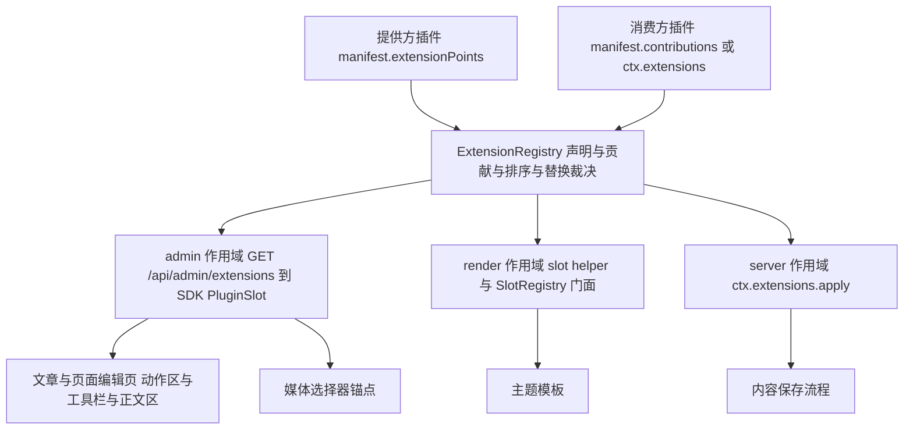

## 产品概述

为 RiceNote 的插件平台补上缺失的「扩展点」能力：插件不仅能提供自己的页面，还能**声明命名扩展点（hook）供其他插件接入**；其他插件以「声明式贡献」扩展它的界面与逻辑，并可用「替换」语义接管默认内容。据此交付用户需求：文章/页面列表点「新建」不再弹窗，而是打开独立编辑页，正文换成现成 Markdown 编辑器；主题可声明统一的内容自定义字段（如特色图片，后台填链接）；媒体库对外提供「媒体选择器」锚点供编辑器做快捷上传并插入；新插件「编辑增强」作为可选官方插件同时适用于文章与页面。

## 核心功能

一、命名扩展点（三作用域统一模型）

- 声明（提供方）：插件声明自己暴露的扩展点（如「列表页动作区」「编辑器工具栏」「编辑器正文区」「媒体选择器」），带命名空间、是否允许替换、可传字段说明。
- 贡献（消费方）：声明「往哪个扩展点贡献什么」，零代码、随插件启停自动生效；可声明追加或替换；需要动态判定时用运行时接口。
- 替换语义：存在替换贡献时默认内容不渲染，由替换者接管；同点多替换冲突在部署前校验阶段报错。
- 三作用域统一：后台界面插槽、站点页面渲染插槽（沿用现有标准插槽并统一到同一模型）、服务端钩子（按序串行传递数据、可修改或替换）。
- 失败隔离与可回退：后台贡献崩溃只让该处降级；页面渲染插槽异常降级为空片段；服务端钩子默认响亮失败。插件停用后声明与贡献立即消失，注册表零残留。
- 权限与启用态：贡献仅在提供方与消费方均启用、且当前用户有权限时出现；停用任一插件即恢复默认行为。

二、文章与页面的独立编辑页

- 两个列表页的「新建」与行内「编辑」改为跳转独立页面（新建与编辑是同一页面两种入口）；左侧为元信息与内容字段区，右侧为占满可用高度的正文区；正文区顶部为工具栏锚点、下方为正文锚点。
- 未保存离开时给出确认提示，不使用浏览器原生确认框。

三、编辑增强（可选官方插件，同时适用于文章与页面）

- 以「替换」贡献接管正文区：Markdown 模式 + 双栏实时预览、工具栏、常用快捷键、自动草稿、字数与行号状态栏。
- 「前台预览」：调用各插件的服务端渲染接口，在对话框展示与前台完全一致的渲染结果（因编辑器自带渲染管线与前台存在差异，故显式提供权威预览）。
- 「插入图片」：渲染媒体库提供的「媒体选择器」锚点，可上传新文件或从媒体库选择，选中后把图片语法插入光标处；未装媒体库时回退为直接填写图片链接。

四、主题声明的内容自定义字段（文章与页面共用同一份声明）

- 主题清单声明字段集合（复用设置表单的全部类型：文本、长文本、链接、图片、颜色、开关、数字、下拉、字符串列表），文章与页面都用它，不区分。
- 作者在两个编辑页填写，例如特色图片输入链接；模板可读取渲染。
- 只接受当前启用主题声明的键，未声明键写入被拒；读取按声明过滤，脏数据不进模板；换主题后字段集合随之变化，历史数据保留但不展示。
- 内置 default 主题真做一遍：声明特色图片并在文章页、页面与列表卡片渲染。

五、扩展点机制自带的可回退契约

- 停用「编辑增强」：正文回到默认多行文本域、列表动作回到默认按钮，无残留样式。
- 停用媒体库：图片选择回退为直接填链接；停用文章或页面插件互不影响。

## 视觉与交互

- 独立编辑页沿用后台既有语言：顶部标题与右侧「取消/保存」动作区，主体两栏（窄屏堆叠），细边框分层、无阴影、无毛玻璃。
- 编辑器：左侧等宽字体编辑区、右侧预览区，中间 1px 分隔线；工具栏为一行图标按钮、分组间 1px 竖线；底栏小字显示字数与光标行号、草稿已自动保存（等宽数字、次要文本色）；窄屏把预览折叠为「编辑/预览」标签页。
- 内容字段区按声明自动生成控件：图片/链接为单行输入并显示缩略图预览；开关为 Switch；下拉为 Select；颜色为色块加文本；字符串列表为可增删胶囊；数字为带步进输入。
- 媒体选择器面板：上传区与媒体网格切换，选中项高亮；未装媒体库时该处只有一行链接输入与提示。

## 技术栈

- 宿主完全沿用现有栈，不新增运行时依赖：Node.js 20.11 以上、TypeScript 5.7、Fastify 5、MySQL 8 与 Drizzle、Vue 3.5 与 Vite 5（后台 SPA）、零构建 ESM 插件后台界面（ADR-014）。
- 编辑器为 Toast UI Editor，其预构建 UMD 文件与 CSS 直接 vendor 进「编辑增强」插件目录，只存在于该目录内：宿主不新增依赖、插件侧无构建步骤，保留 license banner 并在插件 README 注明来源、版本与许可证。
- 校验与测试沿用现有设施：ajv（packages/shared 既有）、node:test 与 tsx、playwright-cli 浏览器实测。

## 实现方案

### 决策一：一个注册表承载三种作用域，旧 API 退化为别名

新增 ExtensionRegistry（packages/core/src/extensions/registry.ts）作为唯一事实来源，记录形如 point、scope（admin 或 render 或 server）、providerId、consumerId、mode（append 或 replace）、order、payload。render/slots.ts 的 SlotRegistry 签名与单组件隔离行为完全不变，内部委托给注册表：register 等价于 contribute 且 scope 为 render、mode 为 append、order 取 priority。这样主题模板的 slot 调用、标准插槽常量、第三方 reading-time 插件、主题渲染路径与 assertNoLeaks 全部无需改动即继续工作。payload 形状按作用域区分并写入文档：render 为带 name 与 render 方法的组件对象；admin 为浏览器可 import 的 ESM 模块 URL；server 为 Node 可 import 的模块（导出 apply）。替换裁决：存在替换贡献时默认内容与追加贡献都不渲染，胜出者取 order 最大；order 相同由校验阶段判错，运行期不猜。

### 决策二：清单声明为主，运行时接口为辅

plugin.schema.json 新增顶层 extensionPoints 与 contributions（两处与 admin 均为 additionalProperties 为 false，需同步扩展）。命名规范为插件 ID 加点分段的区域名，Core 预置标准 render 扩展点（沿用 STANDARD_SLOTS）。新增能力点 extensions:declare 与 extensions:contribute，未声明即拒绝（fail-closed，与既有 forbidden 门面同构）；slots:register 保留为 render 作用域贡献的别名能力，reading-time 无需修改。entry 白名单便于审计：admin 限 ./admin 下的 js，render 与 server 限 ./dist 下的 js；style 与 permission 仅 admin 可用。命令式 ctx.extensions（declare、contribute、apply、list）全部经既有 track 收集句柄，纳入零残留断言。admin.pages 新增可选 hidden 布尔字段：只影响侧栏可见项（菜单条目仍带 entryUrl，从而深链可解析）。

### 决策三：后台插槽由服务端下发，SDK 组件渲染

新增 GET /api/admin/extensions（apps/server/src/http/admin/extensions-routes.ts，使用既有 guard），服务端做三重过滤：仅启用且启动成功的插件、scope 为 admin、按当前用户权限过滤 permission；贡献携带 entryUrl 与 styleUrl（复用 pluginAdminEntryUrl 换算规则），绝不依赖前端隐藏。packages/admin-sdk 新增 defineAdminContribution、useAdminExtensions（一次拉取加缓存，登录与插件启停后失效）、PluginSlot 组件：无生效贡献时渲染默认插槽内容；有追加无替换时默认内容加贡献（按 order 降序）；有替换时只渲染胜出者；每个贡献使用异步组件加错误边界隔离，import 失败只留控制台告警并追加 retry 参数，样式注入与卸载移除沿用既有策略。已核对：零构建插件入口由 browser-entry 再导出 vue 与 vue-router，因此插件页可直接使用 onMounted、onBeforeUnmount、watch、nextTick、ref、computed 与 useRoute（读取查询参数），无需扩展 SDK 出口。

### 决策四：服务端钩子默认响亮失败

ctx.extensions.apply(point, payload, options) 按 order 升序串行传递（filter 语义），默认 onError 为 abort：贡献抛错即上抛 RiceNoteError，让调用方（如保存前钩子）失败，而不是静默写入未经验证的内容；需要容错时显式传 skip（记录日志后沿用上一版 payload）。这与 render 的降级为空片段是刻意相反的策略，理由写入 ADR 与文档。

### 决策五：内容自定义字段由 Core 统一提供，文章与页面共用

主题契约：theme.json 新增 contentFields（扁平键到字段定义），字段类型与文案完全复用 settings.schema.json 的字段定义与多语言结构（该 schema 已被主题与插件清单共用，ajv 已注册，无需新机制）；theme.schema.json 同步扩展并加校验（键名格式、数量上限、类型合法、label 必填、默认值类型匹配、下拉必带选项）。Core 新增 packages/core/src/extensions/content-fields.ts：解析当前启用主题的声明、按站点语言生成本地化 DTO、复用 settings-schema 与 theme-sdk 的字段值校验，并通过后台接口下发（如 GET /api/admin/content-fields，需登录且具备内容写权限），因此文章与页面共用一份实现、不各自重复。存储：文章与页面各加一列 JSON 存字段值（各自迁移文件，沿用既有加列写法与注释风格）。读写：两个插件服务层按声明白名单校验（未声明键拒写），读取时按声明过滤后注入 ViewModel（文章在 runtime 的 ViewModel 构造处，页面在其 ViewModel 构造处）。后台两个编辑页都渲染同一个内容字段渲染组件（放在 admin-sdk，供插件零构建复用）。示范：default 主题声明特色图片（image 类型），在文章页、页面模板与列表卡片渲染，为空时不渲染；minimal 主题不动，作为换主题后字段集合变化的对照。

### 决策六：编辑增强插件 vendor Toast UI，并显式调和预览差异

新建可选官方插件 plugins/official/editor-enhance（id 为 rice.editor-enhance，name 为「编辑增强」，版本 1.0.0，能力为 extensions:contribute；package.json、tsconfig.json、src/index.ts 参照第三方 reading-time 结构，src 为空实现仅提供构建入口）。vendor 文件放 admin/vendor：Toast UI 主包与 CSS（固定版本、保留 license、README 注明归属）。贡献：替换文章与页面的正文锚点（同一入口脚本，initialEditType 为 markdown 加双栏预览、启用命令快捷键、工具栏裁剪、挂载时创建实例并在卸载时销毁、自研防抖自动草稿写 localStorage、字数与行号状态栏）；追加文章与页面的工具栏锚点（前台预览按钮，调用编辑页注入的预览回调并在既有 Dialog 内展示服务端消毒后的 HTML；插入图片按钮，渲染媒体选择器锚点并把图片语法插入光标处）；替换文章与页面的列表动作锚点（带图标与快捷键提示的新建入口，演示替换语义）。该插件同步登记到官方插件目录清单，分类为 optional（安装向导默认不勾选，可在扩展中心一键安装、更新与卸载）。

### 决策七：媒体库对外提供媒体选择器锚点

media 声明 rice.media.picker（admin 作用域，权限为 media.manage）并贡献默认实现 ./admin/picker.js：面板内含「上传新文件」（复用 POST /media，表单字段名为 file，沿用 accept 白名单与体积上限）与「从媒体库选择」（复用 GET /media 的搜索与分页），选中后通过 context 的 onPick 回调返回 url、fileName、mimeType、size。消费者（编辑增强）在「插入图片」对话框内渲染该锚点，默认内容为「直接填写图片链接」，因此未装媒体库或权限不足时功能不缺失。

### 决策八：文章与页面独立编辑页与统一预览契约

文章插件新增隐藏页面 posts.editor（路径 /posts/editor，权限 post.write，入口 ./admin/editor.js），声明三个扩展点（列表动作区、工具栏、正文区）；列表动作区包 PluginSlot（默认按钮行为已改为跳转编辑页），行内编辑改为跳转编辑页并带查询参数，移除对话框编辑路径。页面插件同构：新增隐藏页面 pages.editor（/pages/editor，权限 page.manage），声明同名的三个扩展点，列表「新建页面」与行内编辑改为跳转，正文不再弹窗。预览契约：编辑页在工具栏锚点的 context 中注入 onPreview 回调（内部调用各自新增的 POST /posts/preview 或 POST /pages/preview，复用各自既有的 Markdown 渲染与消毒管线），因此编辑器插件无需知道端点名，且各插件预览与前台一比一。

## 实现要点

- 执行前置：当前工作区构建会因缺少 vite 失败，需先补齐依赖并确认构建、校验、测试基线全绿后再动代码；改 packages 后必须构建并重启进程，改插件界面只需刷新浏览器。
- 校验新增项（apps/server/src/cli/validate.ts）：扩展点名格式与全局唯一（跨插件冲突判错）；贡献指向的扩展点必须存在（标准 render 扩展点视为存在）；scope 与 mode 合法；entry 存在且在白名单内；同点多个 replaces 且 order 相同判错；插件须声明对应能力；主题 contentFields 校验。
- 计数回归点：插件总数由 12 变 13（官方由 11 变 12），校验输出与文档、测试、README 中硬编码的数字需同步。
- 性能：注册表按扩展点建 Map、注册时排序一次；渲染与触发单次为常数级查询加小规模排序（贡献数通常 0 到 3）。后台只拉取一次扩展点清单（与菜单同生命周期），贡献模块由浏览器模块表缓存。
- 可观测：沿用既有日志口径；贡献崩溃记录扩展点、插件与错误摘要，不打印 payload；未声明的扩展点引用与被权限过滤掉的贡献记警告，便于排查「为什么没生效」。
- 安全：服务端过滤是唯一可信边界；模板暴露的自定义字段按声明过滤后再注入；前台预览的 HTML 由服务端消毒后返回，前端渲染仅用于该已消毒内容。
- blast radius：不改主题插槽既有渲染路径与签名；替换语义仅在有插件显式声明时改变表现；封面媒体 ID、既有保存流程与词条逻辑保持兼容。

## 架构设计




## 目录结构

packages/core/src/

- extensions/registry.ts [NEW] 扩展点注册表：声明、贡献、替换裁决、排序、异常隔离、ownedBy 与清理；按扩展点建 Map；导出 admin 载荷构造（含权限过滤）
- extensions/contributions.ts [NEW] 声明式贡献解析与注册：admin 走 URL 换算，render 与 server 走入口模块动态 import；能力与白名单校验；返回句柄集合
- extensions/content-fields.ts [NEW] 主题 contentFields 的解析、本地化 DTO 构造与字段值校验（复用设置字段逻辑），供文章与页面共用
- extensions/index.ts [NEW] 对外出口，由 packages/core/src/index.ts 再导出
- render/slots.ts [MODIFY] SlotRegistry 退化为 render 作用域门面，签名与单组件隔离行为保持不变
- plugins/context-factory.ts [MODIFY] 注入 ctx.extensions；能力门面扩展；slots.register 保留为别名
- plugins/manager.ts [MODIFY] 装配注册表、解析声明式扩展点与贡献；零残留断言覆盖扩展点与贡献
- plugins/admin-pages.ts [MODIFY] hidden 透传到菜单条目
- index.ts [MODIFY] 导出扩展点与内容字段相关类型

packages/plugin-sdk/src/

- extensions.ts [NEW] 三作用域契约类型（Scope、Point、Contribution、Mode、apply 选项）与 ctx.extensions 门面类型
- slots.ts [MODIFY] 标准插槽标注为预置 render 扩展点；SlotRegistry 门面标注为别名
- context.ts [MODIFY] PluginContext 增加 extensions
- index.ts [MODIFY] 导出新类型

packages/shared/

- manifests/plugin.schema.json [MODIFY] 新增 extensionPoints、contributions、admin.pages.hidden 与新能力白名单
- manifests/theme.schema.json [MODIFY] 新增 contentFields，复用设置字段定义与多语言结构
- manifests/plugin-catalog.json [MODIFY] 新增「编辑增强」条目（可选官方插件）
- src/manifests.ts [MODIFY] PluginManifest 与 ThemeManifest 类型补充
- src/types/plugin.ts [MODIFY] PluginCapability 增加 extensions:declare 与 extensions:contribute
- src/types/dto.ts [MODIFY] 新增扩展点与贡献 DTO、内容字段 DTO；菜单条目补充 hidden
- src/index.ts [MODIFY] 导出新类型

packages/admin-sdk/src/

- extension/contribution.ts [NEW] defineAdminContribution（名称、可传字段、setup 与 template）
- extension/use-extensions.ts [NEW] 拉取与缓存扩展点清单，按扩展点解析生效贡献（替换裁决与后端一致）
- extension/PluginSlot.vue [NEW] 默认内容与贡献渲染、惰性 import、错误隔离、样式注入
- extension/index.ts [NEW] 出口
- content/ContentFields.vue [NEW] 按声明自动渲染内容字段控件（文章与页面共用）
- index.ts 与 browser-entry.ts [MODIFY] 导出上述 API 与组件

apps/server/src/http/admin/

- extensions-routes.ts [NEW] GET /api/admin/extensions（启用态与作用域与权限过滤，携带入口与样式 URL）
- content-fields-routes.ts [NEW] GET /api/admin/content-fields（当前启用主题声明的字段 DTO）
- server.ts [MODIFY] 注册新路由

apps/admin/src/stores/menu.ts [MODIFY] 侧栏可见项过滤隐藏页面（插件页面集合仍保留以保证深链可解析）

plugins/official/posts/

- manifest.json [MODIFY] 版本升级、声明三个扩展点、新增隐藏编辑页
- admin/main.js [MODIFY] 动作区包 PluginSlot、新建与编辑改为跳转、移除对话框编辑
- admin/editor.js [NEW] 独立编辑页：元信息、内容字段区、工具栏与正文锚点、未保存离开提示
- src/admin.ts [MODIFY] 新增 POST /posts/preview（复用渲染与消毒管线）；保存端点接受字段
- src/runtime.ts [MODIFY] ViewModel 注入按声明过滤的字段
- src/service.ts 与 src/repository.ts [MODIFY] 字段读写与白名单校验
- migrations/0004_post_fields.sql [NEW] 为文章表增加字段 JSON 列
- README.md [MODIFY] 扩展点与内容字段说明

plugins/official/pages/ 同构改造

- manifest.json、admin/main.js、src/admin.ts、src/service.ts、src/repository.ts、src/runtime.ts [MODIFY]
- admin/editor.js [NEW] 独立编辑页
- migrations/0002_page_fields.sql [NEW] 为页面表增加字段 JSON 列

plugins/official/media/

- manifest.json [MODIFY] 声明 rice.media.picker 锚点并贡献默认实现
- admin/picker.js [NEW] 媒体选择与上传面板（上传新文件、从库中选择、onPick 回调）
- admin/main.js [MODIFY] 复用同一面板以避免两套实现
- README.md [MODIFY] 锚点用法说明

plugins/official/editor-enhance/ [NEW 插件]

- manifest.json、package.json、tsconfig.json、src/index.ts、README.md [NEW]
- admin/editor.js [NEW] 正文锚点：Toast UI 实例、自动草稿、字数与行号状态栏
- admin/toolbar.js [NEW] 工具栏锚点：前台预览、插入图片（渲染媒体选择器锚点）
- admin/list-action.js [NEW] 列表动作锚点：新建入口与快捷键提示
- admin/editor.css [NEW] 编辑器样式
- admin/vendor/toastui-editor-all.min.js 与 toastui-editor.min.css [NEW] 预构建静态文件

themes/default/

- theme.json [MODIFY] 声明 contentFields 特色图片
- templates/post.njk、templates/page.njk、templates/index.njk [MODIFY] 渲染特色图片，为空不渲染

docs/

- plugin-api/v1.md [MODIFY] 新增命名扩展点章节（三作用域、声明、贡献、渲染、替换、命名规范、能力与校验、与既有插槽兼容）
- theme-api/v1.md [MODIFY] 插槽章节指向统一模型；新增内容自定义字段章节
- adr/ADR-017-named-extension-points.md [NEW] 决策记录（含服务端钩子默认 abort 的理由）
- adr/README.md、architecture/hooks-inventory.md、CHANGELOG.md [MODIFY]

tests/

- unit/extension-registry.test.ts [NEW] 声明、贡献、替换裁决、顺序、隔离、零残留、权限过滤
- unit/admin-contributions.test.ts [NEW] 声明式贡献解析（URL 换算、入口缺失、能力缺失、隐藏页面）
- unit/manifest-and-content-fields.test.ts [NEW] 插件与主题 schema 校验（含内容字段、替换冲突）、字段解析与白名单校验
- integration/extension-points.test.ts [NEW] 内核装配、扩展点下发接口、主题插槽兼容、服务端钩子顺序与失败策略、内容字段端到端（文章与页面各一遍）

## 关键代码结构

扩展点声明与贡献（清单形态）：

```ts
export type ExtensionScope = 'admin' | 'render' | 'server';

export interface ExtensionPointDeclaration {
  name: string;
  scope: ExtensionScope;
  replaceable?: boolean;
  description?: string;
  props?: { name: string; description: string }[];
}

export interface ExtensionContributionDeclaration {
  point: string;
  scope: ExtensionScope;
  mode?: 'append' | 'replace';
  order?: number;
  entry: string;
  style?: string;
  permission?: string;
  label?: string;
}
```

运行时门面（ctx.extensions）：

```ts
export interface ExtensionRegistryFacade {
  declare(point: ExtensionPointDeclaration): Dispose;
  contribute(
    point: string,
    payload: unknown,
    options?: { scope?: ExtensionScope; mode?: 'append' | 'replace'; order?: number }
  ): Dispose;
  apply(point: string, payload: unknown, options?: { onError?: 'abort' | 'skip' }): Promise&lt;unknown&gt;;
  list(): { point: string; scope: ExtensionScope; provider: string; contributions: number }[];
}
```

主题内容字段（复用设置字段定义）：

```ts
export type ContentFieldsSchema = Record&lt;string, SettingFieldSchema&gt;;
```

## 设计风格

严格沿用后台既有视觉语言：细边框分层、无阴影、无毛玻璃、等宽代码与数字，克制的微交互。不引入新配色、新字体与新组件库；UI 使用项目自带的 admin-sdk 组件（其工具函数沿用 shadcn 约定的类名合并方式），插件界面保持零构建 ESM。

本轮新增或明显变化的界面共四处：文章独立编辑页、页面独立编辑页（两者结构同构）、由「编辑增强」插件注入的 Markdown 编辑器正文区与工具栏、由媒体库插件提供的媒体选择器面板；另有内容自定义字段区的动态控件。其余后台页面零改动。

## 页面规划

### 一、独立编辑页（文章与页面共用同一套版式）

区块一 顶栏：复用 AdminPage 外壳，左侧为标题（新建文章或编辑文章、新建页面或编辑页面）与一行次要说明（正文支持 Markdown，并提示可填写主题声明的字段），右侧为取消（次要按钮）与创建或保存（主按钮，带加载态）。

区块二 元信息卡片：左列自上而下为标题、别名、状态、摘要、词条多选（页面为页面模板与排序），每一项使用既有 Label 与 Input 的 1px 边框风格，卡片内边距与既有页面一致。

区块三 内容字段区：紧接元信息之后，按主题声明自动生成控件，图片与链接为单行输入并在右侧显示 64px 缩略图预览（无效链接显示占位与提示），开关为 Switch，下拉为 Select，颜色为色块加文本，字符串列表为可增删胶囊，数字为带步进输入；无声明时整块不渲染。

区块四 正文区：右侧栏占约三分之二宽度，容器为 1px 边框与既有圆角，高度占满剩余视口且最小 420px；内部纵向为工具栏锚点与正文锚点两段；未装编辑器插件时回落为普通多行文本域，外观与既有输入框完全一致。

区块五 离开保护与反馈：有未保存改动时用既有确认对话框提示；保存成功与否用既有轻提示反馈；失败原因展示在顶栏下方一行错误文本。

### 二、Markdown 编辑器（编辑增强插件替换正文锚点）

编辑区与预览区左右各半，中间 1px 分隔线；左侧为等宽字体、行高 1.7、无自身边框；右侧预览沿用前台观感（标题层级、引用、代码块浅底、列表、表格）；窄屏切换为编辑与预览的标签页。

工具栏一行图标按钮（ghost 与小尺寸变体，悬停用既有背景分层）：加粗、斜体、标题、引用、行内代码、代码块、无序列表、有序列表、链接、图片；分组之间 1px 竖线；右侧为前台预览与插入图片。

状态栏底栏一行小字：左侧字数与光标行列，右侧草稿已自动保存；均用等宽数字与次要文本色。

前台预览复用既有对话框（较大宽度），内容区展示服务端消毒后的渲染结果，并标注与前台渲染一致。

### 三、媒体选择器面板（媒体库提供，任何插件可渲染）

面板为 1px 边框卡片，顶部为两个切换项（上传新文件与从媒体库选择）与搜索框；上传区为虚线边框拖放区加选择文件按钮，显示接受的文件类型与体积上限提示；媒体网格为四列缩略图卡片，悬停显示文件名与体积，选中项加主色边框；底部为取消与插入所选；未装媒体库或权限不足时，该位置只有一行链接输入与提示文本。

### 四、列表页变化（文章与页面）

动作区仍为一个主按钮（新建），由插件替换后附带快捷键提示；行内编辑入口改为跳转独立编辑页；表格其余列与空状态保持不变。

### SubAgent

- code-explorer
- 用途：在改造 SlotRegistry 与清单解析前做两轮精确盘点——第一轮列出所有调用 ctx.slots.register 的位置、所有构造菜单条目与插件后台页面的位置、零残留断言涉及面、命令行校验现有校验项、主题渲染调用插槽的全部路径；第二轮列出文章、页面、媒体三个插件与第三方示例插件的清单结构、后台入口与接口落点，以及默认主题渲染文章页与页面模板的精确位置。
- 预期结果：一份「文件与行号」级清单，确保门面化改造不漏改调用方，既有第三方插件与主题渲染路径全部覆盖，并为字段渲染与锚点插入给出精确落点。

### Skill

- lsp-code-analysis
- 用途：在 PluginContext、PluginManifest、ThemeManifest、PluginCapability、SlotRegistry、设置字段校验模块变更后做语义级引用核查，确认所有读取旧字段或旧接口的位置都改到点上，且跨包引用没有残留。
- 预期结果：明确的定义与引用清单及调用层级，改造后构建与校验全绿、无遗漏调用点。

- playwright-cli
- 用途：在浏览器中实测完整闭环——文章与页面的新建均跳转独立编辑页；正文被编辑器插件接管（双栏、工具栏、快捷键、草稿、字数）；插入图片经媒体选择器上传并回填；前台预览与前台一致；填写特色图片字段并保存后前台文章页与页面显示该图；随后停用编辑器插件验证回退为默认文本域与默认按钮，停用媒体库验证回退为直接填链接。
- 预期结果：每步可复现的断言输出与截图，作为扩展点可替换、可回退与自定义字段端到端的证据。