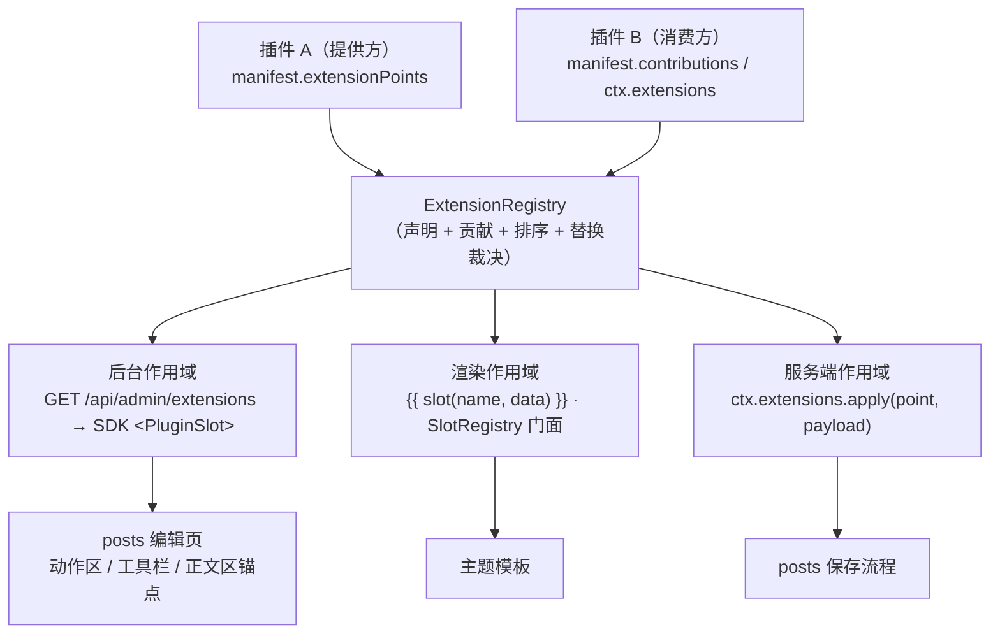
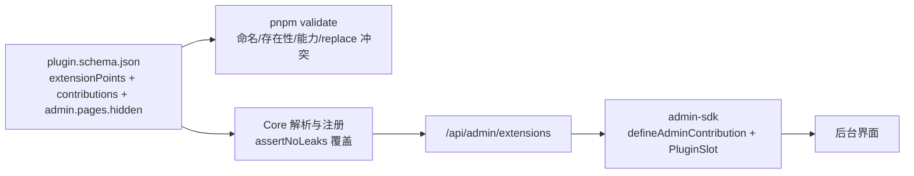

## Product Overview

为 RiceNote 的插件平台补上缺失的"扩展点"能力：插件不仅能贡献自己的页面，还能**声明命名扩展点（hook）供其他插件接入**，其他插件则通过声明式贡献点（可替换默认内容）来扩展它的界面与逻辑。以此打通用户最初的需求——文章列表点击「新建文章」不再弹出对话框，而是打开独立编辑页面，正文换成 Markdown 编辑器。

## Core Features

- **命名扩展点三作用域统一模型**：同一套"声明—贡献—渲染/触发"模型覆盖后台界面插槽、站点页面渲染插槽、服务端钩子。扩展点名带插件命名空间（如 `rice.posts.list.actions`），有作用域、是否允许替换、契约说明（可传的字段）与提供方。
- **提供方声明**：插件可声明自己暴露哪些扩展点（如 posts 声明"列表页动作区""编辑器正文区"），并在自己的界面上放置渲染位置。
- **消费方贡献（声明式为主 + 命令式为辅）**：其他插件在清单里声明"往哪个扩展点贡献什么"，零代码、随插件启停自动生效；需要动态判定时可用运行时接口。
- **替换语义**：同一扩展点上的贡献可声明为"替换"，此时默认内容不再渲染，由替换者接管（例如把默认「新建文章」按钮换成"跳转新页面"）。多个替换贡献按排序权重决定唯一生效者，冲突在部署前校验阶段即报错。
- **失败隔离**：单个贡献崩溃只让该贡献降级（后台界面为空、页面片段为空），不影响整页渲染；插件被停用后其声明与贡献立即消失，注册表零残留。
- **权限与启用态过滤**：贡献只在"提供方与消费方插件均已启用、当前用户拥有所需权限"时出现；停用任一插件即恢复默认行为（无需改代码）。
- **完整闭环示例**：文章插件提供"独立编辑页 + 正文区扩展点"，第三方 Markdown 编辑器插件替换该正文区，提供工具栏与实时预览。

## 视觉与交互效果

- **文章列表页**：顶部动作区在默认「新建文章」按钮之外，还能显示其他插件注入的内容（如"草稿数""快捷键提示"）；点击后跳转到独立编辑页，而不是弹出对话框。
- **独立编辑页**：`/posts/editor`（新建）与 `/posts/editor?id=12`（编辑）为同一个页面的两种入口；页面包含标题/别名/状态/摘要/词条等字段，以及占满可用高度的正文编辑区；离开未保存内容时给出提示。
- **Markdown 编辑器**：正文区左侧为等宽字体编辑区、右侧为实时预览（与前台渲染结果一致）；顶部一行工具按钮（加粗、斜体、标题、引用、行内代码、代码块、无序/有序列表、链接、图片），按钮作用于当前选区；底部状态栏显示字数、光标行号与"已自动保存草稿"状态；支持 Tab 缩进与常用快捷键；窄屏时预览可折叠为切换标签。
- **后台其余部分不变**：沿用既有细边框卡片分层、无阴影、无毛玻璃的视觉语言；插件停用后，列表页与编辑页自动回到默认外观。

## Tech Stack Selection

- 沿用现有栈，**零新增运行时依赖**：Node.js ≥ 20.11、TypeScript 5.7、MySQL 8 + Drizzle、Fastify 5、Vue 3.5 + Vite 5（后台 SPA）、零构建 ESM 插件界面（ADR-014）。
- Markdown 编辑器**自绘**（Textarea + 工具栏 + 分屏预览），预览走服务端既有渲染管线（`marked` + 消毒），不引入编辑器库。

## Implementation Approach

### 关键决策一：用统一注册表承载三种作用域，旧 API 退化为别名

新增 `ExtensionRegistry`（`packages/core/src/extensions/registry.ts`）作为唯一事实来源：一条记录 = `{ point, scope: 'admin'|'render'|'server', providerId, consumerId, mode: 'append'|'replace', order, payload }`。

- `packages/core/src/render/slots.ts` 的 `SlotRegistry` 保留**全部现有签名**（`register / componentsFor / render / list / ownedBy / clear`），内部委托给 `ExtensionRegistry`，`register()` 等价于 `contribute(point, component, { scope: 'render', mode: 'append' })`。这样 `{{ slot('post.comments') }}`、`plugins/third-party/reading-time`（注册 `post.beforeContent`）、主题渲染路径、`assertNoLeaks()` 全部无需改动即继续工作。
- 渲染期**保持既有隔离承诺**：单组件异常降级为空片段（`render/slots.ts` 第 60-82 行的行为原样保留在注册表实现里）。
- `replace` 生效规则：同一扩展点上若有 `replace` 贡献，默认内容与其他 `append` 贡献都不渲染，唯一生效者 = `order` 最大者；`order` 相同时按 `consumerId` 字典序取第一并记警告（`pnpm validate` 阶段把这种情况直接判为错误，避免运行期猜）。

### 关键决策二：清单统一声明，运行时接口作为动态补充

`packages/shared/manifests/plugin.schema.json` 新增两个顶层字段（注意顶层与 `admin` 的 `additionalProperties: false`，必须同步扩展）：

```
"extensionPoints": [                                  // 提供方：声明暴露的扩展点
  { "name": "rice.posts.list.actions", "scope": "admin",
    "replaceable": true, "description": "文章列表页顶部动作区",
    "props": [{ "name": "onCreate", "description": "打开新建流程" }] }
],
"contributions": [                                    // 消费方：声明贡献
  { "point": "rice.posts.editor.body", "scope": "admin", "mode": "replace",
    "entry": "./admin/editor.js", "style": "./admin/editor.css",
    "order": 100, "permission": "post.write" },
  { "point": "post.beforeContent", "scope": "render", "entry": "./dist/slot.js" },
  { "point": "rice.posts.beforeSave", "scope": "server", "entry": "./dist/hook.js", "order": 10 }
]
```

- 扩展点命名规范：`<pluginId>.<area>[.<position>]`，正则与 `AdminMenuItem.id` 同族（`^[a-z][a-z0-9]*(?:[.-][a-z0-9]+)+）；**Core 预置标准 render 扩展点**（`head.end`、`body.start`、`body.end`、`header.navigation`、`sidebar.widgets`、`post.beforeContent`、`post.afterContent`、`post.comments`、`footer.widgets`，对照 `packages/plugin-sdk/src/slots.ts` 的 `STANDARD_SLOTS`）。
- 能力点新增 `extensions:declare` 与 `extensions:contribute`（fail-closed：未声明即 `RN_FORBIDDEN`，与 `context-factory.ts` 现有 `forbidden()` 门面同构）；`slots:register` **保留**为 render 作用域贡献的别名能力，reading-time 无需修改。
- render / server 的声明式贡献由 Core 在插件 `start()` 时按 `entry` 动态 `import()`（`pathToFileURL(path.resolve(plugin.dir, entry))`），契约：默认导出 `{ render(ctx) }`（render）或 `{ apply(payload, ctx) }`（server）。命令式补充：`ctx.extensions.declare(...)` / `ctx.extensions.contribute(...)`，两者都必须经 `track()` 收集句柄，纳入 `assertNoLeaks()`。

### 关键决策三：后台插槽由服务端下发 + SDK 组件渲染（不放开宿主源码）

- 新增 `GET /api/admin/extensions`（`apps/server/src/http/admin/extensions-routes.ts`，`guard(kernel, {})`）：返回 `{ points, contributions }`，其中贡献带 `entryUrl`/`styleUrl`（复用 `admin-pages.ts` 的 `pluginAdminEntryUrl()` 换算规则），并**在服务端做三重过滤**：仅已启用插件、`scope === 'admin'`、按当前用户权限过滤 `permission` —— 与 `/menu`（`system-routes.ts` 第 140-156 行）同一套 `describeUser()` + `permissions` 口径，绝不依赖前端隐藏。
- `packages/admin-sdk` 新增：`defineAdminContribution({ name, props, setup, template })`、`useAdminExtensions()`（一次拉取 + 缓存，宿主登录后与插件启停后失效）、以及组件 `<PluginSlot name="…" :context="{…}">默认内容</PluginSlot>`。渲染规则：
- 无生效贡献 → 渲染默认插槽内容（保证"没装插件就是原样"）；
- 有 `append` 贡献、无 `replace` → 默认内容 + 贡献（按 `order` 降序）；
- 有 `replace` 贡献 → 只渲染生效贡献，默认内容不渲染。
- 每个贡献独立 `defineAsyncComponent` + `onErrorCaptured` 隔离，`import()` 失败只留控制台警示；首个贡献的 `styleUrl` 复用 `PluginHostView` 的样式注入策略（注入 + 卸载移除）。
- `context` 对象以 `v-bind` 展开为贡献组件的 props，契约由提供方的 `props` 字段文档化。
- `admin.pages` 新增可选 `hidden?: boolean`（默认 `false`）：编辑页只注册路由、不进侧栏。实现上只影响 `apps/admin/src/stores/menu.ts` 的 `visibleItems`（`pluginPages` 仍包含它，从而保证深链可解析，与 `PluginHostView` 的 `available: false` 兜底逻辑同构）。

### 关键决策四：服务端钩子的错误策略默认"响亮失败"

`ctx.extensions.apply(point, payload, { onError })` 按 `order` 升序串行传递结果（filter 语义），默认 `onError: 'abort'`：贡献抛错即上抛 `RiceNoteError`，让调用方（如"保存文章前"）失败，而不是静默写入未经验证的内容；需要容错时显式传 `'skip'`（记录日志后继续用上一版 payload）。这与 render 的"降级为空片段"刻意不同，理由写进文档与 ADR-017。

### 关键决策五：闭环交付 = posts 提供扩展点 + 第三方插件消费

- **posts（`rice.posts`，1.5.0 → 1.6.0）**：
- `manifest.json` 声明扩展点 `rice.posts.list.actions`（replaceable，默认 = 「新建文章」按钮）、`rice.posts.editor.toolbar`（append）、`rice.posts.editor.body`（replaceable，默认 = 普通 Textarea）；`admin.pages` 新增 `{ id: 'posts.editor', path: '/posts/editor', hidden: true, permission: 'post.write', entry: './admin/editor.js' }`。
- `admin/main.js`：列表页动作区包成 `<PluginSlot>`，`openCreate()`/行内编辑改为 `navigate('/posts/editor' | '/posts/editor?id=N')`，删除对话框编辑路径（正文编辑不再弹窗）。
- 新增 `admin/editor.js`：独立编辑页（读 `?id=`，复用现有表单字段与词条多选、`POST /posts`/`PUT /posts/:id` 保存逻辑），正文区与工具栏各包一个 `<PluginSlot>`。
- `src/*`：新增 `POST /posts/preview`（admin API，`post.write` 权限）→ `{ html }`，内部就是 `renderMarkdown()` + `runtime.html.sanitize()`（`src/markdown.ts` 与 `src/service.ts` 已有），保证预览与前台 1:1。
- **第三方插件 `plugins/third-party/markdown-editor/`（`acme.markdown-editor`，参照 `reading-time` 的包结构：`manifest.json` + `package.json` + `tsconfig.json` + `src/index.ts`（仅声明能力的空实现）+ `admin/*.js`）**：
- `contributions`：`replace` → `rice.posts.editor.body`（Markdown 编辑器：工具栏 + 分屏预览 + 快捷键 + Tab 缩进 + localStorage 草稿 + 字数/行号 + 全屏切换）；`append` → `rice.posts.editor.toolbar`（"预览开关""插入图片"）；`replace` → `rice.posts.list.actions`（「新建文章」+ 快捷键提示，跳转 `/posts/editor`）。
- 预览调用 posts 的 `POST /posts/preview`（经 `api.post`），不引入任何 markdown 库。

### 兼容与回归控制

- `ctx.slots.register` / `{{ slot() }}` / `STANDARD_SLOTS` / reading-time / 主题渲染路径 **行为不变**（replace 只在有人显式声明时才改变表现）。
- `assertNoLeaks()` 扩展为同时断言"扩展点声明 + 贡献"零残留（`manager.ts` 第 457-476 行的既有断言结构）。
- `pnpm validate`（`apps/server/src/cli/validate.ts`）新增规则：扩展点名格式与全局唯一（跨插件冲突判错）；贡献指向的扩展点必须存在（标准 render 扩展点视为已存在）；`scope` 与 `mode` 合法；`entry` 文件存在且路径在白名单内（admin 限 `./admin/*.js`，render/server 限 `./dist/*.js`）；同点多个 `replace` 且 `order` 相同时判错；插件必须声明对应能力。
- 新增第三个第三方插件会让 `pnpm validate` 的"插件清单 12/12"变成 13/13：需同步检查是否有测试/文档硬编码该数字（`tests/**`、`docs/**`、`README.md`）。

### 性能与可观测性

- 注册表按 `point` 建 `Map`，贡献在注册时排序一次；`render()`/`apply()` 单次查询 O(1) + O(k log k) 排序（k 为该点贡献数，通常 0-3）。
- 后台 SPA 只请求一次 `/api/admin/extensions`（与菜单同生命周期，登录/启停后失效），贡献模块由浏览器模块表缓存；`import()` 失败的 URL 追加 `?retry=N`（复用 `PluginHostView` 第 113-115 行的既有做法）。
- 日志沿用既有口径：`logger.child({ plugin })`、`logger.error` 记贡献崩溃（含 `point`/`plugin`/错误摘要，不打印 payload），`logger.warn` 记未声明的扩展点引用。

## Architecture Design





## Directory Structure

```
packages/core/src/
├── extensions/registry.ts          [NEW] ExtensionRegistry：声明/贡献/replace 裁决/排序/隔离/ownedBy/clear；按 point 建 Map；导出 admin 载荷构造（含权限过滤）
├── extensions/contributions.ts     [NEW] 声明式 contributions 解析：admin（URL 换算）/render/server（entry 模块动态 import）与能力校验，返回 Dispose[]
├── extensions/index.ts             [NEW] 对外出口（供 packages/core/src/index.ts 再导出）
├── render/slots.ts                 [MODIFY] SlotRegistry 退化为 ExtensionRegistry 的 render 作用域门面，签名与错误隔离行为保持不变
├── plugins/context-factory.ts      [MODIFY] 注入 ctx.extensions（declare/contribute/apply/list/points）；能力门面扩展；slots.register 保留为别名
├── plugins/manager.ts              [MODIFY] 装配 ExtensionRegistry；解析声明式扩展点与贡献；assertNoLeaks 增加扩展点与贡献断言
├── index.ts                        [MODIFY] 导出扩展点类型与注册表

packages/plugin-sdk/src/
├── extensions.ts                   [NEW] 契约类型：ExtensionScope/Point/Contribution/Mode/apply 选项 + ctx.extensions 门面类型
├── context.ts                      [MODIFY] PluginContext 增加 extensions
├── slots.ts                        [MODIFY] STANDARD_SLOTS 标注为预置 render 扩展点；SlotRegistryFacade 标注为别名
└── index.ts                        [MODIFY] 导出扩展点类型

packages/shared/
├── manifests/plugin.schema.json    [MODIFY] 新增 extensionPoints / contributions / admin.pages.hidden / 新能力白名单
├── src/types/dto.ts               [MODIFY] 新增 AdminExtensionPointDto / AdminExtensionContributionDto / AdminExtensionsDto；AdminMenuItem 注释补充 hidden
└── src/types/plugin.ts            [MODIFY] PluginManifest 增加 extensionPoints、contributions、admin.pages[].hidden 类型

packages/admin-sdk/src/
├── extension/contribution.ts       [NEW] defineAdminContribution（props + setup + template）
├── extension/use-extensions.ts     [NEW] 贡献清单拉取与缓存（登录/启停后失效）+ 按 point 解析生效贡献（replace 裁决与前端一致）
├── extension/PluginSlot.vue        [NEW] <PluginSlot name :context>：默认插槽内容 + 贡献渲染 + 惰性 import + 错误隔离 + 样式注入
├── extension/index.ts              [NEW] 出口
└── index.ts                        [MODIFY] 导出上述 API 与 PluginSlot

apps/server/src/http/admin/
├── extensions-routes.ts            [NEW] GET /api/admin/extensions（权限/启用态过滤 + entryUrl/styleUrl）
└── system-routes.ts                [MODIFY] 在 server.ts 中注册新路由（如果选择与 menu 并列；不改 menu 语义）

apps/admin/src/
├── stores/menu.ts                  [MODIFY] visibleItems 过滤 hidden 页面（pluginPages 仍含 hidden，保证深链可解析）
└── main.ts / App.vue               [MODIFY] 登录后加载扩展点清单（或由 PluginSlot 组件按需加载，二选一，取改动更小者）

plugins/official/posts/
├── manifest.json                   [MODIFY] version 1.6.0；声明 3 个扩展点；admin.pages 增加隐藏的 posts.editor
├── admin/main.js                   [MODIFY] 动作区包 <PluginSlot>；新建/编辑改为 navigate 到独立编辑页；移除对话框编辑路径
├── admin/editor.js                 [NEW] 独立编辑页（?id= 复用；工具栏与正文区各包一个 <PluginSlot>）
├── admin/style.css                 [NEW] 编辑器页自有样式（如需）
└── src/admin.ts / src/service.ts   [MODIFY] 新增 POST /posts/preview（复用 renderMarkdown + sanitize）

plugins/third-party/markdown-editor/
├── manifest.json                   [NEW] id acme.markdown-editor；能力 extensions:contribute；3 条 contributions
├── package.json / tsconfig.json    [NEW] 参照 reading-time
├── src/index.ts                    [NEW] 空实现 definePlugin（提供 entry，供构建）
├── admin/main.js                   [NEW] 仅声明（可留空页面/不提供页面，只作为贡献宿主）
├── admin/new-post.js               [NEW] replace 列表页动作区（跳转 /posts/editor + 快捷键提示）
├── admin/editor.js                 [NEW] replace 正文区（Markdown 编辑器：工具栏/分屏预览/快捷键/草稿/字数）
├── admin/toolbar.js                [NEW] append 到编辑器工具栏（预览开关、插入图片）
├── admin/editor.css                [NEW] 编辑器样式（1px 边框、等宽、无阴影）
└── README.md                       [NEW] 作为"第三方扩展他人插件界面"的示例说明

docs/
├── plugin-api/v1.md                [MODIFY] 新增「命名扩展点」章节（三作用域 / 声明 / 贡献 / 渲染 / replace / 命名规范 / 能力与校验 / 与 slots 兼容）
├── theme-api/v1.md                 [MODIFY] §6 指向统一模型，说明 replace 与预置扩展点
├── adr/ADR-017-named-extension-points.md  [NEW] 决策记录（含服务端钩子默认 abort 的理由）
├── adr/README.md                   [MODIFY] 索引与版本段落
├── architecture/hooks-inventory.md [MODIFY] 增补扩展点清单与三作用域
└── CHANGELOG.md                    [MODIFY] 新增/变更/兼容条目

tests/
├── unit/extension-registry.test.ts      [NEW] 声明/贡献/replace 裁决/排序/隔离/零残留/权限过滤
├── unit/admin-contributions.test.ts     [NEW] 声明式贡献解析（URL 换算、entry 缺失、能力缺失、hidden 页面）
├── unit/plugin-manifest-extensions.test.ts [NEW] schema 校验：命名、scope、能力、replace 冲突
└── integration/extension-points.test.ts [NEW] 内核装配 + /api/admin/extensions + render slot 兼容（reading-time）+ server hook 顺序与 abort
```

## Key Code Structures

```ts
/** 扩展点作用域：后台界面 / 站点渲染 / 服务端钩子。 */
export type ExtensionScope = 'admin' | 'render' | 'server';

/** 提供方在 manifest.extensionPoints 里声明的形态。 */
export interface ExtensionPointDeclaration {
  name: string;                 // <pluginId>.<area>[.<position>]
  scope: ExtensionScope;
  replaceable?: boolean;        // 是否允许 replace 贡献接管默认内容
  description?: string;
  props?: { name: string; description: string }[];   // 契约文档（admin 的 context 字段）
}

/** 消费方在 manifest.contributions 里声明的形态。 */
export interface ExtensionContributionDeclaration {
  point: string;
  scope: ExtensionScope;
  mode?: 'append' | 'replace';  // 缺省 append
  order?: number;               // 数值越大越靠前；replace 生效者取最大
  entry: string;                // admin: ./admin/*.js（浏览器 import）；render/server: ./dist/*.js（Node import）
  style?: string;               // 仅 admin：./admin/*.css
  permission?: string;          // 仅 admin：服务端按当前用户过滤
  label?: string;               // 仅 admin：调试/占位文案
}
```

```ts
/** ctx.extensions：命令式声明与贡献（声明式之外的动态路径）。 */
export interface ExtensionRegistryFacade {
  declare(point: ExtensionPointDeclaration): Dispose;
  contribute(point: string, payload: ExtensionContributionPayload, options?: {
    scope?: ExtensionScope; mode?: 'append' | 'replace'; order?: number;
  }): Dispose;
  /** 服务端钩子：按 order 升序串行传递 payload；默认 onError='abort'。 */
  apply<T>(point: string, payload: T, options?: { onError?: 'abort' | 'skip' }): Promise<T>;
  list(): { point: string; scope: ExtensionScope; provider: string; contributions: number }[];
}
```

## 设计范围

本轮新增界面只有两处：**posts 的独立编辑页**与**Markdown 编辑器正文区**（由第三方插件注入）。两者必须严格沿用后台既有视觉语言——细边框卡片分层、无阴影、无毛玻璃、等宽代码与日志，不引入新风格、新配色、新字体。

## 独立编辑页（/posts/editor）

- 顶部：沿用 `AdminPage` 外壳（标题「新建文章」/「编辑文章」+ 一行说明「正文支持 Markdown，预览与前台渲染一致」）；右侧动作区为「取消」「保存」/「创建文章」。
- 主体两栏：左列为元信息（标题、别名、状态、摘要、词条多选），右列为正文编辑区；窄屏（<1024px）回落为单列堆叠，元信息在上。
- 正文区占满剩余高度（`min-h-[420px]`），顶部由「编辑器工具栏」扩展点占据，下方为「正文」扩展点；未装扩展插件时显示普通多行文本域，外观与现有 `Textarea` 完全一致。
- 未保存离开时用既有 `ConfirmDialog` 提示，不使用原生 `confirm`。

## Markdown 编辑器（由第三方插件替换正文扩展点）

- 布局：编辑区与预览区左右各半（`grid lg:grid-cols-2`），中间 1px 分隔线；窄屏切换为标签页（「编辑」/「预览」）。
- 编辑区：等宽字体、行高 1.7、无边框（由外层 1px 边框容器承担）、行号列可选；Tab 缩进 2 空格，支持加粗/斜体/链接/列表等快捷键。
- 工具栏：一行图标按钮（lucide），按钮为既有 `Button` 的 ghost/sm 变体，hover 使用既有背景分层；分组之间用 1px 竖线分隔；右侧放「预览开关」与「插入图片」。
- 预览区：复用前台排版（标题、引用、代码块、列表、表格），代码块等宽 + 浅底；滚动与编辑区独立。
- 状态栏：底栏一行小字，左侧显示「字数 N · 行 L:C」，右侧显示「草稿已自动保存」，均用等宽数字（`tabular-nums`），颜色为次要文本色。
- 交互细节：工具栏按压缩放只作用于当前选区；插入内容后光标落在预期位置；预览更新做 300ms 防抖；保存中禁用工具栏并显示既有 loading 态。

## Agent Extensions

### SubAgent

- **code-explorer**
- Purpose: 盘点"扩展点机制"的改造落点与兼容面：所有调用 `ctx.slots.register` 的位置、所有构造 `PluginSummary`/`AdminMenuItem`、所有读取 `manifest.admin` 的位置、`validate.ts` 现有校验项，以及主题渲染调用 `slots.render()` 的全部路径。
- Expected outcome: 一份"文件:行"级清单，确认 `SlotRegistry` 门面化不会漏改调用方，且 reading-time 与主题渲染路径全部覆盖。

### Skill

- **lsp-code-analysis**
- Purpose: 在 `PluginContext`、`PluginManifest`、`PluginCapability`、`SlotRegistry` 变更后做语义级引用核查，确保"所有读取旧字段/旧接口的位置"都改到点上且无残留引用（含跨包的 workspace 包）。
- Expected outcome: 明确的定义/引用清单与调用层级，改造后 `pnpm build`、`pnpm validate` 全绿且无遗漏调用点。

- **playwright-cli**
- Purpose: 在浏览器中实测闭环：文章列表动作区被第三方插件替换、「新建文章」跳转到独立编辑页、编辑页正文区被 Markdown 编辑器接管（工具栏 / 分屏预览 / 快捷键 / 草稿 / 字数）、保存成功后前台渲染一致；并验证停用编辑器插件后恢复默认文本域。
- Expected outcome: 每步可复现的断言输出与截图，作为"扩展点可替换、可回退"的证据。