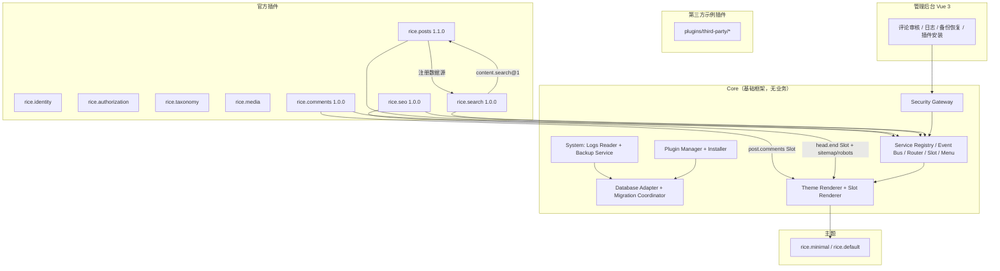

## 产品概述

在 RiceNote 已有 M0→M2 成果（模块化核心底座 + 内容 MVP）基础上，完成规划说明书的 **M4「生态稳定」** 里程碑，并补齐 **M3 两项遗留增强**，使系统达到 v1 完整形态。

## 核心功能

- **评论插件（rice.comments）**：访客评论（昵称/邮箱/网址，可与登录用户关联）、嵌套回复、四态审核状态机（待审/通过/垃圾/回收）、关键词黑名单与频率限制、后台审核页与批量操作，并在文章页 `post.comments` 位置注入评论区。
- **搜索插件（rice.search）**：独立接管全站搜索页，开放可搜索数据源注册机制，供文章等插件接入；支持中文分词的高效检索与无索引时的降级匹配，提供搜索入口与结果列表。
- **SEO 插件（rice.seo）**：为前台页面输出标题与摘要、规范链接、社交分享卡片信息、结构化数据，并提供站点地图与爬虫协议文件。
- **插件包安装**：后台可上传插件压缩包完成安装、启用与升级，包含与主题安装同等级别的安全校验，并对"插件在进程内运行、无真实沙箱"给出显著风险提示。
- **日志查看**：后台只读查看运行日志与操作审计记录，支持按级别与时间范围过滤、分页浏览。
- **备份与恢复**：一键导出包含数据库内容、上传文件与已安装插件/主题清单的压缩包下载；支持上传压缩包恢复，恢复前自动保留当前状态快照以便回滚。
- **第三方示例插件与升级回归**：新增一个由公共接口独立编写的非官方插件，验证第三方可独立开发、发布、启用与升级，并覆盖版本升级的回归验证。
- **主题设置多语言与文档生成**：主题设置字段标签支持多语言声明；由清单结构自动生成插件与主题的开发文档。

## 视觉与交付效果

后台新增"互动（评论审核）""系统（日志、备份恢复）""扩展（插件安装）"三类页面，沿用既有视觉规范：柠檬浅黄主色 `#FDE047`、全站无阴影、无玻璃拟态，卡片仅以 1px 细边框与背景色区分层级。前台评论、搜索、SEO 输出融入现有两套主题，无需改动主题即可获得新能力。

## 技术栈

沿用既有技术栈，不引入新框架：TypeScript / Node.js LTS、Fastify、MySQL 8.4 + Drizzle（`mysql2` 连接池）、Vue 3 + Vite（后台，shadcn-vue 风格组件）、Nunjucks（前台 SSR）、JSON Schema + Ajv、pnpm workspace。

新增依赖仅两项且为必要：`archiver`（流式 ZIP 打包，用于备份与插件包），`unzipper`/`yauzl` 复用主题安装已用的解压方案（以 `packages/core/src/themes/manager.ts` 现有实现为准，若已内置则直接复用）。

## 实现思路

### 1. 插件包安装（核心扩展）

在 `packages/core/src/plugins/` 增加 `installer.ts`，与 `themes/manager.ts::installFromZip` 保持**同构的"两阶段校验 + 落盘"流程**，直接复用现有 ZIP 安全校验工具（Zip Slip、绝对路径、Windows 盘符、反斜杠绕过、符号链接穿越、体积与条目限额、扩展名白名单），避免出现第二套语义。
安装落盘到 `config.paths.pluginsDir` 后写入 `rn_plugins`（状态 `INSTALLED`），启用/停用仍走既有 PluginStore + ADR-004 受控重启语义；**不实现运行时卸载 Fastify 路由**。
关键决策：插件包内必须含合法 `plugin.json`，否则整体拒绝且**不留残留目录**（先在校验通过后才原地解压，失败即回滚）。

### 2. 搜索插件（契约驱动的数据源注册）

`rice.search` 定义并声明 `provides: ["content.search@1"]`，同时**消费**其他插件注册的数据源。契约形态：

```ts
/** content.search@1：可搜索数据源注册契约 */
export interface SearchSource {
  /** 数据源标识，如 'posts' */
  id: string;
  /** 展示名，用于相关性分组 */
  label: string;
  /** 检索：返回带 url 的结果项；分页由实现方处理 */
  query(input: { keyword: string; page: number; pageSize: number }): Promise<{
    items: Array<{ id: string; title: string; excerpt: string; url: string; type: string }>;
    total: number;
  }>;
}
```

注册方向为**反向注入**：search 插件启动后发布 `search.source.register` 事件或在 Service Registry 中以 `content.search.source` 注册表形式提供 `register(source)`，posts 插件（版本升级到 1.1.0）在启动时若发现 `content.search@1` 存在则注册自身数据源，否则静默降级（保持既有"可选依赖惰性解析"模式）。

检索实现：优先使用 MySQL 8 内置 **ngram 解析器的 FULLTEXT 索引**（`WITH PARSER ngram`），无索引或不可用时回退 `LIKE`。索引维护由 posts 插件负责（在其迁移中新增 FULLTEXT 索引），search 插件不越权操作其他插件的表——**遵守"不对其他插件的表建非受控访问"的既有约定**。

`/search` 页面路由由 search 插件注册；**同时从 posts `pages.ts` 移除 `/search` 路由**，避免路由冲突（这是本次必须同步的改动，否则路由注册表会因冲突而报错）。

### 3. 评论插件（含嵌套与四态审核）

表 `rn_comments`：`id / site_id / post_id / parent_id（自引用，嵌套） / author_name / author_email / author_url / user_id（可空，关联登录用户） / content / status(pending|approved|spam|trash) / ip_hash / user_agent / created_at / updated_at`，并对 `(site_id, post_id, status, created_at)` 与 `parent_id` 建索引。

- 单一职责：`repository.ts`（SQL）/ `service.ts`（业务与状态机）/ `pages.ts`（Slot 组件与提交端点）/ `admin-routes.ts`。
- 富文本：评论正文走既有 `sanitizeRichText` 消毒流程，任何直接 HTML 一律标记 `TrustedHtml` 后才在模板输出。
- 反垃圾：关键词黑名单（配置项）+ 频率限制（复用既有登录限流组件或按 IP 哈希做滑动窗口）；`ip` 仅存哈希（`ip_hash`），不落明文。
- Slot 注入：通过 `ctx.slots.register('post.comments', …)` 提供评论区组件，沿用既有"占位符 + 渲染后替换"机制，单组件错误隔离。
- 后台：`/api/admin/comments`（列表、按状态筛选、批量通过/垃圾/回收/删除），并贡献后台菜单到"互动"分区。

### 4. SEO 插件（无自有表）

订阅渲染上下文注入 meta 与 JSON-LD；通过 `head.end` Slot 或渲染上下文的 `page.headExtra` 输出 `<link rel="canonical">`、Open Graph、Twitter Card、`application/ld+json`。注册公开路由 `GET /sitemap.xml`（读取 posts 服务契约列出的已发布文章 URL）与 `GET /robots.txt`。全部输出经转义，URL 走既有 `url()` helper。

### 5. 日志查看与备份恢复（Core 系统能力）

- **日志**：`apps/server/src/http/admin/system-routes.ts` 扩展 `GET /api/admin/logs`（参数：level、from、to、page、pageSize），读取 `config.paths.logsDir` 下结构化 JSON 行日志 + `rn_audit_logs`，流式按行解析并只返回尾部 N 行，避免把大文件读入内存。日志文件访问须做**路径归一化校验**，禁止越权读取目录外文件。
- **备份**：新增 `packages/core/src/system/backup.ts`。导出：`mysqldump`（通过 `--defaults-extra-file` 临时凭据文件传参，避免密码出现在命令行/进程列表） + `storage/uploads` + 插件与主题清单 JSON，用 `archiver` 流式写入 ZIP 并直接作为 HTTP 响应流下载（不落盘大文件）。恢复：校验上传 ZIP（复用同一套 ZIP 安全校验）→ **先生成当前状态快照**（同一备份流程）→ 再导入。`mysqldump` 不可用时返回结构化错误码与友好提示，而非 500。

### 6. 主题设置多语言与 SDK 文档生成

- `packages/theme-sdk/src/` 设置校验器扩展：字段 `label` 允许 `string | Record<locale,string>`，运行时按 `config.site.language` 取用并回退首个可用值；`packages/shared/manifests/theme.schema.json` 同步放宽。
- 文档生成：新增 `apps/server/src/cli/docs.ts`（`ricenote docs`），从 `packages/shared/manifests/*.schema.json` 生成 JSON Schema 参考文档写入 `docs/plugin-api/` 与 `docs/theme-api/`，接入 `package.json` 脚本。

### 7. 第三方示例插件与升级回归测试

在 `plugins/third-party/` 新增一个最小可用插件（如「阅读进度/相关文章」类无外部依赖能力），仅使用 `@ricenote/plugin-sdk` 公共接口，用于证明第三方可独立开发。升级回归测试覆盖：插件 `1.0.0 → 1.1.0` 时迁移增量应用、`rn_plugin_migrations` 校验值、服务契约兼容、启停与依赖校验。

## 实施要点

- **路由冲突是本次最高风险点**：posts 的 `/search` 必须先移除，search 插件才能注册；需有集成测试固定"search 插件禁用时 `/search` 返回 404 或不冲突"的行为。
- **表所有权纪律**：search 不越权读写 `rn_posts`；FULLTEXT 索引由 posts 的迁移创建。comments 只操作 `rn_comments`。新增表须在说明书第 8 章与 `docs/architecture/` 登记。
- **能力声明必须完整**：新插件若访问数据库需声明 `database:own`，注册前台路由需 `routes:public`，注册后台路由需 `routes:admin`，订阅/发布事件需 `events:subscribe` / `events:publish`，注册 Slot 需对应能力——既有的能力白名单是 fail-closed，漏声明会直接启动失败。
- **备份的密码传递**：`mysqldump` 密码必须经临时 `--defaults-extra-file`（权限收紧、用后即删），不得出现在命令行参数或日志中；日志脱敏既有机制自动生效。
- **性能**：日志接口只读尾部并分页；搜索引擎结果按 `(type, score)` 分页；评论列表按状态 + 时间分页并使用既有索引；备份走流式，内存占用与文件大小无关。
- **零残留验证**：三个新插件的禁用路径必须通过既有 `assertNoLeaks()`，确保路由 / 服务 / Slot / 菜单 / 事件订阅全部注销。

## 架构设计

本次为在既有分层架构上的**插件式能力扩展 + Core 系统能力补全**，不改变架构范式。



## 目录结构

```text
ricenote/
├── packages/
│   ├── core/src/
│   │   ├── plugins/
│   │   │   ├── installer.ts                    # [NEW] 插件 ZIP 两阶段安全安装（复用主题校验工具）
│   │   │   └── ...
│   │   ├── system/
│   │   │   ├── backup.ts                       # [NEW] mysqldump + uploads + 清单 → 流式 ZIP；恢复前自动快照
│   │   │   ├── logs-reader.ts                  # [NEW] 结构化日志尾部读取、级别/时间过滤、路径归一化校验
│   │   │   └── index.ts                        # [NEW] 系统能力导出
│   │   └── index.ts                            # [MODIFY] 导出 installer / system 能力
│   ├── shared/src/
│   │   ├── types/contracts.ts                  # [MODIFY] 新增 content.search@1 的 SearchSource 契约
│   │   ├── errors.ts                           # [MODIFY] 新增备份/日志/安装相关错误码
│   │   └── manifests/plugin.schema.json        # [MODIFY] 若需放宽/校验安装包结构则同步
│   ├── theme-sdk/src/
│   │   ├── settings.ts                         # [MODIFY] label 支持 string | Record<locale,string> 与回退
│   │   └── index.ts                            # [MODIFY] 导出多语言解析工具
│   └── shared/manifests/theme.schema.json      # [MODIFY] label 放宽为 string 或对象
├── plugins/official/
│   ├── comments/                               # [NEW] 评论插件（完整版：嵌套 + 四态审核 + 反垃圾 + Slot + 后台）
│   │   ├── plugin.json
│   │   ├── migrations/001_init.sql             # rn_comments 建表与索引
│   │   └── src/{index.ts,repository.ts,service.ts,pages.ts,admin-routes.ts}
│   ├── search/                                 # [NEW] 搜索插件（接管 /search + content.search@1）
│   │   ├── plugin.json
│   │   └── src/{index.ts,registry.ts,page.ts,admin-routes.ts}
│   ├── seo/                                    # [NEW] SEO 插件（meta/JSON-LD/sitemap/robots，无表）
│   │   ├── plugin.json
│   │   └── src/{index.ts,meta.ts,sitemap.ts}
│   ├── posts/                                  # [MODIFY] 移除 /search 路由；新增 FULLTEXT(ngram) 迁移；注册搜索数据源；版本 1.1.0
│   │   ├── plugin.json
│   │   ├── migrations/002_search_index.sql
│   │   └── src/{pages.ts,service.ts,index.ts}
│   ├── media/ , taxonomy/ , identity/ , authorization/ , hello/   # 参照，不改
├── plugins/third-party/
│   └── <示例插件>/                             # [NEW] 仅用 plugin-sdk 的第三方示例插件
├── apps/server/src/
│   ├── http/admin/
│   │   ├── comments-routes.ts                  # [NEW] 评论审核 API（列表/筛选/批量操作）
│   │   ├── plugins-routes.ts                   # [MODIFY] 新增 POST /api/admin/plugins/install（ZIP 上传）
│   │   ├── system-routes.ts                    # [MODIFY] 新增 logs / backup / restore 端点
│   │   └── guard.ts                            # [参照] 认证→CSRF→权限→审计链路
│   ├── cli/index.ts                            # [MODIFY] 新增 docs 命令
│   └── cli/docs.ts                             # [NEW] 由 JSON Schema 生成 SDK 文档
├── apps/admin/src/
│   ├── router.ts                               # [MODIFY] 新增 comments / logs / backup 路由
│   ├── views/
│   │   ├── CommentsView.vue                    # [NEW] 互动・评论审核（筛选/批量/嵌套展示）
│   │   ├── LogsView.vue                        # [NEW] 系统・日志（级别/时间过滤 + 分页）
│   │   ├── BackupView.vue                      # [NEW] 系统・备份与恢复（导出/上传恢复/快照）
│   │   ├── PluginsView.vue                     # [MODIFY] 增加上传安装与风险提示
│   │   └── ThemesView.vue                      # [MODIFY] label 多语言渲染
│   └── api/                                    # [MODIFY] 新增 comments/logs/backup 客户端
├── themes/{minimal,default}/
│   └── templates/post.njk                      # [MODIFY] 渲染评论区 Slot（若无则补）
├── tests/
│   ├── unit/                                   # [NEW] 搜索契约/多语言 label/zip 安装校验/日志解析
│   └── integration/                            # [NEW] 评论闭环、/search 接管与禁用回归、备份恢复、插件升级回归、第三方插件
├── docs/
│   ├── architecture/                           # [MODIFY] 登记新增表所有权与系统能力
│   ├── plugin-api/v1.md                        # [MODIFY] content.search@1 契约 + 安装说明
│   ├── adr/ADR-007-plugin-package-install.md   # [NEW] 插件包安装决策
│   ├── adr/ADR-008-backup-restore-scope.md     # [NEW] 备份范围与快照策略
│   └── adr/ADR-009-search-fulltext-ngram.md    # [NEW] 搜索索引与中文分词决策
└── CHANGELOG.md                                # [MODIFY] 记录本次全部显著变更
```

## 关键代码结构

```ts
// packages/shared/src/types/contracts.ts —— 新增可搜索数据源契约
export interface SearchHit {
  id: string;
  title: string;
  excerpt: string;
  url: string;
  type: string;
}
export interface SearchQuery {
  keyword: string;
  page: number;
  pageSize: number;
}
export interface SearchSource {
  id: string;
  label: string;
  query(input: SearchQuery): Promise<{ items: SearchHit[]; total: number }>;
}
```

```ts
// packages/core/src/plugins/installer.ts —— 插件包安装（两阶段：全量校验 → 落盘）
export interface PluginInstallResult {
  pluginId: string;
  version: string;
  dir: string;
  restartRequired: true;
}
export declare function installPluginFromZip(input: {
  archive: Buffer;
  pluginsDir: string;
  logger: Logger;
}): Promise<PluginInstallResult>;
```

```ts
// packages/core/src/system/backup.ts —— 备份/恢复
export interface BackupManifest {
  createdAt: string;
  appVersion: string;
  database: { name: string; server: string };
  plugins: Array<{ id: string; version: string; enabled: boolean }>;
  themes: Array<{ id: string; version: string; active: boolean }>;
  uploads: { fileCount: number; totalBytes: number };
}
export declare function createBackupArchive(input: { config: RiceNoteConfig; logger: Logger }): Promise<NodeJS.ReadableStream>;
export declare function restoreBackupArchive(input: { archive: Buffer; config: RiceNoteConfig; logger: Logger }): Promise<{ snapshotPath: string }>;
```

## 设计定位

本次为**既有后台的延续性扩展**，新增"互动・评论审核""系统・日志""系统・备份与恢复"三个页面，并增强"扩展・插件安装"与主题设置的表单渲染。视觉上必须与既有后台完全一致：柠檬浅黄主色、全站无阴影、无玻璃拟态，层级仅靠 1px 细边框与背景色区分。组件沿用既有的 shadcn 风格自建组件（`apps/admin/src/components/ui/*`），不引入新组件库。

## 页面规划（3 个新页面，均沿用既有布局）

### 1. 评论审核（互动）

- **顶部导航栏**：复用既有后台 Topbar（站点名 + 用户菜单），面包屑显示"互动 / 评论审核"。
- **状态筛选条**：四个状态页签（待审 / 已通过 / 垃圾 / 回收站）以 pill 形式排布，右侧显示各状态计数徽标；选中态用柠檬黄填充、深色文字。
- **评论列表区**：每条评论以 1px 细边框卡片呈现，含昵称、邮箱（脱敏）、时间、关联文章标题、正文摘要；嵌套回复以左侧 2px 竖线 + 缩进呈现层级，不额外加阴影。
- **批量操作条**：勾选后底部浮出操作条（通过 / 标记垃圾 / 移入回收站 / 删除），浮层同样仅有边框与背景色。
- **右侧详情抽屉**：点击评论展开只读详情（完整正文、IP 哈希、UA、嵌套路径），用于审核判断。

### 2. 日志（系统）

- **顶部导航栏**：面包屑"系统 / 日志"，右上角"刷新"按钮。
- **过滤工具栏**：级别下拉（debug/info/warn/error）、时间范围选择、关键字输入；控件排布为单行，窄屏换行。
- **日志流列表**：等宽字体逐行展示，每行左侧级别色块（复用功能色），时间戳次之；JSON 字段折叠为可展开的键值区，长文本截断。
- **分页区**：底部固定分页控件（上一页 / 页码 / 下一页），并显示"当前读取自 logsDir 的哪个文件"。

### 3. 备份与恢复（系统）

- **顶部导航栏**：面包屑"系统 / 备份与恢复"。
- **导出卡片**：说明导出范围（数据库 + 上传文件 + 插件/主题清单），"立即导出"按钮触发流式下载，带进度状态。
- **恢复卡片**：上传区（拖拽或点击选择 ZIP），选定后先展示包内清单预览，再要求二次确认；确认文案明确指出"将先生成当前状态快照"。
- **快照列表**：历史快照以细边框列表呈现（时间、体积、类型），提供下载与回滚入口。
- **风险提示区**：恢复操作旁固定显示警示条（仅边框 + 底色），说明恢复会覆盖数据。

## 交互与响应式

- 全部操作经统一 Toast 反馈；错误状态使用功能色 + 图标，不使用阴影浮起。
- 卡片 hover 仅加深边框与背景色；页签、按钮的选中态用柠檬黄实色。
- 桌面优先（后台场景），窄屏下筛选条与批量操作条自动换行堆叠，列表保持单列。
- 所有表格/列表均支持分页，遵循既有 `pageSize` 约定。

## Agent Extensions

### SubAgent

- **code-explorer**
- Purpose: 在实现前对 `packages/core/src/themes/manager.ts` 的 ZIP 安全校验实现、`packages/core/src/plugins/` 与 `packages/core/src/services/` 的注册表接口、`packages/plugin-sdk/src` 的 `PluginContext` 能力门面、`plugins/official/posts/src/{pages.ts,service.ts,repository.ts}` 的搜索与路由注册方式、以及 `apps/server/src/http/admin/{guard.ts,plugins-routes.ts,themes-routes.ts,system-routes.ts}` 的现有守卫与响应约定做一次彻底勘察，确保新增插件与路由严格复用既有模式而不引入第二套语义。
- Expected outcome: 产出一份精确的既有接口与约定清单（函数签名、能力名称、错误码、响应包装格式、Slot/菜单注册方法），作为三个新插件与新增后台路由的实现依据，避免因凭记忆编码导致的返工。

### Skill

- **agent-browser**
- Purpose: 在交付前对新增的三个后台页面（评论审核、日志、备份与恢复）以及插件上传安装流程做真实浏览器验证，并对前台评论提交与搜索页做端到端交互验证。
- Expected outcome: 产出可核验的截图与操作记录，确认页面在柠檬黄主色、无阴影、无玻璃拟态约束下渲染正确，且评论"提交 → 待审 → 审核通过 → 前台显示"与搜索闭环真实可用。

### Skill

- **playwright-cli**
- Purpose: 作为浏览器验证的补充手段，在需要脚本化断言（如批量操作、分页、恢复确认弹窗、ZIP 上传的拒绝行为）时执行可重复的自动化检查。
- Expected outcome: 产出通过/失败明确的自动化断言结果，特别是恶意插件包被拒绝且不留残留文件、禁用 search 插件后 `/search` 不报 500 等回归场景。