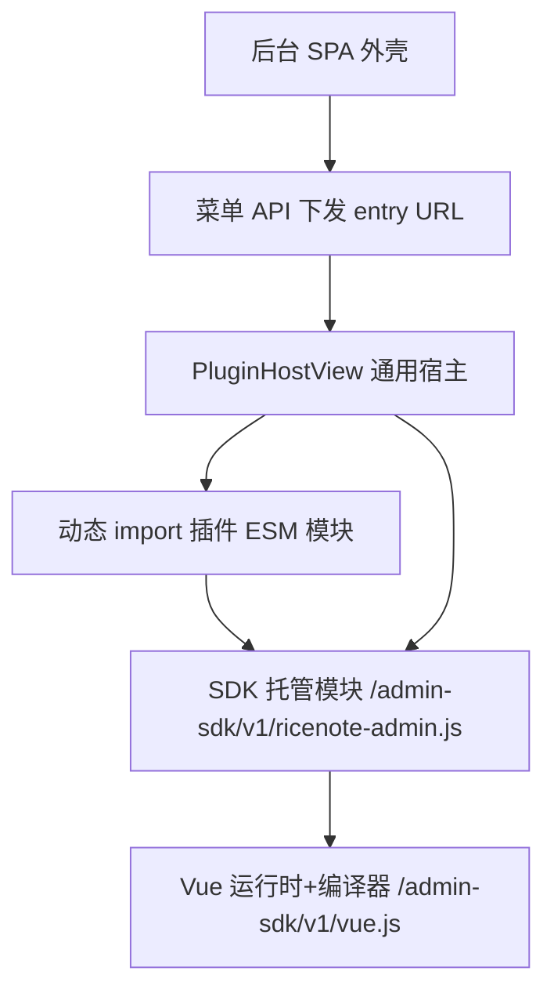

## 产品概述

把"插件后台界面"从 Core 后台里彻底移出，交给插件自己拥有，并提供一套后台界面 SDK，让插件作者用现成组件快速搭出与官方一致的管理页面。

当前状态：8 个插件功能的后台页面（文章、页面、导航栏、分类与标签、媒体库、评论审核、用户、角色与权限）都写在 Core 的后台 SPA 里，插件只贡献菜单入口。用户认为这不算解耦：插件停用后界面文件仍留在 Core，且管理员直敲地址还能进去撞错误。

## 核心功能

- 插件在自己目录里提供后台界面代码，Core 后台不再出现任何插件专属页面文件；插件安装/停用即决定界面是否存在，界面随插件一起启用、禁用、升级。
- 后台侧栏入口与地址保持不变（/posts、/pages、/navigation、/taxonomy、/media、/comments、/users、/roles），用户书签与操作习惯不受影响。
- 提供后台界面 SDK：成套的界面组件（卡片、按钮、输入、下拉、开关、对话框、提示条、徽章、数据表、分页、空状态、确认框、字段容器、页头等）、设计令牌样式、以及"取当前登录者与权限、调用管理接口、弹出提示、感知待重启状态"的现成能力，插件作者无需安装任何前端依赖、无需构建即可使用。
- 插件作者写界面时无需关心外壳：侧栏、顶栏、页面标题区由后台提供；插件只描述"页面内容是什么"。
- 界面加载过程对使用者可见且可控：加载中有占位提示；插件界面出错时只降级该页面并允许重试，不会让整个后台白屏；插件未启用或本人无权限时给出明确提示（并引导去扩展中心），而不是报接口错误。
- 插件可以自带额外样式（可选），也可只用 SDK 组件与允许的样式类，保证与官方页面观感一致（柠檬浅黄主色、1px 细边框分区、无阴影、无毛玻璃）。
- 第三方插件同样适用，且安装插件等同于授予其前台脚本访问管理后台的能力，这一点在后台有明确风险提示。

## 视觉与交互效果

- 迁移后的 8 个页面在观感与交互上与迁移前一致（同一套组件与设计令牌），不做视觉改版；列表、筛选、分页、抽屉/对话框编辑、批量操作等原有能力一项不少。
- 新增的三种宿主状态（加载中、加载失败、插件未启用/无权限）沿用同一视觉语言：细边框卡片 + 文字说明 + 一个继续操作按钮，不使用阴影或毛玻璃。

## 技术栈

沿用现有栈，不引入新的运行时依赖类别：

- 后台前端：Vue 3 + Vite + Vue Router + Tailwind CSS（现状不变）。
- 新增 `packages/admin-sdk`：TS 源码 + Vite library 模式产出**浏览器可直接 import 的单文件 ESM**（内含 Vue 运行时 + 编译器），并保留 `exports` 供 TS 侧引用（与 `packages/theme-sdk` 的包形态一致）。
- 服务端：Fastify 静态分发（复用 `apps/server/src/http/theme-assets.ts` 的 `registerAdminSpa` 范式：动态解析、`resolveInside` 防穿越、`contentTypeOf` 推断 MIME、`nosniff`）。
- 插件侧：**零构建**——纯 ESM `.js` + `template` 字符串，不装依赖、不跑打包（与"零构建主题"理念一致）。

## 实施方案

### 1）三条硬约束（决定整体设计）

1. **Vue 必须单实例**。插件模板字符串需要"运行时编译器"（`new Function`），若宿主与 SDK 各自打包一份 Vue，会出现"同一页面两个 Vue 实例"，表现为模板不编译、响应式不生效、`h()` 产物渲染异常。因此 `vue`、`@ricenote/admin-sdk` 必须由 Core 以**唯一 URL**托管，且 **admin SPA 自身也从该 URL 加载**。
2. **插件界面在后台同源上下文执行**，等价于"以当前登录用户身份调用任意 `/api/admin/*`"。这与"插件服务端代码在进程内运行、无真实沙箱"是同一事实，必须在 ADR 与扩展中心提示中写明（它不是安全沙箱）。
3. **当前仓库没有任何 CSP**（服务端、`docker-compose.yml`、Nginx 配置、文档中均无 `Content-Security-Policy`，仅媒体插件对 SVG 响应设置定向 CSP）。因此零构建的 `template` 写法当前可行；ADR 必须显式记录：一旦引入严格 CSP（`script-src` 无 `unsafe-eval`），该写法立即失效，只能改用渲染函数或放开 `unsafe-eval`。

### 2）模块加载链（核心机制）



- 托管产物三件套：`/admin-sdk/v1/vue.js`（Vue esm-browser 生产版，含编译器）、`/admin-sdk/v1/vue-router.js`（供宿主共享路由实例）、`/admin-sdk/v1/ricenote-admin.js`（SDK 组件与 API，内部相对导入前两者）。
- SPA 侧：构建时把 `vue` 与 `@ricenote/admin-sdk` **external 化并映射到上述 URL**（rollup `output.paths`），开发模式用 `resolve.alias` 指向同一 URL，并在 `vite.config.ts` 的 dev proxy 增加 `/admin-sdk`。这样宿主与插件引用的是**同一个模块实例**。
- 插件侧：`import { defineAdminPage, Card, api } from '/admin-sdk/v1/ricenote-admin.js'`（绝对 URL，零配置；URL 带 `/v1/` 大版本，Core 承诺同大版本内不破坏插件）。

### 3）契约与声明方式

- `plugin.schema.json`（当前 `additionalProperties: false`，必须显式新增）增加可选 `admin.pages` 数组，每项：`id` / `label` / `path` / `icon` / `order` / `permission` / `entry`（相对插件目录，形如 `./admin/main.js`）。
- **不新增 capability**：`admin.pages` 是声明式（Core 读清单、插件不调用注册 API），语义上已等价于原计划的 `admin:page`，少一层机制；`ctx.adminMenu.add` 保留为兼容路径。未来若要支持运行时注册再引入 `ctx.adminPages` 与对应能力。
- `AdminMenuItem`（`packages/shared/src/types/dto.ts`，同时被 plugin-sdk 复用）新增 `pluginId` 与 `entry`（Core 计算出的**托管 URL**，前端不猜路径）。
- Core 在插件启动时按声明注册菜单并校验：`entry` 文件存在、`path` 唯一且以 `/` 开头、`id` 唯一、字段合法；`pnpm validate` 同步覆盖。
- 插件目录约定：`plugins/&lt;id&gt;/admin/main.js`（必需）+ `plugins/&lt;id&gt;/admin/style.css`（可选，存在则宿主动态注入）。插件仍只跑 `tsc` 构建服务端代码。

### 4）宿主与插件模块契约

- 新增 Core 通用组件 `PluginHostView.vue`（与具体插件无关）：读路由 meta 中的 `pluginId` / `entry`，动态 `import()`，取 `default` 渲染；失败分类处理——模块 404（插件未构建/已删除）、无 default 导出、运行时抛错。
- 错误隔离：宿主用 `onErrorCaptured` 兜住插件组件异常，只把该页降级为"插件界面出错 + 重试"，其他页面不受影响（当前 admin 全仓库没有任何错误边界，必须新增）。
- 禁用态：以 `GET /api/admin/menu` 为依据（它天然反映"插件启用 + 当前用户权限"），未包含该路径时渲染"该功能由插件提供，当前未启用"，而不是让插件页面撞 API 404。
- 动态路由：菜单加载完成后 `router.addRoute` 注册宿主路由（URL 与现状一致）；直接访问深链时在导航守卫中 `await` 菜单加载再放行，避免命中 `{ path: '/:pathMatch(.*)*', redirect: '/' }`。
- 宿主向 SDK 注入上下文：`setHostContext({ router, session, toast, systemState })`，使插件可用 SDK 的 `navigate()` 等能力而不直接耦合宿主实现。
- 插件模块契约：`defineAdminPage({ setup, template | render })` 返回 Vue 组件定义，宿主渲染；SDK 另外重新导出 Vue 常用 API（`ref` / `computed` / `watch` / `h` / `onMounted`）供插件使用（保证用的是同一个 Vue 实例）。

### 5）SDK 内容（"做好的组件"清单）

- 设计令牌：把 `apps/admin/src/index.css` 中的 `:root` 令牌、`rn-card` / `rn-nav-item` / `rn-th` / `rn-td`、"压平阴影/禁用毛玻璃"的兜底规则抽到 SDK 的样式层，成为唯一来源。
- UI 原子组件：从 `apps/admin/src/components/ui/*` **迁入**（Badge、Button、Card、Dialog、Input、Label、Select、Switch、Textarea、Toaster），admin SPA 改为从 SDK 引用，杜绝两套实现漂移。
- 复合组件（新增，用于让 8 个页面迁移后代码量可控）：`AdminPage`（页头/描述/操作区插槽）、`DataTable`（列定义、行渲染、空态、加载态）、`Pagination`、`Field`（Label + 控件 + 说明 + 错误）、`ConfirmDialog`、`EmptyState`、`Tabs`、`Icon`（lucide 名到组件的映射，与后台侧栏同一份）。
- 能力型 API：`api`（从 `apps/admin/src/api/client.ts` 迁入：CSRF、`ApiError`、`list`/`upload`/`download`）、`useSession`（当前用户与权限）、`useToast`、`useSystemState`（读 `/api/admin/system/state`，插件保存需要重启的变更后能让顶栏"重启"按钮即时出现）、可选 `useAsyncData`（加载/错误/重试的统一状态机）。
- 类型与编辑器友好：SDK 产出 `.d.ts` 并在文档中给出零构建插件的 JSDoc 用法（可选：插件侧 `jsconfig.json` 引用，不强制）。

### 6）样式可用范围（零构建的核心难点与对策）

问题：SPA 的 Tailwind 是**静态扫描**，运行时安装的第三方插件模板里的工具类不会被生成，样式会丢失。

对策组合（三管齐下，写入文档）：

1. **SDK 组件承载主要外观**（推荐路径）——插件模板只写结构，样式由组件提供；
2. **受限工具类白名单**：SDK 内置一份 safelist（布局、间距、字体、颜色、显隐等常用类），由 SDK 的 Tailwind 配置在后台构建时生成，插件模板可用这些类；
3. **插件自带样式**：`admin/style.css` 存在时由宿主动态注入（`&lt;link&gt;` 或 style 标签），且强制沿用视觉硬约束（无阴影、无毛玻璃、浅黄底配深色前景）。

同时：`apps/admin/tailwind.config` 的 `content` 需加入 SDK 源码与产物 glob，使 SDK 组件类在后台样式表里存在——插件挂载到宿主 DOM 后**自动继承已加载的样式**，无需额外引入 CSS。

### 7）托管与安全

- `GET /admin-sdk/**`：版本化路径（`/v1/`）→ 长缓存 `immutable` + `nosniff` + MIME 白名单（仅 js/css/map/字体/图片）；防路径穿越（复用 `resolveInside` 范式）；产物缺失时告警并跳过（不导致启动失败，与 `registerAdminSpa` 一致）。
- `GET /plugin-admin/:pluginId/**`：需登录（复用 `guard`），且**插件必须处于已启用状态**，否则 404（禁用后界面立即不可加载）；响应 `no-cache`（插件资源不带指纹，插件更新后必须能立刻生效）；仅允许 MIME 白名单内的扩展名；路径解析限定在 `plugins/&lt;dir&gt;/admin/` 内。
- 第三方 ZIP 安装：`admin/**` 资源纳入既有安装校验口径（体积上限、扩展名白名单、路径归一化、Zip Slip 防护），并计入"已安装插件清单"用于备份。
- 权限边界不削弱：前端权限仍只做界面门控，服务端 `requirePermission` 保持 fail-closed。

### 8）架构与目录（新增/修改清单）

```
packages/admin-sdk/                          [NEW] 后台界面 SDK（组件 + 令牌 + API + 浏览器 ESM 产物）
├── package.json / tsconfig.json / tailwind.config.cjs
├── vite.config.ts                           构建三件套（vue.js / vue-router.js / ricenote-admin.js）+ tokens.css
├── README.md                                面向插件作者的用法与样式可用范围
└── src/
    ├── index.ts                             类型与组件出口（供 admin SPA 与 TS 侧）
    ├── browser-entry.ts                     浏览器单文件 ESM 出口（re-export Vue API + 组件 + API）
    ├── api/client.ts                        [迁移] apps/admin/src/api/client.ts
    ├── composables/{useSession,useToast,useSystemState,useAsyncData}.ts
    ├── define-admin-page.ts                 defineAdminPage + setHostContext
    ├── components/ui/*.vue                  [迁移] 自 apps/admin/src/components/ui
    ├── components/{AdminPage,DataTable,Pagination,Field,ConfirmDialog,EmptyState,Tabs,Icon}.vue
    ├── utils.ts                             [迁移] cn / formatDateTime
    └── styles/index.css                     [迁移] 设计令牌 + 后台公共类 + 视觉兜底规则

apps/server/src/http/
├── admin-sdk-assets.ts                      [NEW] /admin-sdk/** 托管（含三件套与 tokens.css）
├── plugin-admin-assets.ts                   [NEW] /plugin-admin/:pluginId/** 托管（登录 + 插件启用校验 + 防穿越）
└── theme-assets.ts                          [MODIFY] 复用/抽出 resolveInside 与 contentTypeOf 为共享工具

apps/server/src/http/admin/system-routes.ts  [MODIFY] GET /menu 下发 pluginId 与 entry（托管 URL）

packages/shared/
├── manifests/plugin.schema.json             [MODIFY] 新增 admin.pages（显式字段，additionalProperties 仍为 false）
└── src/types/dto.ts                         [MODIFY] AdminMenuItem 增 pluginId? / entry?

packages/core/src/plugins/
├── manifest.ts                             [MODIFY] 读取并校验 admin.pages（entry 存在性/路径唯一性）
└── admin-menu.ts / manager.ts               [MODIFY] 按声明注册菜单，计算 entry 托管 URL

apps/admin/
├── index.html                              [MODIFY] 载入托管 Vue/SDK（经 alias 或显式 script）
├── vite.config.ts                           [MODIFY] external + output.paths + 别名 + /admin-sdk 代理
├── tailwind.config.cjs                      [MODIFY] content 增加 SDK glob；safelist 由 SDK 提供
├── src/router.ts                            [MODIFY] 删除 8 条硬编码插件路由，改为菜单驱动动态注册
├── src/stores/menu.ts                       [NEW] 菜单状态（供守卫与宿主共用，避免重复请求）
├── src/views/PluginHostView.vue             [NEW] 通用宿主（加载/错误/未启用/重试）
├── src/views/{PostsView,PagesView,NavigationView,TaxonomyView,MediaView,CommentsView,UsersView,RolesView}.vue  [DELETE] 迁入各插件
└── src/{api/client.ts,lib/utils.ts,components/ui/*,stores/toast.ts,stores/system.ts}  [MODIFY] 改为从 SDK 引用

plugins/official/{posts,pages,navigation,taxonomy,media,comments,identity,authorization}/
├── admin/main.js                            [NEW] 该插件的后台界面（零构建 ESM，导出 Vue 组件）
├── admin/style.css                          [NEW 可选] 插件自有样式（仅在需要时）
└── manifest.json                            [MODIFY] 新增 admin.pages；版本递增；README 增加"后台界面"小节
```

### 9）关键代码结构

插件侧（零构建，纯 ESM）：

```js
import { defineAdminPage, ref, computed, api, useToast, Card, Button, DataTable } from '/admin-sdk/v1/ricenote-admin.js';

export default defineAdminPage({
  title: '导航栏',
  setup() {
    const items = ref([]);
    const toast = useToast();
    async function load() { items.value = await api.list('/navigation/items').then((r) => r.data); }
    return { items, load, onSave: async () => { await api.post('/navigation/items', {...}); toast.success('已添加'); await load(); } };
  },
  template: '...'   // 零构建：模板字符串（依赖 SDK 内置的 Vue 运行时编译器）
});
```

宿主契约（核心接口，其余为实现细节）：

```ts
interface AdminPageDeclaration {
  id: string; label: string; path: string;
  icon?: string; order?: number; permission?: string;
  entry: string;                 // 相对插件目录：./admin/main.js
  pluginId: string;              // 由 Core 注入，供宿主做禁用态判定
  entryUrl: string;              // 由 Core 计算：/plugin-admin/&lt;pluginId&gt;/main.js
}
interface AdminPageModule { default: Component }            // 插件模块契约
defineAdminPage(options: { title?: string; setup(): object; template?: string; render?: () => unknown }): Component
```

### 10）实施注意事项（防回归）

- **先建 SDK 与宿主、再逐个迁移**：SDK 与宿主是对所有迁移的公共依赖，先跑通一个页面（导航栏，体积最小）作为范式验证，再批量迁移，避免 8 个页面同时改动导致回归难以定位。
- **迁移是 1:1 行为保持**：迁移前用 code-explorer 盘点每个视图的字段、交互（筛选/分页/抽屉/对话框/批量/上传/下载）、以及调用的接口与权限点，形成逐页清单；迁移后用真实浏览器逐页比对。
- **缓存必须正确**：`/admin-sdk/v1/**` 用 `immutable` 长缓存（版本在路径里）；`/plugin-admin/**` 用 `no-cache`（无指纹，插件升级必须立刻生效）；后台 SPA 自身仍走既有的指纹长缓存。
- **启动不因缺产物失败**：SDK 或插件 admin 产物缺失时只告警并跳过（开发期常见），与 `registerAdminSpa` 现有行为一致。
- **视觉硬约束**（沿用，不可违背）：主色柠檬浅黄 `#FDE047` 且底色上禁用白字；全站禁用阴影（`box-shadow` / `shadow-*` / `drop-shadow-*`）与玻璃拟态；层级只用 1px 边框与背景色差表达；SDK 组件与插件界面一并遵守（兜底规则保留在 SDK 样式层）。
- **性能**：SDK 三件套附带浏览器缓存、插件模块按需动态 `import()`（不进入首屏 bundle）、菜单只请求一次（store 缓存）；轮询类状态（系统状态）保持既有 30s 间隔，不因插件增多而增加轮询。
- **可观测**：插件模块加载失败/渲染异常以 `warn` 级日志带 `pluginId` 与 `entryUrl` 记录（不含用户数据），并在界面上给出可操作提示。
- **文档口径必须同步**：本轮会改变"插件后台界面归属"的既有表述，`docs/plugin-api/v1.md` §12.4、`docs/architecture/hooks-inventory.md`、8 个插件 README、说明书 §9 与 ADR-006 的适用范围都要更新；新增 ADR 记录"插件自带后台界面 + SDK + 单 Vue 实例 + 同源信任 + 依赖 CSP 不做运行时编译限制"等决策与代价。
- **环境时序**：服务端经 `dist` 引用工作区包，改 `packages/*`/插件后必须 `pnpm build`；**进程内软重启不会重载模块代码**，代码改动必须重启进程；新增包需要 `pnpm install` 建立 workspace 链接。
- **不要顺手修的既存问题**：`tests` 包的既有类型报错（`overrides` 只传部分字段、`adm-zip` 缺类型声明）与本次无关，保持原样。

## 风险与验收要点

- 最大风险是"零构建模板"对 CSP 的依赖：若无 CSP（现状）可行；引入严格 CSP 后必须改造（ADR 明确记录，届时可选放开 `unsafe-eval` 或改渲染函数）。
- 次大风险是 Tailwind 静态扫描：以"SDK 组件 + 白名单工具类 + 插件自带 CSS"三层覆盖，并在文档中写明可用范围，避免插件作者写出"样式不生效"的迷惑体验。
- 验收时以"8 个页面逐页真实浏览器可用"为准，而非仅接口可用；同时验证插件禁用后资源 404、菜单消失、直敲地址提示未启用。

## Agent Extensions

### SubAgent

- **code-explorer**
- Purpose: 在批量迁移前，盘点 `PostsView.vue` / `PagesView.vue` / `NavigationView.vue` / `TaxonomyView.vue` / `MediaView.vue` / `CommentsView.vue` / `UsersView.vue` / `RolesView.vue` 的完整能力清单（字段、交互、分页、筛选、抽屉/对话框、批量操作、上传下载、调用的接口与权限点），形成 1:1 迁移依据，避免迁移后丢功能。
- Expected outcome: 每个视图一份"行为与接口调用清单"，直接作为插件 `admin/main.js` 的实现对照表与浏览器验证清单。

### Skill

- **lsp-code-analysis**
- Purpose: 把 UI 组件、`api` 客户端、`cn` 工具、stores 从 `apps/admin` 迁入 `packages/admin-sdk` 时，用语义引用查找确保所有引用点都被改到（含路由、布局、其他视图），避免遗漏导致的构建或运行期错误。
- Expected outcome: 迁移后无残留引用（构建与 `vue-tsc` 全绿），且能确认没有任何文件仍从旧路径导入已迁出的组件。
- **playwright-cli**
- Purpose: 迁移后对 8 个后台页面做真实浏览器验证：登录、列表与筛选、新增/编辑/删除、批量操作、上传、以及三种宿主状态（加载中、加载失败、插件未启用）与插件禁用后的表现。
- Expected outcome: 每页可用的截图与关键断言输出（含禁用插件后的提示页与资源 404），作为"完成标准"的可复现证据。