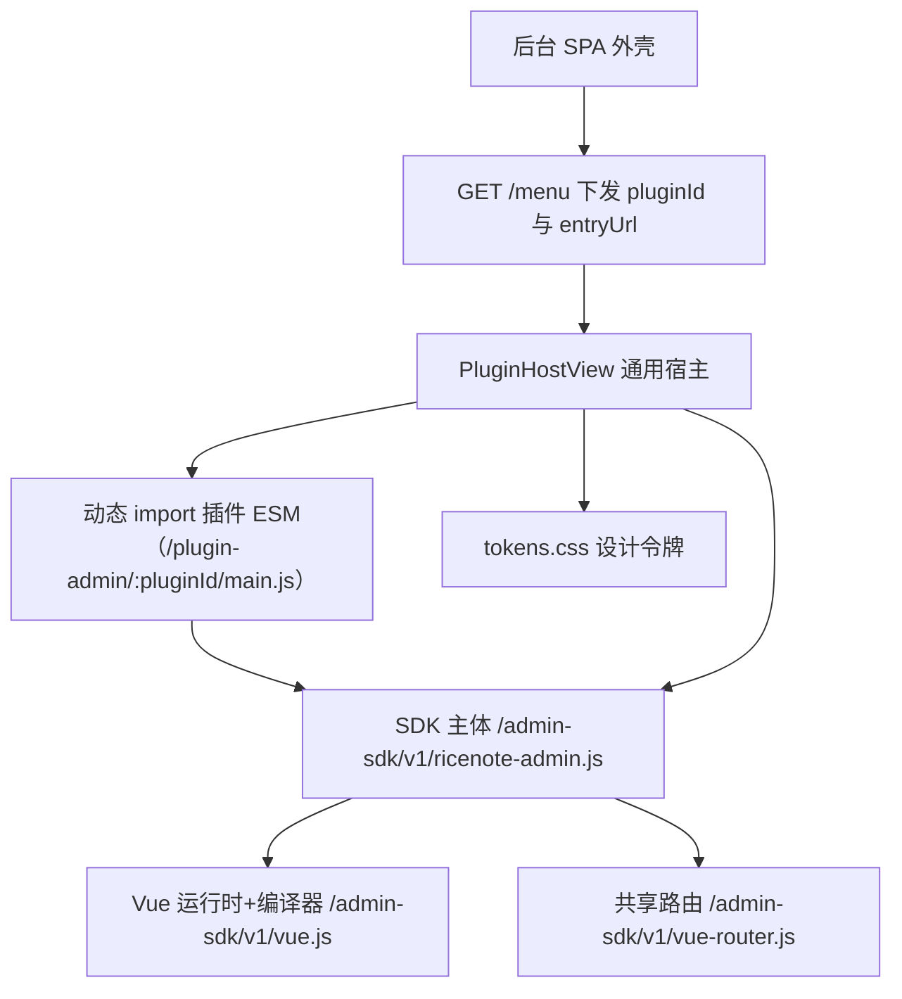
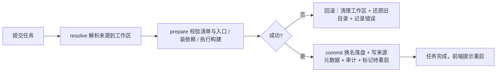

## Product Overview

把 RiceNote 的插件能力做一次平台化收口，包含两条主线：插件自己拥有后台界面（含一套后台界面 SDK），以及插件安装方式由"压缩包上传"改为"npm Registry / Git 仓库 / 本地目录"三种来源，并提供一键安装与更新、后台任务与日志。

## Core Features

### 一、插件自带后台界面

- 插件在自己目录里提供后台界面代码；安装、启用、停用、卸载与插件本体一致地决定界面存在与否，后台不再残留插件专属页面文件。
- 侧栏入口与地址保持不变（/posts、/pages、/navigation、/taxonomy、/media、/comments、/users、/roles），书签与操作习惯不受影响。
- 提供后台界面 SDK：成套组件（卡片、按钮、输入、多行文本、下拉、开关、徽章、对话框、提示条、数据表、分页、字段容器、页头、空状态、确认框、标签页、图标），设计令牌样式，以及现成能力（取当前登录者与权限、调用管理接口、弹出提示、感知待重启状态）。
- 插件作者零安装、零构建即可写界面：只写一个模块文件，用模板描述页面内容；外壳（侧栏、顶栏、页面标题区）由后台提供。
- 页面加载过程可见可控：加载中占位；插件界面出错只降级该页并可重试，不让整个后台白屏；插件未启用或本人无权限时给出明确提示并引导去扩展中心。
- 插件可选用自带样式，或只用 SDK 组件与允许的样式类，保证与官方页面观感一致。

### 二、插件安装与更新

- 三种来源：npm Registry（主路径，一键安装与更新、自动解析普通 npm 依赖、按语义化版本识别可用更新）、Git 仓库（指定 Tag/Commit/分支获取源码，安装前构建，适合开发版与私人插件）、本地插件目录（开发调试直接引用源码；压缩包上传归入这一路，作为离线兜底）。
- 后台一键执行安装、更新、卸载；服务端后台任务队列提供进度、实时日志、超时、失败回滚与同一插件并发互斥；命令行与后台行为一致。
- 每个插件记录来源信息（来源类型、来源地址、引用版本、解析后的版本、安装时间），在扩展中心可见；历史上传安装的记录自动归为本地来源。
- 本地目录来源在开发环境支持改动即生效（秒级自动重启，非模块级热替换）。
- 安装第三方插件等同授予其服务器代码执行权限（允许依赖安装脚本与构建脚本），后台以高风险确认与审计明示这一点；主题资源包的安装行为不变。

## 视觉与交互效果

迁移后的 8 个页面不做视觉改版，组件、间距、配色与交互与迁移前一致。新增的宿主状态（加载中、加载失败、界面出错、插件未启用或无权限）沿用既有语言：细边框卡片 + 说明文字 + 一个继续操作按钮，不使用阴影或毛玻璃。扩展中心新增的来源表单、任务进度与日志、更新标记同样遵循该语言。

## Tech Stack

- 后台前端：Vue 3.5 + Vite 5 + Vue Router 4 + Tailwind CSS 3.4.17（沿用现状，不引入新的运行时类别）。
- 新增 `packages/admin-sdk`：TS 源码 + Vite library 模式，产出浏览器可直接 `import` 的单文件 ESM 三件套（含 Vue 运行时与编译器）+ 设计令牌 CSS + `.d.ts`；包形态与 `packages/theme-sdk` 一致，admin SPA 与插件共用同一份。
- 服务端：Fastify 5 静态分发，复用 `apps/server/src/http/theme-assets.ts` 中 `registerAdminSpa()` 的范式（动态解析、`resolveInside()` 防穿越、`contentTypeOf()` 推断 MIME、`nosniff`、产物缺失仅告警）。
- 插件侧：零构建，纯 ESM `.js` + `template` 字符串，不装依赖、不跑打包。
- 安装器（Core）：`node:child_process`（spawn 包管理器与 git）、`node:fetch`（registry metadata 与 tarball）、`semver`（已在 Core，版本比较）、`adm-zip`（已在 Core，ZIP 路径与 zip-guard 两阶段校验）、新增 `tar`（解包 npm tarball）。
- 数据库：MySQL 8 + Drizzle；`rn_plugins` 增来源元数据列，新增 `rn_plugin_jobs` 任务表（迁移走 `core-migrations.ts`）。
- 测试：`node:test`（既有）；registry 场景用本地静态 registry 服务，git 场景用本地临时仓库，保证离线可复现。

## Implementation Approach

### 三条硬约束（决定整体设计）

1. **Vue 必须单实例**。插件模板字符串依赖 Vue 运行时编译器（`new Function`）。若宿主与插件各自打包一份 Vue，会出现模板不编译、响应式不生效、`h()` 渲染异常。因此 `vue`、`@ricenote/admin-sdk` 必须由 Core 以唯一 URL 托管，且 **admin SPA 自身也从该 URL 加载**（生产构建 external 化 + `output.paths`；开发期 alias 指向根相对路径并由 dev proxy 转发到服务端）。
2. **插件界面在后台同源上下文执行**，等价于以当前登录用户身份调用任意 `/api/admin/*`。这与"插件服务端代码在进程内运行、无真实沙箱"是同一事实，必须在 ADR 与扩展中心提示中写明（它不是安全沙箱）。
3. **当前仓库没有任何 CSP**（服务端、`docker-compose.yml`、Nginx 配置、文档均无 `Content-Security-Policy`；唯一命中是媒体插件对 SVG 响应的定向 CSP），故零构建 `template` 可行；ADR 必须显式记录：一旦引入严格 CSP（`script-src` 无 `unsafe-eval`），该写法失效，只能改渲染函数或放开 `unsafe-eval`。

### 模块加载链（后台界面）



### 安装编排（三段式 + 回滚）



### 关键设计决策

- **声明式后台页面**：`plugin.schema.json` 新增可选 `admin.pages[]`（`id/label/path/icon/order/permission/entry`），Core 在插件启动时按声明注册菜单并校验（`entry` 文件存在、`path` 与 `id` 唯一且合法、`path` 以 `/` 开头）；`ctx.adminMenu.add` 保留为兼容路径；不新增 capability（无运行时注册 API）。
- **`AdminMenuItem` 增 `pluginId` 与 `entry`（托管 URL，由 Core 计算）**，前端不猜路径；`GET /menu` 继续按权限过滤，天然表达"插件启用 + 当前用户有权限"。
- **宿主与协议**：Core 通用 `PluginHostView.vue` 读路由 meta 的 `pluginId`/`entryUrl`，动态 `import()` 取 `default` 渲染；用 `onErrorCaptured` 兜住插件异常（全仓库当前无任何错误边界，必须新增）；加载失败分类提示（模块 404 / 无默认导出 / 运行期抛错）；菜单驱动动态注册路由（`router.addRoute`，URL 不变），深链时导航守卫先 `await` 菜单加载再放行，避免命中 catch-all。
- **插件模块契约**：`defineAdminPage({ title?, setup(), template | render })` 返回 Vue 组件定义；SDK 重新导出 Vue 常用 API（`ref`/`computed`/`watch`/`h`/`onMounted` 等），保证插件与宿主用同一个 Vue 实例。
- **样式范围（零构建难点）**：SPA 的 Tailwind 是静态扫描，运行时安装的第三方插件模板里的工具类不会被生成。对策三层：SDK 组件承载主要外观（推荐路径）+ SDK 内置受限工具类白名单（safelist）+ 插件可自带 `admin/style.css`（宿主动态注入，强制沿用视觉硬约束）。`apps/admin/tailwind.config.cjs` 的 `content` 需包含 SDK 源码/产物 glob，使插件挂到宿主 DOM 后自动继承已加载样式。
- **托管与缓存**：`/admin-sdk/v1/**` 版本化路径 + `immutable` 长缓存；`/plugin-admin/:pluginId/**` 需登录 + 插件已启用（禁用后 404）+ `no-cache`（无指纹，升级立即生效）+ MIME 白名单 + 路径限定在插件 `admin/` 目录内。
- **来源模型三路 + ZIP 归 local**：`registry`（npm 包名 + 可选版本区间；自动解析普通 npm 依赖；semver 更新检查）、`git`（`repo + ref`；取源码后按 `package.json` 的 `scripts.build` 构建）、`local`（目录或软链；**ZIP 上传解压即归入此路**，无版本与更新能力，沿用 zip-guard 两阶段校验与目录占用保护）。
- **统一编排与回滚**：`resolve`（解析来源到工作区）→ `prepare`（校验 manifest/入口、装依赖、执行构建）→ `commit`（`.incoming-*` → 换名，旧目录保留为备份 → 写 DB + 审计 → 标记待重启）；任一步失败即回滚（还原旧目录、清理工作区）。第三方一律装进 `config.paths.pluginsInstallDir`（默认 `plugins/third-party`）。
- **依赖可被运行时解析**：依赖装在插件目录内（`<pluginDir>/node_modules`），Node 从插件模块位置向上查找即命中，无需额外解析机制。
- **任务队列**：`rn_plugin_jobs`（`id/plugin_id/action/source/status/step/progress/log_tail/error/actor_id/started_at/finished_at`）+ 进程内执行器（同一 `pluginId` 加锁、全局串行避免并发改磁盘）；日志流以轮询为主（`GET /api/admin/plugins/jobs/:jobId?offset=N`，跨平台可靠），SSE 作为可选优化；带超时与任务历史。
- **权限与审计**：新增权限点 `plugin.install`（安装/更新/卸载/构建，默认仅 `administrator` 具备），`plugin.manage` 保留给启停与设置；"允许执行脚本"的选择与所有写操作落审计。
- **脚本执行策略**（用户决策）：允许依赖安装脚本与构建脚本执行；后台以高风险确认框明示"安装等同授予服务器代码执行权限"，并写入审计；文档同步说明。
- **开发期本地目录**：配置登记本地插件路径（如 `RICENOTE_LOCAL_PLUGINS`），`pnpm dev` 监视这些目录，变更即自动重启内核（秒级生效，非模块级 HMR——原因见下），终端与日志给出明确原因提示。
- **更新检查**：`GET /api/admin/plugins/updates`——registry 查 dist-tags/versions 与当前版本比较；git 查远端 ref 是否有新提交；local 明确标注"不可检查"。
- **私有源**：registry 地址与 token 仅从环境变量读取（`RICENOTE_NPM_REGISTRY` / `RICENOTE_NPM_TOKEN`），不落库、不进日志。

### 与既有决策的修订口径（必须同步落地）

- **说明书 §1.2 非目标**原文禁止的是"通用 Vue/React 主题 SSR 适配器与**插件市场支付**"，并未禁止"从注册表解析并安装"。ADR-007 当年把非目标扩大解释为"不做从 URL 自动下载"，本轮按"新增 ADR 修订 ADR-007"处理，把口径改回"只禁止市场与支付"，并把 ZIP 上传降级为 `local` 来源的一种入口形式（两阶段安全校验保留）。
- **ADR-007 决策 4**（扩展名白名单仅 `.js .mjs .cjs .json .sql .md .txt .map`、不含 `.css`、禁止 `.node`）与"插件自带后台界面（需 `admin/*.js` 与可选 `admin/style.css`）"及"允许依赖安装脚本"冲突，需放宽并重新定义限额与白名单。
- **说明书 §9**（`| 内容 | 文章/页面/分类/媒体 | 按插件贡献菜单 |`）需修订为"插件页面由插件自带界面提供 + Core 提供宿主外壳"；ADR-006 需补充适用范围说明（仍约束 Core 自有页面与 SDK 组件库的风格）。

## Implementation Notes（执行要点，防回归）

- **子进程跨平台**：先探测 `node` / 包管理器（优先 `pnpm`，回退 `npm`）/ `git`；Windows 需 `pnpm.cmd`/`npm.cmd`（`shell: true` 或显式后缀），Linux 常规；探测失败给出可操作错误与安装命令示例。
- **动态 import 与开发期**：`PluginHostView` 用 `import(/* @vite-ignore */ entryUrl)`（运行时 URL，必须显式忽略 Vite 预打包改写）；dev 需为 `/admin-sdk`、`/plugin-admin` 增加代理；SDK 或插件产物缺失时只告警不崩。
- **单实例验证**：除构建 external + `output.paths` 外，必须有一个显式断言（例如 SDK 导出一个单例标记并在宿主与插件侧比对）证明两侧拿到同一模块实例。
- **缓存策略**：`/admin-sdk/v1/**` 用 `immutable`（版本在路径里）；`/plugin-admin/**` 用 `no-cache`；后台 SPA 自身仍走既有指纹长缓存。
- **ESM 缓存事实**：`loadPluginModule()` 用 `import(pathToFileURL(entryPath).href)` 且无缓存破坏参数，因此进程内软重启不重载模块代码（已实测）；本地目录"热重载"只能是"文件变更 → 自动重启内核"，不得承诺模块级 HMR。
- **安装脚本 vs 插件零构建**：两者不冲突但必须在文档中讲清区别——前者约束"插件作者写界面"（零构建），后者是"安装期的依赖解析"（可执行脚本）。
- **测试必须离线可复现**：registry 用本地静态 registry 服务（metadata + tarball 两端点）或 `npm pack` + `file:`；git 用本地临时仓库（`git init` + tag/commit）；local 用临时目录；不得让测试依赖外网。
- **安全不回退**：ZIP 路径仍走 zip-guard；新增来源的路径解析限定在目标目录内并防穿越；registry token 不落库不进日志；服务端权限校验保持 fail-closed。
- **性能**：插件模块按需动态 `import()`（不进首屏 bundle）；菜单只请求一次（store 缓存）；系统状态轮询维持既有 30 秒，不因插件增多而加快。
- **可观测**：插件模块加载失败与渲染异常以 warn 级日志带 `pluginId` 与 `entryUrl` 记录（不含用户数据），界面给出可操作提示。
- **环境时序**：服务端经 `dist` 引用工作区包，改 `packages/*` 或插件后必须 `pnpm build`；新增包需 `pnpm install` 建立 workspace 链接；代码改动必须重启进程。
- **不要顺手修的既存问题**：`tests` 包的既有类型报错（`overrides` 只传部分字段、`adm-zip` 缺类型声明）与本次无关，保持原样。

## Directory Structure

```
packages/admin-sdk/                                    [NEW] 后台界面 SDK（组件 + 令牌 + API + 浏览器 ESM 产物）
├── package.json / tsconfig.json / tailwind.config.cjs 包形态与 theme-sdk 对齐；构建脚本产出三件套
├── vite.config.ts                                      构建 vue.js / vue-router.js / ricenote-admin.js + tokens.css
├── README.md                                           面向插件作者的用法、组件清单与样式可用范围
└── src/
    ├── index.ts                                        TS 侧出口（供 admin SPA 与构建型插件）
    ├── browser-entry.ts                                浏览器 ESM 出口（re-export Vue API + 组件 + api + composables）
    ├── api/client.ts                                   [迁移] apps/admin/src/api/client.ts（api/ApiError/setCsrfToken/saveBlob）
    ├── composables/{useSession,useToast,useSystemState,useAsyncData}.ts  新建组合式能力（权限、提示、待重启、异步状态机）
    ├── define-admin-page.ts                            defineAdminPage + setHostContext + 单例标记
    ├── components/ui/*.vue                             [迁移] 自 apps/admin/src/components/ui（10 个原子组件）
    ├── components/{AdminPage,DataTable,Pagination,Field,ConfirmDialog,EmptyState,Tabs,Icon}.vue  新增复合组件
    ├── utils.ts                                        [迁移] cn / formatDateTime
    └── styles/index.css                                [迁移] 设计令牌 + 公共类 + 无阴影/无毛玻璃兜底规则

apps/server/src/http/
├── admin-sdk-assets.ts                                 [NEW] /admin-sdk/v1/** 托管（版本化长缓存、MIME 白名单、防穿越、缺产物仅告警）
├── plugin-admin-assets.ts                              [NEW] /plugin-admin/:pluginId/** 托管（登录 + 插件启用校验 + no-cache + 限定 admin/ 目录）
├── theme-assets.ts                                     [MODIFY] 抽出 resolveInside/contentTypeOf 为共享工具供上面两处复用
├── server.ts                                           [MODIFY] 注册新增两条托管路由
└── admin/
    ├── system-routes.ts                                [MODIFY] GET /menu 下发 pluginId 与 entryUrl
    └── plugins-routes.ts                               [MODIFY] 安装/更新/卸载/更新检查/任务查询（plugin.install）

packages/shared/
├── manifests/plugin.schema.json                        [MODIFY] 新增 admin.pages[]（显式字段，additionalProperties 仍为 false）
└── src/types/dto.ts                                    [MODIFY] AdminMenuItem 增 pluginId/entry；新增来源与任务 DTO

packages/core/src/
├── plugins/manifest.ts                                 [MODIFY] 解析并校验 admin.pages（entry 存在、path/id 唯一）
├── plugins/admin-menu.ts                               [MODIFY] path 唯一性校验、透出 pluginId 与 entryUrl
├── plugins/manager.ts                                  [MODIFY] 按声明注册菜单、计算托管 URL、来源元数据同步
├── plugins/installer.ts                                [MODIFY] ZIP 安装改造为编排中的 local 入口
├── plugins/install/{index,sources/{registry,git,local},toolchain,jobs}.ts  [NEW] 统一编排、三路解析器、工具链探测、任务执行
├── plugins/plugin-store.ts                             [MODIFY] 来源元数据与任务记录读写
├── database/schema/core.ts                             [MODIFY] rn_plugins 增列、新增 rn_plugin_jobs
├── database/core-migrations.ts                         [MODIFY] 对应迁移（向后兼容，历史 ZIP 记录回填 local）
├── config/{schema.ts,loader.ts}                        [MODIFY] RICENOTE_NPM_REGISTRY/TOKEN、RICENOTE_LOCAL_PLUGINS、开发期监视开关
└── index.ts                                            [MODIFY] 导出新增模块

apps/server/src/
├── cli/index.ts                                        [MODIFY] plugin install/update/remove/jobs/updates（复用同一编排）
└── index.ts                                            [MODIFY] 开发期本地插件目录监视与自动重启内核

apps/admin/
├── vite.config.ts                                      [MODIFY] external + output.paths + 别名 + /admin-sdk 与 /plugin-admin 代理
├── tailwind.config.cjs                                 [MODIFY] content 增 SDK glob；safelist 由 SDK 提供
├── index.html                                          [MODIFY] 经别名载入托管 Vue/SDK
└── src/
    ├── router.ts                                       [MODIFY] 删除 8 条硬编码插件路由，改为菜单驱动动态注册
    ├── stores/menu.ts                                  [NEW] 菜单状态（守卫与宿主共用，避免重复请求）
    ├── views/PluginHostView.vue                        [NEW] 通用宿主（加载/出错重试/加载失败/未启用四态）
    ├── views/PluginsView.vue                           [MODIFY] 来源表单、任务进度与日志、更新标记、高风险确认
    ├── views/{PostsView,PagesView,NavigationView,TaxonomyView,MediaView,CommentsView,UsersView,RolesView}.vue  [DELETE] 迁入各插件
    ├── components/ui/*                                 [DELETE] 迁入 SDK
    ├── api/client.ts / lib/utils.ts                    [DELETE] 迁入 SDK
    └── stores/{toast,system}.ts / layouts/AdminLayout.vue  [MODIFY] 改为从 SDK 引用，图标映射与菜单来源对齐

plugins/official/{posts,pages,navigation,taxonomy,media,comments,identity,authorization}/
├── admin/main.js                                       [NEW] 该插件的后台界面（零构建 ESM，导出 Vue 组件）
├── admin/style.css                                     [NEW 可选] 插件自有样式（仅在需要时）
├── manifest.json                                        [MODIFY] 新增 admin.pages；版本递增
└── README.md                                           [MODIFY] 增加"后台界面"小节与来源/更新说明

docs/
├── adr/ADR-014-plugin-owned-admin-ui-and-sdk.md         [NEW] 插件自带后台界面与 SDK（含单实例、同源信任、CSP 依赖）
├── adr/ADR-015-plugin-sources-and-install-orchestration.md [NEW] 三路来源、编排与回滚、脚本执行策略、任务队列
├── adr/ADR-007-plugin-package-install.md                [MODIFY] 追加修订说明（ZIP 归入 local，白名单放宽）
├── adr/ADR-006-admin-ui-shadcn-vue.md                   [MODIFY] 补充适用范围（Core 自有页面与 SDK 组件库）
├── plugin-api/v1.md                                     [MODIFY] 新增"插件自带后台界面"与"插件分发与安装"两章，修正 §12.4
└── architecture/hooks-inventory.md                      [MODIFY] 增补托管路由、admin.pages、plugin.install 权限点

RiceNote 项目规划与架构说明书 v1.0.md                     [MODIFY] §9 管理后台信息架构改为"插件自带界面 + Core 宿主"
CHANGELOG.md / README.md                                 [MODIFY] 记录本轮全部显著变更与非目标口径修订说明

tests/
├── unit/admin-sdk-*.test.ts                             [NEW] 契约与单实例断言、组件导出完整性
├── unit/plugin-sources.test.ts                          [NEW] 三路来源解析、semver 比较、路径安全
├── unit/plugin-install-orchestrator.test.ts             [NEW] 编排三段式与回滚、目录占用、脚本执行开关
└── integration/plugin-admin-ui.test.ts                  [NEW] 托管路由（MIME/穿越/未构建/禁用）、admin.pages 校验、禁用态
```

## Key Code Structures

插件侧的声明与模块契约（零构建，纯 ESM）：

```js
// plugins/official/navigation/admin/main.js
import { defineAdminPage, ref, api, useToast, Card, Button, DataTable } from '/admin-sdk/v1/ricenote-admin.js';

export default defineAdminPage({
  title: '导航栏',
  setup() {
    const items = ref([]);
    const toast = useToast();
    async function load() { items.value = await api.get('/navigation/items'); }
    return { items, load, save: async (payload) => { await api.post('/navigation/items', payload); toast.success('已保存'); await load(); } };
  },
  template: '...'   // 依赖 SDK 内置的 Vue 运行时编译器（无 CSP 时可用）
});
```

宿主与 Core 之间的契约（仅列关键字段，其余为实现细节）：

```ts
// packages/shared/manifests/plugin.schema.json → manifest.admin.pages[]
interface AdminPageDeclaration {
  id: string; label: string; path: string;      // path 必须以 / 开头且全局唯一
  icon?: string; order?: number; permission?: string;
  entry: string;                                // 相对插件目录：./admin/main.js
}
// 下发给前端的菜单项（Core 计算 entryUrl，前端不猜路径）
interface AdminMenuItem {
  id: string; label: string; path: string; icon?: string; order?: number; permission?: string;
  pluginId?: string; entryUrl?: string;          // /plugin-admin/:pluginId/main.js
}
interface AdminPageModule { default: Component } // 插件模块契约
```

安装来源与任务（Core 编排的输入输出）：

```ts
type PluginSource =
  | { type: 'registry'; spec: string; version?: string }          // 例如 ricenote-plugin-nav@^1.2.0
  | { type: 'git'; repo: string; ref: string }                    // tag / commit / branch
  | { type: 'local'; path: string; via: 'directory' | 'zip' };    // ZIP 上传归入此路

interface PluginInstallJob {
  id: string; pluginId: string | null; action: 'install' | 'update' | 'remove';
  source: PluginSource; status: 'queued' | 'running' | 'succeeded' | 'failed';
  step: 'resolve' | 'prepare' | 'commit'; progress: number;
  logTail: string; error: string | null; actorId: number;
  startedAt: string; finishedAt: string | null;
}
```

## Design Scope

本轮 8 个插件页面为**行为与视觉 1:1 迁移**，不做改版：沿用同一套设计令牌、同一批组件、同一套间距与圆角，迁移后观感应与迁移前无法区分。设计工作只覆盖三类**新增界面**，且必须沿用既有视觉语言。

## 新增界面一：通用宿主四态

插件页面在后台"内容区"内加载，外壳（侧栏、顶栏、页面标题区）由后台提供。

- **加载中**：内容区居中显示一枚细环加载指示器 + 一行次要文字"正在加载「导航栏」界面…"，占位高度与常见列表页接近，避免布局跳动。
- **加载失败**：1px 边框卡片，标题"界面加载失败"，正文说明可能原因（插件未构建 / 文件缺失 / 模块格式不正确），提供"重试"主按钮与"查看扩展中心"次按钮。
- **界面出错**：标题"该插件界面出错"，正文附错误摘要（单行、可展开看详情），提供"重试"按钮；其余页面与侧栏不受影响。
- **未启用或无权限**：标题"「导航栏」由插件 rice.navigation 提供，当前未启用"，正文引导到扩展中心启用，或说明当前账号缺少所需权限；仅提供"去扩展中心"一个按钮。

四态共用同一容器规格：最大宽度与常规页面内容一致、垂直居中、卡片仅用 1px 边框与背景色分层，按钮使用既有主/次按钮样式。

## 新增界面二：扩展中心（安装与更新）

- **来源选择**：卡片内用分段控件在"npm 包 / Git 仓库 / 本地目录"间切换；每种来源下面是单行输入 + 说明文字；"本地目录"页签内含"选择压缩包上传"与"填写本地路径"两种方式（ZIP 归入本地来源，界面上标注"离线兜底，不参与版本管理"）。
- **高风险确认**：提交前弹出确认对话框，明示"安装第三方插件等同授予其服务器代码执行权限（可执行依赖安装与构建脚本）"，需要勾选确认后才可提交。
- **任务进度**：任务卡片展示步骤条（解析来源 → 准备与构建 → 落盘）与百分比；下方是等宽字体的日志面板（自动滚动、可复制、失败行用危险色标注）。
- **更新标记**：插件列表中可更新项显示次要徽章（"可更新 v1.3.0"），行内提供"更新"按钮；本地来源显示"不可检查更新"的次要文字而非空白。
- **来源信息**：列表行内以次要文字展示来源类型与来源地址（过长省略、悬停显示完整值）。

## 新增界面三：SDK 复合组件

在既有 10 个原子组件基础上新增页头、数据表、分页、字段容器、确认框、空状态、标签页、图标，全部沿用现有令牌与类名约定；设计令牌与"无阴影 / 无毛玻璃"兜底规则集中在 SDK 样式层，插件界面与 Core 页面共用同一份。

## Interaction

- 侧栏入口点击后内容区切换（不整页刷新）；切换过程保留侧栏与顶栏状态。
- 页面内操作（保存、删除、批量）使用既有 Toast 反馈；需要重启的变更仍由顶栏「重启」按钮承接，插件界面通过 SDK 感知并提示。
- 键盘可达性与既有页面一致：焦点环沿用 `ring` 令牌，危险操作需二次确认。

## Agent Extensions

### SubAgent

- **code-explorer**
- Purpose: 在批量迁移前盘点 8 个插件视图的完整能力清单（字段、交互、分页、筛选、抽屉或对话框、批量操作、上传下载、调用的接口与权限点），并在安装器改造前盘点 `installer.ts` / `zip-guard.ts` / `plugins-routes.ts` / `cli/index.ts` 的现有行为与错误码。
- Expected outcome: 每个视图一份"行为与接口调用清单"作为 1:1 迁移对照表；安装器一份"现有校验与限额清单"作为编排改造与回滚设计的依据。

### Skill

- **lsp-code-analysis**
- Purpose: 把 UI 组件、`api` 客户端、`cn`/`formatDateTime`、stores 从 `apps/admin` 迁入 `packages/admin-sdk` 时做语义级引用查找，确保路由、布局与其他视图的引用点全部改到；并在删除 Core 视图后确认无残留引用。
- Expected outcome: 迁移后无残留引用，`vue-tsc` 与构建全绿，且能明确列出"仍从旧路径导入"的文件为零。

- **playwright-cli**
- Purpose: 迁移后对 8 个后台页面做真实浏览器验证（登录、列表与筛选、新增/编辑/删除、批量、上传、下载），并验证宿主四态（加载中、加载失败、界面出错、未启用或无权限）、插件禁用后的表现，以及安装/更新任务进度与日志面板。
- Expected outcome: 每页可用的截图与关键断言输出（含禁用插件后的提示页与资源 404、安装任务完成提示），作为"完成标准"的可复现证据。