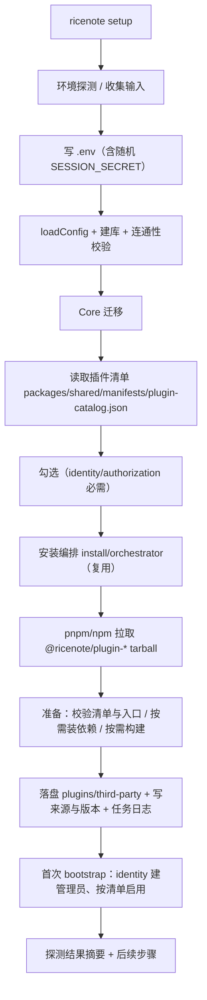
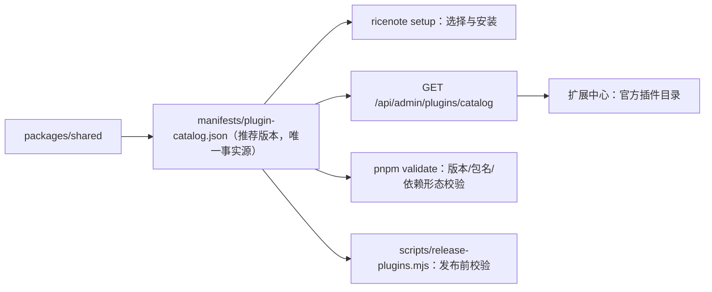

## Product Overview

把 RiceNote 的安装过程从"手工 clone + 环境变量 + 全量内置插件"升级为**CLI 交互式安装向导**，并把 11 个官方插件改造为**可公开发布到 npm 的独立包**：安装时由用户勾选需要的插件、从 npm 拉取并记录版本，使官方插件由"随仓库内置、不可卸载"变成"可选、可更新、可卸载"。

## Core Features

### 一、安装向导（`ricenote setup`）

- 一条命令走完：检查运行环境（Node / 包管理器 / 数据库客户端）→ 收集数据库连接与站点基础信息 → 建库（不存在时自动创建）与连通性校验 → 生成/更新 `.env`（含随机 `SESSION_SECRET` 与管理员初始凭据）→ 执行内核迁移 → **勾选要安装的官方插件**并从 npm 安装 → 首次启动内核完成初始化 → 输出后续步骤与后台地址。
- 插件选择以**推荐插件清单**为准逐项展示：`identity`（身份与登录）与 `authorization`（权限）**标注为必需、不可取消**（缺任一都无法登录后台），其余项默认推荐勾选、可取消。
- 支持**非交互模式**（容器与自动化必须可用）：`--yes` 采用推荐档一键装完；`--plugins=posts,seo` 指定清单；`--from-manifest` 复用已有清单只补装缺失项。
- **可重入**：任何一步失败（库连不上、npm 不可达、某个插件装不上）都可修好后重跑；已存在的 `.env` 与已装插件被识别并跳过，不产生半启用状态。

### 二、官方插件 npm 化与版本管理

- 11 个官方插件各自作为独立 npm 包（`@ricenote/plugin-*`，使用已创建的 `ricenote` 组织 scope）对外发布；仓库内继续以 workspace 方式开发，发布时由包管理器改写工作区协议。
- **推荐插件清单随主程序发布**：记录每个官方插件的包名、推荐版本、显示名与描述、必需/推荐/可选分类、能力与依赖；向导与后台都读这份清单，因此"装哪个版本"由应用统一掌握，而不是散落在文档里。
- 部署可用声明式清单锁定版本（`RICENOTE_PLUGINS`，形如 `包名@区间` 逗号分隔）：重建环境一条命令即可复现同一组插件与版本。
- 后台可见每个插件"从哪来、装的哪个版本"；升级主程序后能提示"推荐版本有更新"。

### 三、扩展中心：官方插件目录

- 扩展中心新增「官方插件目录」区块：列出清单中**尚未安装**的官方插件，可一键从 npm 安装；已安装且低于推荐版本时显示更新标记与"更新"按钮；显示每个插件的推荐版本与来源。
- 安装过程沿用既有任务机制：步骤条 + 实时日志 + 失败原因可读，安装完成后提示重启。
- 从 npm 安装的官方插件显示"官方"徽章，但**允许卸载与更新**（与仓库内置、随仓库分发的那份区分开）。

### 视觉与交互效果

安装向导在终端中呈现：分节标题、逐项勾选（`[x]`/`[ ]` + 必需项标注"必需"）、步骤进度与结果摘要（成功项、跳过项、失败原因）；失败时给出可操作的下一步命令。后台「官方插件目录」沿用既有视觉语言：1px 细边框卡片分层、无阴影、无毛玻璃，与现有插件卡片一致；安装/更新的任务面板与既有日志面板完全一致。

## Tech Stack Selection

- **运行环境**：Node.js >= 20.11（沿用）、TypeScript 5.7、Fastify 5、MySQL 8 + Drizzle、Vue 3.5 + Vite 5 后台（沿用）。
- **CLI 交互**：`node:readline/promises`（**零新增依赖**；跨平台、无 TTY 时可自动降级为非交互）。
- **数据与校验**：清单 JSON 走既有 `@ricenote/shared/manifests/` 目录与 ajv 校验机制（零新增依赖）。
- **安装与发布**：复用既有安装编排（`packages/core/src/plugins/install/`）与任务队列；发布使用 `pnpm publish --access public`（包管理器负责把 `workspace:*` 改写为实际版本），无新增依赖、不引入 changesets。
- **测试**：`node:test`（沿用）；registry 场景继续用"本地静态 registry + 进程内 tar 打包"，保证离线可复现。

## Implementation Approach

### 关键决策一：推荐插件清单放在 `packages/shared/manifests/`（与既有 Schema 同址同加载方式）

`packages/shared` 已经把 `manifests/*.json` 作为**随包发布的数据文件**（`files: ["dist","manifests"]` + `readFileSync` 路径兼容 `src/` 与 `dist/`，见 `src/validation.ts` 的 `resolveSchemaPath()`），并由 ajv 校验。推荐清单沿用同一模式：

- 新增 `packages/shared/manifests/plugin-catalog.json`（数据）+ `plugin-catalog.schema.json`（校验）；
- 新增 `packages/shared/src/catalog.ts` 导出 `getPluginCatalog()`（与 `getPluginSchema()` 同风格，带缓存）；
- 新增 `packages/shared/src/types/catalog.ts` 的 `PluginCatalogEntry` / `PluginCatalog` 类型，并加入 `package.json` 的 `exports` 映射。

理由：单一定义源。CLI、Core（`official` 判定与 `validate`）与后台（目录 API）读同一份数据；它随 `@ricenote/shared` 一起进发布产物，不需要额外的构建拷贝步骤，也不会出现"仓库里一份、产物里另一份"的漂移。

### 关键决策二：`builtin` 与 `official` 分离（这是"变成可选插件"的核心）

现状：`builtin` 由**目录路径**判定（`manifest.ts` 第 105 行 `root.includes('/plugins/official')`），它同时承担了「官方徽章」「禁止卸载」「来源以仓库路径为准」三件事。npm 化后必须拆开：

| 概念 | 判据 | 语义 |
| --- | --- | --- |
| `builtin` | 目录在 `plugins/official` 下 | 随仓库分发，**不可卸载**，来源每次启动以仓库路径为准（开发期路径） |
| `official`（新增） | 包名命中推荐清单（registry 来源查 `source.spec` 的包名；本地来源按 manifest id 反查清单） | 显示"官方"徽章、可看推荐版本、**允许更新与卸载** |


- `PluginSummary` 增 `official?: boolean`（`packages/shared/src/types/dto.ts`）；
- `install/jobs.ts` 的 `runRemove` 守卫**保持只看 `builtin`**，因此 npm 装的官方插件可正常卸载；
- 扩展中心按 `official` 决定徽章与"目录/更新"行为，按 `builtin` 决定是否允许卸载。

### 关键决策三：宿主提供的包不得被装进插件目录

插件运行时依赖由宿主提供（`@ricenote/plugin-sdk` / `@ricenote/shared` 从项目根 `node_modules` 解析，见 plugin-api §11）。若发布包把它们写成 `dependencies`，安装时会在插件目录内生成**第二份**实例 —— 与 ADR-014 记录过的"两份 Vue → 页面空白且控制台干净"同类风险。

对策（双保险）：

1. 11 个插件的 `package.json` 把这两个包改为 `peerDependencies` + `peerDependenciesMeta.optional = true`（语义正确：宿主必须提供，插件不该自带）；
2. 安装编排 `prepare` 增加「宿主提供的包」白名单（由 `@ricenote/shared` 导出常量，与文档同一处定义），即使某些包管理器仍尝试落盘也跳过；
3. `pnpm validate` 增补校验：插件 `package.json` 不得把宿主包写成普通依赖。

### 关键决策四：安装向导的执行顺序与可重入

```
环境探测 → 收集输入(库/站点/管理员) → 写 .env → loadConfig → 建库+连通性
   → Core 迁移 → 读取推荐清单 → 勾选(必需项锁定) → 从 npm 逐个安装(串行+日志)
   → 写 RICENOTE_PLUGINS/RICENOTE_SEED_PLUGINS → 首次 bootstrap(identity 自动建管理员) → 输出后续步骤
```

- **先写 `.env` 再 `loadConfig`**：`loadConfig` 会按 `env()` 读取必需项，向导收集到的值先落盘最省事，也顺带解决"用户下次直接 `pnpm start` 就能跑"；
- **自动建库**：用 mysql2 建立**不带 database** 的连接执行 `CREATE DATABASE IF NOT EXISTS`（当前用户必须手工建库，属真实摩擦点）；库名/字符集（`utf8mb4`/`utf8mb4_unicode_ci`）与既有迁移一致；
- **复用既有安装器**：`apps/server/src/cli/index.ts` 已有 `createInstallRunner(config, db, logger, store, discovery, snapshot?)` 与 `buildPluginPort()`，向导直接复用（同一套编排、回滚与日志），不新写安装逻辑；
- **管理员创建沿用既有能力**：identity 在启动时通过 `core.setup@1.bootstrapAdmin()` 凭据创建初始管理员（`plugins/official/identity/src/index.ts` 第 325 行），因此向导只需把凭据写入 `.env` 并在装完后跑一次 bootstrap；
- **幂等**：逐步检测并跳过已完成项；重跑时默认沿用已有 `.env`（需显式确认才覆盖）；不写半启用状态（安装任务串行 + 失败回滚已具备）。

### 关键决策五：发布由"可发布形态 + 脚本 + dry-run"交付，真实发布需用户凭据

AI 无法执行 `npm publish`（没有 `@ricenote` scope 的发布凭据）。因此交付物是：

- 11 个包改造为可发布形态（去 `private`、补 `files`/`publishConfig.access=public`/`license`/`repository`、版本对齐）；
- `scripts/release-plugins.mjs`：**先校验后发布**（`manifest.version === package.json.version`、清单里的包名与版本一致、包名规范、禁止宿主包写成普通依赖、`dist` 与 `admin/` 产物存在）→ 逐包 `pnpm publish --access public`；支持 `--dry-run`（打印将要发布的文件清单与版本，供离线核对）与 `--only=<pluginId>`；
- 文档写明：配置 `NPM_TOKEN` 后执行 `pnpm release:plugins`（首次发布前用 `--dry-run` 核对）。

### 关键决策六：版本管理的两层语义（必须写清，否则会混淆）

- **推荐版本**（清单里锁定的版本）：随主程序发布，代表"经测试可用"的版本组合 → 向导默认安装它，后台以它作为"有更新"的提示基线；
- **最新版本**（registry 的 dist-tags）：既有 `GET /plugins/updates` 查询远端最新 → 用于"尝鲜"，但默认不自动升级。

两者在文档与界面文案上显式区分（推荐版本 vs 最新版本），避免"提示可更新到 2.0 却装不上兼容版本"的困惑。

### 兼容与过渡

- `RICENOTE_SEED_PLUGINS` 保留（既有部署零改动即可继续运行），新增 `RICENOTE_PLUGINS`（声明式清单，含包名与版本区间）作为向导产出的推荐方式；
- `plugins/official` 目录**保留**：开发期仍被扫描、仍标 `builtin`、仍可启动（本地来源）；
- 同名 ID 的冲突沿用既有 ID 去重语义（先发现的根目录生效），文档给出"迁移到 npm 安装"的步骤：先按清单装 npm 版 → 确认启停与数据正常 → 再把 `plugins/official` 下的对应目录移出或不再登记；
- 未初始化（无 `.env` / 库未建）时启动服务端，给出「请先执行 `pnpm ricenote setup`」的可操作提示，而不是数据库错误堆栈。

### 架构与数据流





## Implementation Notes

- **无 TTY 必须可用**：`process.stdout.isTTY === false` 或传入 `--yes`/显式参数时走非交互路径；容器镜像构建不得依赖交互，退出码语义明确（0 成功、1 失败、2 用法错误）。
- **跨平台**：交互用 `node:readline/promises`；包管理器调用沿用既有工具链探测（优先 pnpm，回退 npm，Windows 走 `.cmd` 垫片）；路径一律 `path.resolve`。
- **安全**：`SESSION_SECRET` 用 `node:crypto` 生成高熵值；npm token **只从环境变量读取**，绝不写入 `.env` 或日志；建库 SQL 的库名做标识符校验（只允许 `[A-Za-z0-9_$]`）后反引号包裹，不用参数占位（DDL 不支持）。
- **可观测**：向导每步输出"正在做什么 / 结果"；安装步骤复用任务日志（CLI 无操作者，审计 `actorId` 记空）。
- **性能**：安装严格串行（同一时刻只改磁盘，既有保证）；清单读取与校验带缓存（与 `getPluginSchema()` 同风格，避免每次请求重复解析 JSON）；后台目录接口一次返回，不做 N 次版本查询。
- **回归控制**：不改既有 283 项测试行为；`RICENOTE_SEED_PLUGINS` 语义与 `.env.example` 兼容；`tests` 包既有的类型报错（`overrides` 部分字段、`adm-zip` 缺声明）保持原样不动。
- **时序**：改 `packages/*` 后必须 `pnpm build`；改插件后必须重启进程（ESM 缓存，ADR-012）；发布脚本本身要先构建再发布。

## Directory Structure

```
packages/shared/
├── manifests/plugin-catalog.json              [NEW] 推荐插件清单（唯一事实源）：id / npm 包名 / 推荐版本 / 显示名 / 描述 / 分类(required|recommended|optional|example) / capabilities / requires / 官方仓库
├── manifests/plugin-catalog.schema.json       [NEW] 清单的 JSON Schema（ajv 校验，沿用既有 schemas 的写法与 $id 约定）
├── src/catalog.ts                             [NEW] getPluginCatalog() + 缓存 + 校验失败时的可读报错；导出 HOST_PROVIDED_PACKAGES（宿主提供的包白名单）
├── src/types/catalog.ts                       [NEW] PluginCatalogEntry / PluginCatalog / 分类枚举类型
├── src/types/dto.ts                           [MODIFY] PluginSummary 增 official?: boolean；新增插件目录 DTO（含"已装版本 / 推荐版本 / 是否有更新 / 可否卸载"）
├── src/index.ts                               [MODIFY] 导出 catalog 相关 API 与类型
└── package.json                               [MODIFY] exports 映射新增 manifests/plugin-catalog.json 与 schema

plugins/official/*/package.json                [MODIFY ×11] 去 private；补 files（dist/admin/migrations/manifest.json/README.md）、publishConfig.access=public、license/repository/homepage；@ricenote/plugin-sdk 与 @ricenote/shared 改为 peerDependencies + peerDependenciesMeta.optional；version 与 manifest 对齐
plugins/official/*/manifest.json               [MODIFY ×11] version 与 package.json 严格一致（修正 comments 等已存在的漂移）
plugins/official/hello/                        [MODIFY] 作为"示例插件"归类（清单 category=example），确认可发布形态

scripts/release-plugins.mjs                     [NEW] 发布前校验 + 逐包 pnpm publish（--dry-run / --only），校验项见"关键决策五"
package.json                                    [MODIFY] 新增脚本：setup、release:plugins（转发到 apps/server 与 scripts/）

packages/core/src/plugins/catalog.ts            [NEW] Core 侧封装：清单读取（复用 shared）、按包名/id 解析 official、推荐版本比较（semver）
packages/core/src/plugins/manager.ts            [MODIFY] bootstrap 段：official 判定写入记录（npm 来源与本地目录来源两条路径）；未初始化检测所需的启动前置信息
packages/core/src/plugins/install/orchestrator.ts  [MODIFY] prepare：跳过宿主提供包（HOST_PROVIDED_PACKAGES）+ 依赖形态校验（若发现宿主包被写成普通依赖则明确报错）
packages/core/src/plugins/install/jobs.ts       [MODIFY] 卸载守卫保持 builtin；补充 official 场景下的"推荐版本 vs 已装版本"信息供后台展示（如放 DTO 层则不在此改）
packages/core/src/config/schema.ts              [MODIFY] 新增 plugins 声明字段（RICENOTE_PLUGINS 解析结果）与校验
packages/core/src/config/loader.ts              [MODIFY] 读取 RICENOTE_PLUGINS（包名@区间 列表）；保留 RICENOTE_SEED_PLUGINS
packages/core/src/index.ts                      [MODIFY] 导出 catalog 与新增类型

apps/server/src/cli/setup.ts                    [NEW] 安装向导主体：参数解析（--yes/--plugins/--from-manifest/--db-url/--no-scripts）、环境探测、建库、写 .env、迁移、按清单安装、首次 bootstrap、结果摘要；无 TTY 自动降级
apps/server/src/cli/prompts.ts                  [NEW] 零依赖交互原语：单选、多选（含必需项锁定）、确认、敏感输入（不回显）、非交互降级
apps/server/src/cli/index.ts                    [MODIFY] main() 新增 case 'setup'；help 增补 setup 说明；validate 转发增补项
apps/server/src/cli/validate.ts                 [MODIFY] 增补：manifest.version == package.json.version、包名与清单一致、禁止宿主包写成普通依赖、清单中 required 插件齐备
apps/server/src/http/admin/plugins-routes.ts    [MODIFY] 新增 GET /plugins/catalog（合并"清单 + 已装状态 + 推荐/最新版本"）；安装走既有端点（无需新写入接口）
apps/server/src/index.ts                        [MODIFY] 未初始化时输出「请先执行 pnpm ricenote setup」的可操作提示（库缺失/配置缺失两类分别给指引）
.env.example                                    [MODIFY] 增补 RICENOTE_PLUGINS 说明与向导产出的推荐清单示例；标注 seed 与 plugins 的关系
README.md                                       [MODIFY] 安装章节改为"向导优先"，保留手工安装作为高级路径；补发布插件（NPM_TOKEN + release:plugins）

apps/admin/src/views/PluginsView.vue            [MODIFY] 新增「官方插件目录」区块：未装项一键安装、已装项显示推荐/已装版本与更新按钮、复用现有任务面板
apps/admin/src/components/plugins/CatalogCard.vue  [NEW] 目录区块（沿用 Card/Field/Button/Badge 与既有 1px 边框视觉；无阴影）
apps/admin/src/api 或 SDK 侧（如需要）          [MODIFY] 目录接口调用的类型（复用 @ricenote/admin-sdk 的 api 客户端，不新增运行时依赖）

docs/adr/ADR-016-official-plugin-npm-distribution.md  [NEW] 官方插件 npm 分发、推荐清单、builtin/official 分离、发布流程与凭据边界
docs/plugin-api/v1.md                           [MODIFY] 新增「官方插件目录与版本管理」章节；§11 补 peerDependencies 约定与"宿主提供包"清单
docs/architecture/hooks-inventory.md            [MODIFY] 增补 setup 命令、清单、RICENOTE_PLUGINS、目录接口
CHANGELOG.md                                    [MODIFY] 记录本轮变更（新增/变更/兼容）

tests/unit/plugin-catalog.test.ts               [NEW] 清单 Schema 校验、required 齐备、包名规范、版本与各 package.json 一致、宿主包未写成普通依赖
tests/unit/setup-cli.test.ts                    [NEW] 参数解析与非交互路径、幂等重入、.env 生成与不覆盖策略、退出码
tests/integration/setup-flow.test.ts            [NEW] 离线可复现：本地静态 registry 提供清单全量包 → 非交互 setup → 断言安装记录/启用状态/管理员创建/必需插件必装/可选插件可跳过
```

## Key Code Structures

清单条目（`plugin-catalog.json` 的单条形状）：

```ts
/** 推荐插件清单条目：安装向导、后台目录与发布校验共用同一份数据。 */
interface PluginCatalogEntry {
  /** 插件 ID，与 manifest.json 的 id 一致（如 rice.posts）。 */
  id: string;
  /** npm 包名（如 @ricenote/plugin-posts）。 */
  npm: string;
  /** 推荐的精确版本；随主程序发布，代表"经测试可用"。 */
  version: string;
  /** 分类：required 强制安装；recommended 默认勾选；optional 默认不勾；example 示例。 */
  category: 'required' | 'recommended' | 'optional' | 'example';
  /** 展示文案（后台与向导共用）。 */
  label: string;
  description: string;
  capabilities: string[];
  /** 依赖的其他插件 id（缺省为空）。 */
  requires?: string[];
}

interface PluginCatalog {
  /** 清单自身的 schema 版本，便于后续演进。 */
  schemaVersion: 1;
  /** 随哪个 RiceNote 版本发布（用于提示"推荐版本是否更新"）。 */
  appVersion: string;
  plugins: PluginCatalogEntry[];
}
```

后台目录接口的合并视图（供扩展中心渲染）：

```ts
/** 扩展中心「官方插件目录」一行。 */
interface CatalogPluginDto extends PluginCatalogEntry {
  /** 已安装版本；未安装为 null。 */
  installedVersion: string | null;
  /** 是否已安装（含从 npm 与从仓库内置两种来源）。 */
  installed: boolean;
  /** 是否为仓库内置（随仓库分发，不可卸载）。 */
  builtin: boolean;
  /** 已装版本低于推荐版本时为 true（推荐版本口径，非 registry 最新）。 */
  updateToRecommended: boolean;
}
```

## Design Scope

本轮唯一新增界面是后台「扩展中心」内的**官方插件目录**区块（不新建页面、不改版既有页面），以及安装向导的**终端输出规范**。两者都严格沿用项目既有视觉语言，不引入新风格。

## 新增界面：扩展中心「官方插件目录」

- 位置：扩展中心页「安装插件」卡片之下、插件卡片网格之上，作为独立区块（Card，1px 边框，无阴影、无毛玻璃）。
- 结构：区块标题「官方插件目录」+ 一行说明（"官方插件随主程序发布，按推荐版本安装；可从 npm 更新"）；下方为目录列表。
- 目录列表每行：插件名 + 分类徽章（必需 / 推荐 / 可选 / 示例）+ 插件 ID（等宽小字）+ 一行描述；右侧为状态与操作。
- 状态与操作：
- 未安装 → 次要文字"未安装 · 推荐 v1.5.0" + 「安装」主按钮；
- 已安装且为推荐版本 → 次要徽章"已安装 v1.5.0"+ 无操作；
- 已安装但低于推荐版本 → 警告色徽章"可更新到 v1.6.0" + 「更新」按钮；
- 仓库内置（随仓库分发）→ 次要徽章"随仓库分发"且不提供卸载。
- 必需插件（身份与权限）在目录中带"必需"徽章，并附一行说明"缺少它无法登录后台"。
- 点击安装/更新后，复用既有任务面板（步骤条 + 等宽日志 + 失败原因），完成后提示重启。
- 交互与既有页面一致：hover 使用既有背景分层、按钮使用既有主/次样式、危险操作不在此区块（卸载仍在插件卡片上）。

## 终端输出规范（安装向导）

- 分节标题（`▸ 环境检查 / 数据库 / 站点 / 插件选择 / 安装`）+ 缩进的结果行；成功用绿色对勾、跳过用灰色、失败用红色并附下一步命令。
- 插件选择呈现为编号多选：`[x] 3. 文章（rice.posts）v1.5.0 - 内容发布与管理`，必需项固定显示 `[x]` 并标注"必需"。
- 结束时输出摘要块：已安装 N 项、跳过 M 项、失败项与原因、后台地址与登录账号提示（不回显密码）。

## Agent Extensions

### SubAgent

- **code-explorer**
- Purpose: 在改造前做两轮精确盘点：（1）11 个官方插件包的发布阻塞项（`private`/`files`/`publishConfig`/依赖形态/版本漂移/产物目录）与 `manifest.json` 字段对照表；（2）CLI 与配置的改动落点清单（`main()` 分发、`createInstallRunner`/`buildPluginPort` 复用面、`loadConfig`/`assertConfig` 的必需项、`.env` 键全集、`validate.ts` 现有校验项）。
- Expected outcome: 每个包一份"改造前后字段对照表"，以及一份"CLI/配置改动落点清单"，作为执行阶段的对照依据，避免遗漏与误改。

### Skill

- **lsp-code-analysis**
- Purpose: 在新增 `PluginSummary.official`、拆分 `builtin` 语义、并用 `RICENOTE_PLUGINS` 扩展配置后，做语义级引用核查：找出所有读取 `builtin`、构造 `PluginSummary`、读取 `seedPlugins` 的位置，确保显示徽章/卸载守卫/来源刷新的三类行为各自改到点上且无残留引用。
- Expected outcome: 明确的引用清单（文件:行），改造后 `pnpm build` 与 `pnpm validate` 全绿，且不存在"仍在用 builtin 判官方"的遗漏点。

- **playwright-cli**
- Purpose: 在浏览器中实测扩展中心新增的「官方插件目录」：未安装项一键安装、已装项显示推荐/已装版本、更新按钮触发任务面板、任务日志与完成提示、失败项的可读原因；并验证安装后插件卡片与来源信息同步更新。
- Expected outcome: 每步可复现的断言输出与截图（含任务面板与目录状态变化），作为该区块"完成标准"的证据。

### Playwright CLI 备注（沿用既有用法）

- 后台开发地址为根路径（`vite` 的 `base` 在 serve 时为 `/`），登录后在站内点击侧栏进入扩展中心，不要硬拼 `/admin/...` 地址。