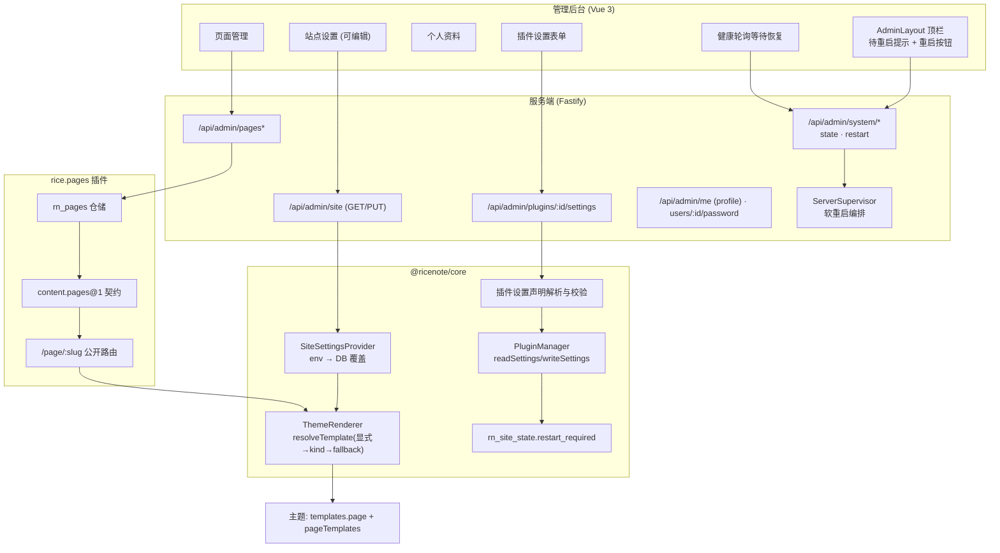

## 产品概述

RiceNote 是一套以插件与主题为扩展方式的内容系统。本轮进行架构层面的改造，把「页面」升级为与「文章」并列的独立内容类型：主题可声明并渲染自定义页面模板，新增「页面」插件负责创建与管理独立页面，页面与文章都能从主题声明的模板清单中选择渲染模板。同时补齐插件设置、站点与账户信息在线修改、改动生效所需的一键重启、插件与主题文档、以及启动终端输出体验。

## 核心功能

1. **主题支持自定义页面类型**：主题可为「自定义页面」提供模板，独立的页面内容可拥有自己的访问地址并在站点正常展示。
2. **新增页面插件**：后台可新建、编辑、删除、发布与排序独立页面（标题、别名/地址、正文、状态），前台按别名访问；该插件可独立启用与禁用，禁用后不残留任何入口。
3. **页面模板选择**：主题声明可选页面模板清单（含名称与说明，支持多语言），页面与文章在编辑时下拉选择，渲染按所选模板输出；切换模板只改变外观布局，不影响内容本身。
4. **插件设置**：插件可在自身清单中声明设置项（分组 + 字段；字段类型包含单行文本、多行文本、颜色、开关、数字、下拉、图片、链接，标签支持多语言），后台据此自动生成设置表单并保存；插件也可提供自己的设置页覆盖默认表单；保存冲突时给出明确提示。
5. **后台修改站点信息**：可修改站点标题、描述、语言、站点地址，以及站点图标/Logo 与页脚备案信息；保存后对外展示即时生效，无需重启；地址类字段有格式校验与明确错误提示。
6. **后台修改账户信息**：新增个人资料页，可修改显示名与邮箱、修改密码（需校验原密码，改密后其他登录会话失效）；管理员可在用户列表中为其他用户重置密码。
7. **待生效变更提示与一键重启**：当改动需要重启才能生效时（插件启停、插件设置保存、备份恢复等），顶部栏右上角出现重启按钮；点击后页面显示"正在重启"，服务恢复后可继续使用，重启动作被记录以便追溯。
8. **插件说明文档**：每个已完成的插件在其所在插件目录内都有一份说明文档，真实反映用途、清单、设置项与扩展点。
9. **制作文档补全**：插件制作文档与主题制作文档完善，所有可用的扩展点（插槽、事件、服务契约、路由、模板变量与辅助方法、生命周期、后台菜单与权限点等）全部列全。
10. **启动终端输出优化**：启动时终端展示更易读的信息——版本、运行环境、数据库、当前主题、插件状态分组、路由/服务/插槽统计与监听地址；异常项突出显示，不静默吞掉。

## 视觉呈现

新增的后台界面沿用现有设计语言：柠檬浅黄主色、纯细边框分层、无阴影、无玻璃拟态、紧凑清晰的信息密度。顶部栏右上角在存在待生效变更时出现一个明确的重启入口按钮（带"待重启"提示态）；页面管理以列表 + 编辑弹层组织；插件设置与站点信息以分组表单呈现；个人资料页区分资料与密码两个区块。所有新增界面在窄屏下仍可用。

## 技术栈选择

沿用既有技术栈，不引入新技术：TypeScript + pnpm Monorepo；服务端 Fastify + `@ricenote/core` 内核；主题 Nunjucks SSR（零构建）；后台 Vue 3 + Vite + Tailwind + shadcn-vue(Reka UI) + lucide-vue-next；MySQL 8（Drizzle 表定义 + 手写幂等 SQL 迁移）；测试 `node:test`。

## 实现方案

### 关键决策与理由

1. **站点信息采用「运行时覆盖层」，而非改配置源**
现状 `config.site.*` 只来自 `.env`，且 `ctx.site` 与渲染上下文是**启动期快照**（`packages/core/src/plugins/manager.ts:247-253`、`packages/core/src/render/renderer.ts:140-146`）。方案：新增 Core 表 `rn_site_settings`（`site_id` / `settings_json` / `revision` / `updated_at`）作为覆盖层，加载顺序 `env 默认值 → DB 覆盖`，由新增的 `SiteSettingsProvider` 统一提供，带内存缓存与 revision；内核暴露 `site` 实时取值（`ctx.site` 与渲染上下文改为经 provider 读取），写入后失效 HTML 缓存。这样改站点信息**无需重启即生效**，同时保持 `.env` 作为默认值与兜底。
2. **插件设置：向后兼容的「声明式 + 自定义页兜底」**
现状 `manifest.settings` 仅是可自由扩展的默认值对象（`packages/shared/manifests/plugin.schema.json:92-96`），9 个官方插件与 `reading-time` 都在用（如 `plugins/official/search/src/index.ts:55` 读 `ctx.config.get('resultPageSize', 10)`）。方案：**保留旧写法**（键值默认值继续可用，语义不变），**新增可选 `settingsSchema`**（分组 + 字段，定义与主题设置同构）。持久化复用已存在的 `rn_plugin_settings` 与 `PluginManager.readSettings/writeSettings`（含 revision 乐观锁）。后台表单由 `settingsSchema` 驱动；插件可通过注册后台菜单项指向自有页面来覆盖默认表单。因 `ctx.config` 是启动期快照，**保存后置「待重启」**，正好由第 7 项承接。
3. **页面模板复用既有显式模板链路，不新造机制**
`PageRouteSpec.template` 与 `PageViewModel.template` 已存在（`packages/plugin-sdk/src/http.ts:70-83`），渲染回退链已实现（`packages/core/src/render/renderer.ts:208-218`：显式模板 → `templates[kind]` → 主题 `fallback.njk` → Core `fallback.njk`）。方案：主题 `theme.json` 新增 `templates.page`（kind→文件）与 `pageTemplates`（可选模板清单：键、模板文件、多语言标签与说明）；页面与文章新增 `template` 字段并透传到 ViewModel；服务端**校验所选模板必须存在于当前主题声明清单**，避免任意模板名导致读文件越界。
4. **页面插件作为普通官方插件实现**
`rice.pages` 独立目录 `plugins/official/pages/`，自持表 `rn_pages`（表所有权登记），提供 `content.pages@1` 契约与后台 API `/api/admin/pages*`（权限点 `page.manage`）、后台菜单「页面」、公开页面路由 `/page/:slug`。完全走既有插件生命周期与 `assertNoLeaks()` 契约，禁用后零残留。
5. **进程内软重启（用户已确认）**
新增 `ServerSupervisor`（`apps/server/src/runtime/supervisor.ts`）持有当前 `kernel` 与 `RunningServer` 引用，通过 Core 服务 `core.runtime` 暴露给路由层。`POST /api/admin/system/restart` 先返回 202，随后 `setImmediate` 触发：置 `restarting` 标记 → `server.close()`（等待 in-flight 请求）→ `kernel.shutdown()`（插件 `stopAll` → 关闭连接池）→ `bootstrap()` → `startHttpServer()` 重新监听同一端口。待生效状态落库到 `rn_site_state` 新增列，经 `GET /api/admin/system/state` 与 `/api/health` 暴露，前端轮询等待恢复。**不引入** `RICENOTE_RESTART_MODE`，**不做** Fastify 路由热卸载，与 `ADR-004` 受控重启语义保持一致。
6. **启动终端输出：控制台与人可读，文件保持结构化**
现状 `JsonLogger` 同时向 stdout/stderr 与日志文件写 JSON Lines（`packages/core/src/logger.ts:98-122`）。方案：新增控制台格式化器（彩色级别、字段对齐、无 TTY 或 `LOG_FORMAT=json` 时降级为 JSON），**日志文件始终 JSON Lines 不变**；`bootstrap` 完成后输出启动摘要横幅（版本、根目录、环境、数据库、激活主题、插件按状态分组、路由/服务/插槽计数、监听地址），失败项高亮不静默。

### 性能与可靠性

- `SiteSettingsProvider` 内存缓存 + revision，每次渲染不查库；写入后 `cache.clear()` 与 provider 失效，避免陈旧 HTML。
- `pageTemplates` 与模板存在性在主题加载时解析并缓存，避免每请求 `fs.existsSync`。
- `rn_pages` 对 `slug` 建唯一索引；后台列表分页；公开页面路由命中 HTML 缓存（复用现有标签失效）。
- 软重启存在数秒不可用窗口：期间先置 `restarting` 让新请求快速失败并返回维护提示，`server.close()` 等待 in-flight；重启失败要记录错误并保留可诊断输出，而不是静默半死。
- 插件设置读写仅在保存与插件启动时发生，不进入热路径。

### 安全

- 站点设置写入**字段白名单**（title/description/language/siteUrl/logoUrl/faviconUrl/icpText/icpUrl），类型与长度校验，URL 仅允许 `http/https`；禁止写入任意键。
- 上传 Logo/图标复用媒体库既有体积与类型校验，文件名归一化，禁止路径穿越。
- 页面/文章的 `template` 必须命中主题声明清单，否则回退到 kind 模板。
- 重置他人密码需 `user.manage`，重置后使该用户全部会话失效，且不能借此绕过原密码校验修改自己（自己走 `/me/password`）；所有写入均落审计。
- 重启端点需 `system.restart` 权限（仅管理员 `*` 天然具备），并写审计。

### 爆炸半径控制

- `manifest.settings` 旧语义保持不变，`settingsSchema` 为**新增可选字段**，旧插件与第三方插件不受影响。
- 主题新增 `templates.page` 与 `pageTemplates` 均为新增可选声明，缺省时自定义页面走 `fallback.njk`，不影响既有 kind。
- posts 新增列通过新迁移文件（插件迁移由 ledger 保证只跑一次），版本按语义化提升；不改动现有列语义。
- 插件启停与 SIGINT/SIGTERM 关停语义不变；软重启是新增通道而非替换。
- 不改动其他插件业务逻辑，不做无关重构。

## 架构设计



数据流要点：站点信息读取路径为 `Renderer / ctx.site → SiteSettingsProvider（缓存）→ DB 覆盖 + env 默认`；写入路径为 `PUT /api/admin/site → 白名单校验 → rn_site_settings（revision+1）→ 失效缓存`。待重启状态读取路径为 `rn_site_state → GET /api/admin/system/state → 顶栏按钮`；点击后 `POST .../restart → 202 → Supervisor 编排 → 前端轮询 /api/health 直到恢复`。

## 目录结构摘要

本轮改动集中在「共享契约与 Schema → Core 运行时 → 新插件 → 主题 → 服务端 API → 后台界面 → 文档 → 验证」八层。

```text
c:/dev/ricenote/
├── packages/
│   ├── shared/
│   │   ├── manifests/
│   │   │   ├── theme.schema.json                 # [MODIFY] 新增 templates.page 与 pageTemplates 声明（键/模板文件/多语言 label 与 description）；localizedText 保持可复用
│   │   │   └── plugin.schema.json                # [MODIFY] 新增可选 settingsSchema（分组+字段），保持 settings 旧语义不变
│   │   └── src/
│   │       ├── types/dto.ts                      # [MODIFY] 新增/扩展：SiteSettings 可写字段（含 logo/favicon/icp）、SiteSettingsUpdate、PageTemplateDescriptor、PluginSettingsDto(groups/values/revision)、Pages DTO、SystemStateDto(restartRequired 与原因)
│   │       ├── types/settings-schema.ts          # [NEW] 抽出的共享设置字段定义（settingField + localizedText）与校验规则，供主题与插件复用，避免重复定义
│   │       ├── capability.ts                     # [MODIFY] 注册 content.pages@1 与 core.runtime 契约常量
│   │       └── errors.ts                         # [MODIFY] 按需新增错误码（模板不存在、设置校验失败、重启进行中）
│   └── core/src/
│       ├── config/{loader.ts,schema.ts}          # [MODIFY] 站点字段标注为「默认值」，供运行时覆盖层使用
│       ├── system/site-settings.ts               # [NEW] SiteSettingsProvider：env 默认值 + DB 覆盖、内存缓存与 revision、白名单写入与校验、变更后失效
│       ├── system/restart.ts                     # [NEW] 重启状态读写（rn_site_state.restart_required/reason）与 core.runtime 服务描述
│       ├── plugins/settings-schema.ts            # [NEW] 解析与校验 manifest.settingsSchema，输出后台表单 DTO，并做值校验与默认值合并
│       ├── plugins/{manager.ts,context-factory.ts} # [MODIFY] ctx.site 改为实时经 provider 读取；插件设置读写接入 schema 校验与待重启标记
│       ├── render/renderer.ts                    # [MODIFY] 渲染上下文的 site 改由 provider 读取；透传 input.template 并校验其来自主题声明清单
│       ├── themes/manager.ts                     # [MODIFY] 解析并缓存 pageTemplates；校验模板文件存在性
│       ├── database/core-migrations.ts           # [MODIFY] 新增 rn_site_settings 表；rn_site_state 增加 restart_required/restart_reason/restart_requested_at
│       ├── database/schema/core.ts               # [MODIFY] 同步 Drizzle 表定义
│       ├── logger.ts                             # [MODIFY] 新增控制台格式化器（pretty/json，TTY 自适应），文件始终 JSON Lines
│       ├── bootstrap.ts                          # [MODIFY] 组装 provider、输出启动摘要横幅、清除待重启标记、注册 core.runtime
│       └── index.ts                              # [MODIFY] 导出新类型与模块
├── plugins/official/
│   ├── pages/                                    # [NEW] rice.pages 插件目录
│   │   ├── manifest.json                         # 清单：id/version/entry/provides(content.pages@1)/capabilities/settingsSchema(每页条数等)
│   │   ├── migrations/0001_pages.sql             # rn_pages(slug 唯一索引、status、template、sort_order、SEO 字段、时间戳)
│   │   ├── src/{index.ts,repository.ts,service.ts,pages.ts,admin.ts,types.ts}
│   │   └── README.md                             # 插件说明（用途/清单/设置/扩展点/启用方式）
│   ├── posts/                                    # [MODIFY] 增 template 列与透传 PageViewModel.template；版本 1.2.0
│   │   ├── manifest.json                         # 版本提升
│   │   ├── migrations/0003_post_template.sql     # 新增 template 列
│   │   ├── src/{repository.ts,service.ts,pages.ts,index.ts,types.ts}  # 读写与透传 template
│   │   └── README.md                             # [NEW] 补齐
│   ├── {authorization,comments,hello,identity,media,search,seo,taxonomy}/README.md  # [NEW] 每个插件目录内补 README
├── plugins/third-party/reading-time/README.md    # [NEW]
├── themes/
│   ├── minimal/{theme.json,templates/page.njk,templates/page-*.njk}   # [MODIFY/NEW] templates.page 与 pageTemplates 声明 + 页面模板文件
│   └── default/{theme.json,templates/page.njk,templates/page-*.njk}   # [MODIFY/NEW] 同上
├── apps/server/src/
│   ├── index.ts                                  # [MODIFY] 启动改由 Supervisor 托管，支持软重启后重新监听
│   ├── server.ts                                 # [MODIFY] startHttpServer 返回可被 Supervisor 关闭/重建的句柄
│   ├── runtime/supervisor.ts                     # [NEW] ServerSupervisor：优雅关停 → 重新 bootstrap → 重新监听；重启期间拒绝新请求
│   └── http/admin/
│       ├── system-routes.ts                      # [MODIFY] /site 改为读写并经 provider；新增 /system/state 与 /system/restart
│       ├── profile-routes.ts                     # [NEW] /me 资料读写（写入身份插件契约）与 /users/:id/password 管理员重置
│       └── plugins-routes.ts                     # [MODIFY] 新增 GET/PUT /plugins/:id/settings（schema 校验 + revision 乐观锁 + 待重启标记）
├── apps/admin/src/
│   ├── router.ts                                 # [MODIFY] 新增 pages、profile 路由；插件设置作为 PluginsView 内页
│   ├── layouts/AdminLayout.vue                   # [MODIFY] 顶栏右侧新增待重启提示与重启按钮
│   ├── stores/restart.ts                         # [NEW] 待重启状态与重启流程（轮询 /api/health 等待恢复）
│   ├── views/PagesView.vue                       # [NEW] 页面管理：列表 + 编辑弹层（标题/别名/正文/模板/状态/排序）
│   ├── views/ProfileView.vue                     # [NEW] 个人资料：资料区与密码区
│   ├── views/PluginsView.vue                     # [MODIFY] 插件设置入口与设置表单（复用主题设置的字段渲染）
│   ├── views/SettingsView.vue                    # [MODIFY] 站点信息改为可编辑（含 Logo/favicon/备案），保留审计与诊断
│   ├── views/UsersView.vue                       # [MODIFY] 增加管理员重置他人密码入口
│   └── components/settings/SettingsForm.vue      # [NEW] 声明式设置表单（主题与插件设置共用，多语言 label 解析）
├── tests/
│   ├── unit/{site-settings.test.ts,plugin-settings-schema.test.ts,page-templates.test.ts}
│   └── integration/{pages-plugin.test.ts,restart-flow.test.ts,password-reset.test.ts}
├── docs/
│   ├── adr/ADR-010-custom-page-templates.md      # [NEW] 页面类型与模板清单
│   ├── adr/ADR-011-runtime-site-and-plugin-settings.md  # [NEW] 运行时站点设置与插件设置
│   ├── adr/ADR-012-in-process-soft-restart.md    # [NEW] 进程内软重启（与 ADR-004 的关系）
│   ├── architecture/hooks-inventory.md           # [NEW] 全量 Hook 点清单（插槽/事件/服务/路由/模板变量/生命周期/菜单权限），由能力清单实测交叉核对
│   ├── plugin-api/v1.md                          # [MODIFY] 补全插件制作全部扩展点、设置声明、生命周期与清单字段
│   └── theme-api/v1.md                           # [MODIFY] 补全主题制作全部扩展点、templates.page/pageTemplates、设置字段与多语言
└── CHANGELOG.md                                  # [MODIFY] 本轮全部显著变更（按 Keep a Changelog 1.1.0 中文版分组）
```

## 关键代码结构

仅列出跨模块共享、必须精确一致的类型（其余以文本描述为准）：

```ts
/** 主题声明中「可被用户选择的页面模板」条目（theme.json: pageTemplates）。 */
interface PageTemplateDescriptor {
  /** 选项键，页面/文章的 template 字段存该值。 */
  key: string;
  /** 主题内模板文件名（必须在 templates 目录存在）。 */
  template: string;
  /** 多语言标签，与主题设置字段同构。 */
  label: LocalizedText;
  description?: LocalizedText;
}

/** 插件设置声明解析结果，供后台生成表单（与主题设置 DTO 同构）。 */
interface PluginSettingsDto {
  pluginId: string;
  revision: number;
  /** 分组 + 字段；无 settingsSchema 时为空数组，前端退化为键值编辑。 */
  groups: SettingsGroupDto[];
  values: Record<string, unknown>;
  /** 保存后是否需重启才生效（ctx.config 为启动期快照）。 */
  restartRequiredOnSave: boolean;
}

/** 系统待生效状态，供顶栏与重启流程使用。 */
interface SystemStateDto {
  restartRequired: boolean;
  reason?: string;
  requestedAt?: string;
  /** 进程是否正在重启（新请求快速失败并提示维护中）。 */
  restarting: boolean;
}
```

## 设计定位

本轮为**在既有后台中新增与改造界面**，不重建设计体系。全部沿用已确立的视觉规范：柠檬浅黄主色、纯 1px 细边框分层、无阴影、无玻璃拟态、内容优先的高信息密度。新增页面必须与既有 12 个视图在观感与交互上完全一致，用户不应感觉到"这是另一套系统"。

## 布局与结构

沿用现有 `AdminLayout`（固定顶栏 + 左侧导航 + 内容区），不引入底部导航（桌面管理后台不适用）。

- **顶栏（全局改造）**：左侧为菜单折叠与品牌；右侧通知/用户菜单簇**之前**插入「重启」入口。无待生效变更时按钮不出现（保持顶栏稳定，避免噪声）；存在待生效变更时显示为带柠檬黄描边的高亮按钮 + 圆点提示，悬停展开原因说明（如"插件设置已保存，重启后生效"）。点击后立即切换为进行中态（按钮禁用 + 旋转图标 + "正在重启"），并以轻量条幅提示"服务恢复中，请稍候"，恢复后自动消失并回到可用状态。
- **页面管理**：顶部为标题 + 「新建页面」主按钮；其下为筛选栏（状态：全部/已发布/草稿）；主体为高密度表格（标题、别名、模板、状态徽标、更新时间、操作）；行操作提供编辑与删除；新建/编辑使用右侧抽屉表单，字段为标题、别名/地址、模板下拉（选项来自当前主题声明，含说明文案）、状态、排序、正文编辑器与"保存/发布"操作。空态提供引导文案与主按钮，不显示空白表格。
- **个人资料**：左右两栏。左栏「账户资料」卡片：显示名、邮箱编辑 + 保存；右栏「修改密码」卡片：原密码、新密码、确认新密码 + 保存，并说明"修改后其他设备将被登出"。卡片间用细边框与间距区分，不使用阴影。
- **插件设置**：从扩展中心插件卡片进入设置子页（或抽屉）。按 `settingsSchema` 分组渲染为若干卡片，每组标题为分组标签、下为字段；字段控件与主题设置完全一致（文本框、多行文本、颜色选择、开关、数字、下拉、图片、链接）。顶部显示插件名称与版本；底部为「保存」与「取消」；保存中出现条幅提示"保存成功，重启后生效"。无 `settingsSchema` 的插件退化为键值编辑并给出说明。
- **系统设置（改造）**：站点信息区由只读改为可编辑分组表单——基本信息（标题、描述、语言、站点地址）、外观标识（图标/Logo 上传与预览、清除）、页脚备案（备案号文本、备案链接）。保存按钮固定在区块底部，保存成功提示"已即时生效"，不再出现"后台不提供配置写入"的旧文案。下方原有审计日志与运行时诊断区块保持不变。
- **用户列表（改造）**：行操作新增「重置密码」，弹层内输入新密码并二次确认，明确提示"该用户所有登录会话将失效"。

## 交互与响应式

- 所有异步动作有进行中态（按钮禁用 + 加载指示）与结果反馈（成功条幅/字段级错误），校验失败时错误紧贴字段展示。
- 危险动作（删除页面、重置密码）必须二次确认，确认弹层仅用细边框与背景色区分层级。
- 窄屏：顶栏保留重启入口为图标按钮；表格在窄屏可横向滚动或降级为卡片式列表；抽屉表单宽度自适应并为全宽。
- 无阴影、无模糊、无半透明磨砂；悬停反馈仅通过边框与背景色变化表达。

## Agent Extensions

### SubAgent

- **code-explorer**
- Purpose: 在文档与 README 阶段对 `plugins/` 下每个插件目录做一次中等强度的结构化盘点（清单字段、迁移、注册的路由/插槽/事件/服务、设置项、后台菜单），用于撰写真实准确的 11 份 README 与 Hook 点清单，避免文档与代码脱节。
- Expected outcome: 输出逐插件的「用途 / provides / requires / capabilities / 后台菜单与权限 / 公开与管理路由 / 注册的插槽 / 发布与订阅的事件 / 设置项 / 迁移文件」清单，作为 README 与 `docs/architecture/hooks-inventory.md` 的编写依据。

### Skill

- **lsp-code-analysis**
- Purpose: 通过「查找引用」枚举全部 Hook 点调用位点——`emit`、`services.provide`、`routes.page`、`routes.adminApi`、`routes.raw`、`slots.register`、`config.get`、`addMenuItem` 等符号的引用，确保「所有可 HOOK 点列全」是可验证的穷举而非抽样。
- Expected outcome: 产出按符号归类的引用清单（含文件与行号），与 `GET /api/admin/capabilities` 的运行时实测结果交叉核对，确认文档覆盖无遗漏、无过时条目。

- **playwright-cli**
- Purpose: 端到端验证新增后台界面的真实交互——页面管理增删改与前台按别名访问、站点信息保存后前台即时生效、插件设置保存后出现待重启按钮、点击重启后服务恢复、个人资料改密与管理员重置密码。
- Expected outcome: 关键路径的浏览器实操截图与断言结果，确认新页面在真实浏览器中布局正确、无阴影、交互可用，重启闭环成功。